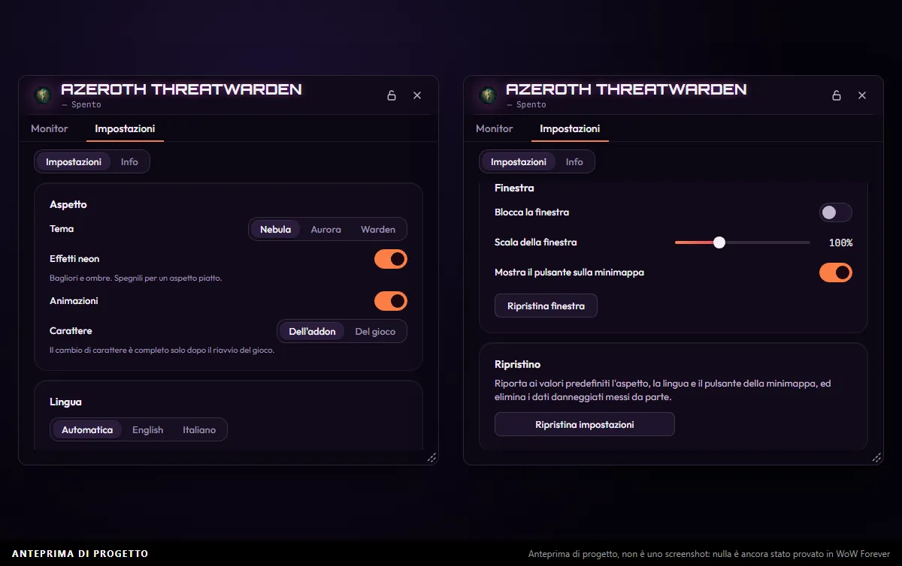
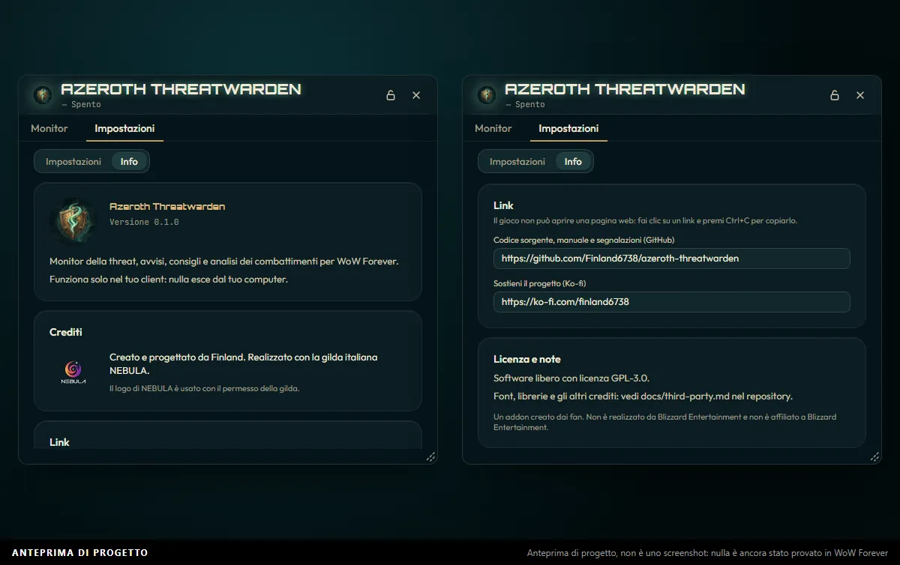
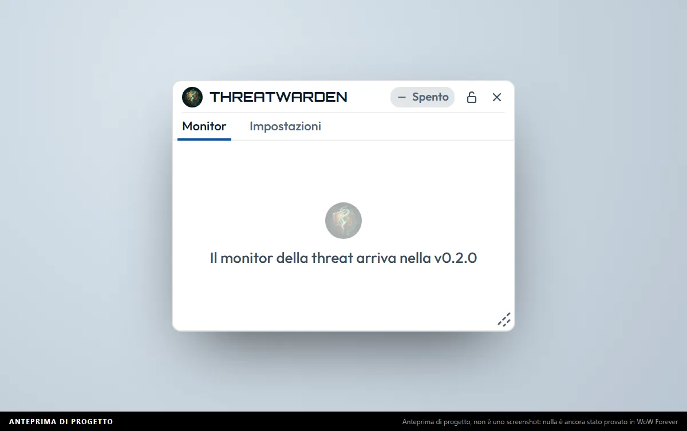

# Azeroth Threatwarden

**Conosci la tua threat. Capisci i tuoi errori. Non perdere l'aggro.** Azeroth Threatwarden è un addon di monitoraggio
della threat, di coaching e di analisi dei combattimenti per **World of Warcraft: Forever**. Mostra chi genera threat su
quale mob, ti avvisa prima che tu prenda l'aggro, registra i combattimenti e spiega cosa è successo, distinguendo sempre
ciò che è **noto** da ciò che è **stimato**.

> **Stato: sviluppo iniziale. La [`v0.1.0`](https://github.com/Finland6738/azeroth-threatwarden/releases/tag/v0.1.0) è
> la prima versione di prova: solo le fondamenta, ancora nessuna threat.** Si scarica da
> [GitHub Releases](https://github.com/Finland6738/azeroth-threatwarden/releases)
> ([come installarla](docs/wiki/Installation-it.md)). Ha le impostazioni salvate (con versione e migrazioni), l'aspetto
> dell'ecosistema, una finestra spostabile (la scheda Monitor è ancora vuota) con le Impostazioni (temi, lingua,
> finestra) e la pagina Info con i crediti, i [comandi](docs/wiki/Commands-it.md) `/atw` e `/threatwarden`, il pulsante
> della minimappa e la voce nell'Addon Compartment. È controllata solo da test offline: la
> [verifica in gioco della M1](docs/checklists/M1.md) (in inglese) e i risultati della sonda M0 sono ancora aperti. La
> [sonda](docs/spike/README.md) (uno strumento di sviluppo, mai distribuito) verifica nel client vero quali dati di
> threat WoW Forever dà a un addon, perché in alcune situazioni il client può nascondere i valori agli addon: il client e
> le funzioni della threat, compreso se i loro valori sono segreti (P1–P4), quali unità e mob rispondono, gli eventi
> della threat, i GUID e i ruoli (P5, P6, P9), gli eventi di combattimento e il damage meter (P7, P8), il costo del
> campionamento, le restrizioni e cosa sopravvive a un ricaricamento (P10–P12). L'MVP (monitor, avvisi, Coach,
> registrazione e report di combattimento) è la `v0.4.0`.

[English](README.md) · [Roadmap](ROADMAP.md) · [Specifiche](docs/specs/README.md) ·
[Architettura (in inglese)](docs/ARCHITECTURE.md) · [Decisioni](docs/adr/README.md) · [Manuale](docs/wiki/Home-it.md)
([English](docs/wiki/Home.md))

## Che aspetto ha

Anteprime di progetto, non screenshot: disegnate dal layout e dai testi dell'addon, perché non è ancora stato provato
in gioco ([tutte le anteprime: inglese e italiano, tre temi](docs/specs/mockups/previews/README.md)).

## Funzioni previste

| Area | Cosa ottieni | Milestone |
|---|---|---|
| **Threat Monitor** | La threat di ogni membro del gruppo sul tuo target, il tank, la percentuale scalata (al 100% prendi l'aggro), il margine, il trend e uno stato chiaro: **Safe**, **Warning**, **Danger** o **Unknown** | M2 |
| **Avvisi e Coach** | Avvisi prima di superare il tank, con cooldown e silenziamento rapido, mai in chat; brevi consigli con il loro motivo e una confidenza | M3 |
| **Combat Report** | Ogni combattimento registrato mentre accade; alla fine superamenti di soglia, tempo in pericolo, cambi di tank | M4 (MVP) |
| **Threat Timeline e Replay** | Come si è mossa la threat durante lo scontro, con play, pausa e salto; stime e buchi ben segnati | M5 |
| **Threat Analytics** | Numeri descrittivi per scontro e tra scontri, ed esportazione da copiare; nessuna classifica accusatoria | M6 |
| **Multi-target / Dungeon Focus** | I mob su cui il gruppo è più vicino a perdere l'aggro, se il client lo consente | M7 |
| **Profili e Heatmap** | Preset per tank, DPS e healer; stati leggibili anche con il daltonismo | M8 |

**Dati onesti.** Ogni numero è letto dal gioco, calcolato, stimato o previsto, e l'addon dice quale; quando il gioco
non dà un valore, mostra *Unknown* invece di indovinare ([ADR 0003](docs/adr/0003-data-reliability-categories.md)).

**Privato per scelta.** Niente rete, niente messaggi tra addon, nulla in chat; le registrazioni restano sul tuo computer
e puoi cancellarle ([ADR 0001](docs/adr/0001-local-only-addon-no-network.md)).

## Come è fatto

- Target: WoW Forever, `## Interface: 16001`; Lua 5.1 con Ace3 incorporato.
- Threat letta solo dall'API della threat del gioco, su eventi e con un campionamento limitato in combattimento.
- Inglese predefinito, italiano dalla prima versione; un'altra lingua è un solo file.
- Lo stile della famiglia di addon del proprietario (Finland Dragon Credit Points, Azeroth Accord), con un tema
  **Warden** ricavato dal logo.
- Test offline con un client finto e combattimenti scriptati.

## Contribuire

Vedi [CONTRIBUTING.md](CONTRIBUTING.md) (in inglese). Issue, pull request e documentazione pubblica sono in inglese; le
specifiche sono in italiano.

## Licenza

[GNU GPL v3.0](LICENSE), per codice e documentazione. World of Warcraft è un marchio di Blizzard Entertainment, Inc.;
questo è un progetto indipendente di fan, non affiliato né approvato da Blizzard.

## Crediti

- **Creato e disegnato da Finland.**
- **Fatto con la gilda italiana NEBULA** ([la pagina della gilda](https://nebula-community.github.io/giochi/wow-forever/)).
  Il logo NEBULA è usato con il permesso della gilda.
- Sostieni il progetto su [Ko-fi](https://ko-fi.com/finland6738); segnala un problema o proponi un'idea nelle
  [issue](https://github.com/Finland6738/azeroth-threatwarden/issues).
