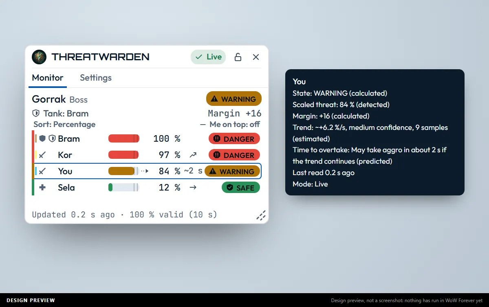
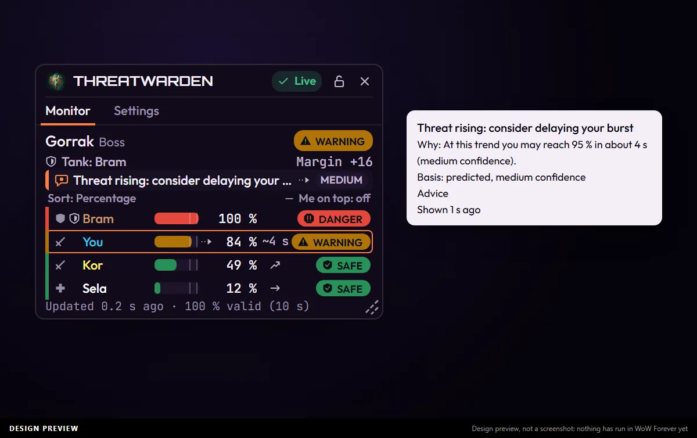

# Azeroth Threatwarden


**Know your threat. Understand your mistakes. Prevent aggro loss.** Azeroth Threatwarden is a threat monitoring,
threat coaching and combat analysis addon for **World of Warcraft: Forever**. It shows who is generating threat on
which mob, warns you before you pull aggro, records your fights and explains what happened, always telling what is
**known** from what is **estimated**.

> **Status: early development. [`v0.3.0`](https://github.com/Finland6738/azeroth-threatwarden/releases/tag/v0.3.0) is
> the third test version: it adds Alerts and the Threat Coach to the Threat Monitor, not verified in game.** Download it
> from [GitHub Releases](https://github.com/Finland6738/azeroth-threatwarden/releases)
> ([how to install](docs/wiki/Installation.md)). The Monitor tab shows who threatens the mob you target, the tank, the
> percentage, the margin, the trend and a state, or *state only* / *unknown* with the reason when the client gives no
> numbers; `/atw demo` plays an invented fight. A strip in that tab warns you once when a risk begins and gives one
> short tip with its reason ([Alerts and Coach](docs/wiki/Alerts-and-Coach.md)), never in chat; `/atw mute` silences
> the alerts. Thresholds, cooldown and sampling rate are provisional
> ([Threat Monitor](docs/wiki/Threat-Monitor.md)). It also has saved settings (versioned, with migrations), the
> ecosystem look, a movable window with Settings and an Info page with the credits, the
> [commands](docs/wiki/Commands.md) `/atw` and `/threatwarden`, a minimap button and the Addon Compartment entry. It is
> checked by offline tests only: the M0 probe and the in-game checks of [M1](docs/checklists/M1.md),
> [M2](docs/checklists/M2.md), [M3](docs/checklists/M3.md) and [M4](docs/checklists/M4.md) are still open. The
> [probe](docs/spike/README.md) (a development tool, never distributed) checks in the real
> client which threat data WoW Forever gives an addon, because the client may hide threat values from addons in some
> situations: the client and the threat functions, including whether their values are secret (P1–P4), which units and
> mobs answer, the threat events, GUIDs and roles (P5, P6, P9), the combat events and the damage meter (P7, P8), the
> cost of sampling, the restrictions and what survives a reload (P10–P12). The MVP (monitor, alerts, Coach, recording
> and combat report) is `v0.4.0`. Recording and the combat
> report are built and tested offline but **switched off** until then; their
> [in-game check](docs/checklists/M4.md) is written and not run, and the MVP is
> [not complete yet](docs/checklists/M4.md#12-mvp-check): it waits for the checks in the real client.

[Italiano](README.it.md) · [Roadmap](ROADMAP.md) · [Specification (Italian)](docs/specs/README.md) ·
[Architecture](docs/ARCHITECTURE.md) · [Decisions](docs/adr/README.md) · [User manual](docs/wiki/Home.md)
([Italiano](docs/wiki/Home-it.md))

## What it looks like

Design previews, not screenshots: drawn from the addon's own layout and texts, because it has not been run in the game
yet ([all previews: English and Italian, three themes](docs/specs/mockups/previews/README.md)).






## Planned features

| Area | What you get | Milestone |
|---|---|---|
| **Threat Monitor** | Every group member's threat on your target, the tank, the scaled percentage (100% pulls aggro), the margin, the trend, and a clear state: **Safe**, **Warning**, **Danger** or **Unknown** | M2 |
| **Alerts and Coach** | Warnings before you overtake the tank, with cooldowns and a quick mute, never in chat; short advice with its reason and a confidence | M3 |
| **Combat Report** | Every fight recorded while it happens; at the end, threshold crossings, time in danger, tank changes | M4 (MVP) |
| **Threat Timeline and Replay** | How threat moved during a fight, with play, pause and seek; estimates and gaps clearly marked | M5 |
| **Threat Analytics** | Descriptive numbers per fight and across fights, and an export to copy; no blame rankings | M6 |
| **Multi-target / Dungeon Focus** | The mobs where your group is closest to losing aggro, if the client allows it | M7 |
| **Profiles and Heatmap** | Presets for tanks, damage dealers and healers; colour-blind friendly states | M8 |

**Honest data.** Every number is either read from the game, calculated from it, estimated or predicted, and the
addon shows which; when the game does not give a value, it says *Unknown* instead of guessing
([ADR 0003](docs/adr/0003-data-reliability-categories.md)).

**Private by design.** No network, no addon messages, nothing posted in chat; your recordings stay on your computer and
you can delete them ([ADR 0001](docs/adr/0001-local-only-addon-no-network.md)).

## How it is built

- Target: WoW Forever, `## Interface: 16001` ([ADR 0002](docs/adr/0002-wow-forever-target-and-api-dump.md)); Lua 5.1
  with embedded Ace3.
- Threat read only from the game's unit threat API, on events and by bounded sampling during combat
  ([ADR 0004](docs/adr/0004-threat-from-the-unit-threat-api-sampled-in-combat.md)).
- English by default, Italian from the first version; another language is one file
  ([ADR 0009](docs/adr/0009-interface-and-documentation-languages.md)).
- The look of the owner's addon family (Finland Dragon Credit Points, Azeroth Accord), with a **Warden** theme drawn
  from the logo ([ADR 0015](docs/adr/0015-interface-follows-the-ecosystem-style.md)).
- Offline tests with a mock client and scripted fights ([ADR 0010](docs/adr/0010-offline-tests-with-lupa-and-a-mock-client.md)).

## Development

```bash
python -I -X utf8 tools/fetch_libs.py
python -I -X utf8 tools/check_docs.py
python -X utf8 Tests/run_tests.py
```

The first downloads the embedded libraries (never committed), the second checks documentation, addon and package, the
third runs the offline tests (`python -m pip install --user lupa==2.8` once; [CONTRIBUTING](CONTRIBUTING.md#4-checks-and-tests)).
[Releasing](docs/RELEASING.md) and [third-party material](docs/third-party.md).

## Contributing

See [CONTRIBUTING.md](CONTRIBUTING.md). Issues, pull requests and public docs are in English; the specification is in
Italian.

## Licence

[GNU GPL v3.0](LICENSE), for the code and the documentation ([ADR 0011](docs/adr/0011-license-gpl-3.md)).
World of Warcraft is a trademark of Blizzard Entertainment, Inc.; this is an independent fan project, not affiliated
with or endorsed by Blizzard.

## Credits

- **Created and designed by Finland.**
- **Made with the Italian guild NEBULA** ([the guild's page](https://nebula-community.github.io/giochi/wow-forever/)).
  The NEBULA logo is used with the guild's permission.
- Support the project on [Ko-fi](https://ko-fi.com/finland6738); report a problem or suggest something in the
  [issues](https://github.com/Finland6738/azeroth-threatwarden/issues).
