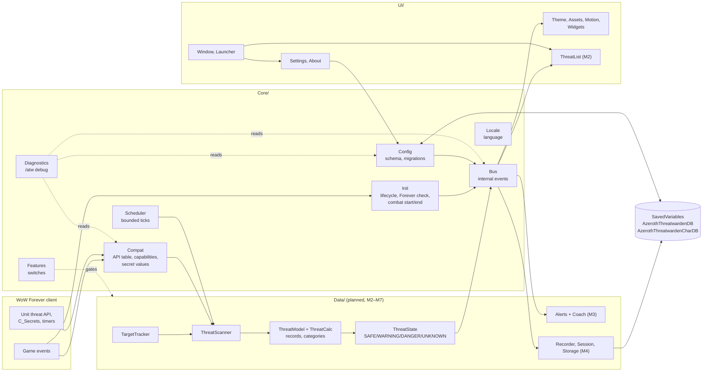
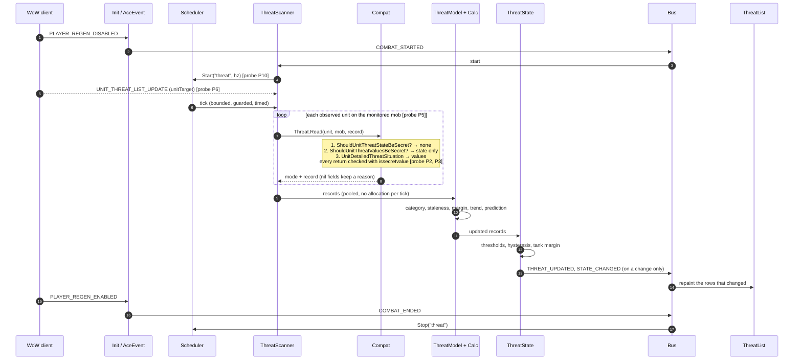
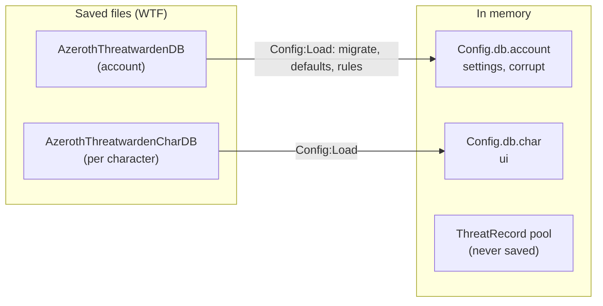

# Azeroth Threatwarden Architecture

This document describes how the addon is built and where each later milestone plugs in. It follows the model of
Azeroth Unspoken's `docs/ARCHITECTURE.md` ([ADR 0012](adr/0012-reuse-accord-and-unspoken-foundations.md)). It was
written in step **M1.1**; since **M1.2** the addon has its skeleton (TOC, libraries, `Core/Init.lua`,
`Core/Features.lua`, `Core/Locale.lua`, `Locales/`), since **M1.3** its offline tests on a mock client (`Tests/`), and
everything else below is the design that M1 builds and later milestones extend. Parts that are not there yet are marked
*planned*; parts whose behaviour depends on the M0 probe results are marked **[probe Pn]**. The detailed specification
is in Italian: [SPEC-01](specs/SPEC-01-platform-architecture.md) (modules, Bus events, Compat), [SPEC-02](specs/SPEC-02-data-model-storage.md)
(data), [SPEC-03](specs/SPEC-03-threat-monitor-ui.md) (window and commands) and [ui-style](specs/ui-style.md) (look).
The reasons behind the choices are in the [ADRs](adr/README.md).

## Contents

1. [Overview](#1-overview)
2. [Modules and responsibilities](#2-modules-and-responsibilities)
3. [Flow of a threat update](#3-flow-of-a-threat-update)
4. [Data and SavedVariables](#4-data-and-savedvariables)
5. [Extension points](#5-extension-points)
6. [What is planned and not there yet](#6-what-is-planned-and-not-there-yet)
7. [What waits for the probe](#7-what-waits-for-the-probe)

## 1. Overview

The addon is a pipeline: the **client** raises events and answers API calls; **Compat** is the only door to it and
says what is available, missing or secret; the **Scanner** reads threat on events and on a bounded combat tick; the
**Model** turns readings into records that carry their reliability category; **ThreatState** decides SAFE, WARNING,
DANGER or UNKNOWN; the **views**, **Alerts** and the **Recorder** listen on the internal **Bus**. Nothing leaves the
computer.

Principles everything else rests on:

- **Unknown is shown, never invented** ([ADR 0003](adr/0003-data-reliability-categories.md)): every value carries a
  category (detected, calculated, estimated, predicted, hypothesis); a secret, missing or stale value is an explicit
  state with its reason.
- **Secret values are never read** ([SPEC-01](specs/SPEC-01-platform-architecture.md) ARC-11): every returned value is
  checked with `issecretvalue` before anything else touches it.
- **One door to the game** (ARC-02): only `Core/Compat.lua` calls the client; no `UI/` file does (a test checks it).
- **A missing API switches a function off, not the addon** (ARC-10).
- **Local only** ([ADR 0001](adr/0001-local-only-addon-no-network.md)): no network, no addon messages, nothing posted
  in chat.
- **A release never carries half a feature** ([ADR 0014](adr/0014-one-version-per-milestone-and-feature-switches.md)):
  later parts stay behind `Core/Features.lua`.

## 2. Modules and responsibilities

Files are loaded in the order of the TOC (`AzerothThreatwarden/AzerothThreatwarden.toc`): the libraries, then `Bus` and
`Compat` first (the language of the client is asked while `Locales/` load), `Locale`, `Locales/`, `Init`, `Features`,
`Scheduler`, `Config`, `Diagnostics`, `Commands`, then `UI/`. Every file
receives `ADDON_NAME, ns = ...`; modules attach to `ns` (`ns.Compat`, `ns.Config`…) and, for tests, to the addon object
`AzerothThreatwarden`, the only global besides the SavedVariables, the three Addon Compartment functions, the key
binding names and the frames named `AzerothThreatwarden…` that the game needs (ARC-04). Most of `Core/` and `UI/` is
copied from Azeroth Accord and renamed; each copied file says so in its header.

| File | Responsibility | Milestone |
|---|---|---|
| `Core/Locale.lua` | language tables registered by `Locales/`; `ns.L` answers in the active language with English as fallback; the language is chosen at load from `settings.language` (*auto*, English, Italian) | M1.2, M1.5 |
| `Locales/enUS.lua`, `itIT.lua` | every visible string, one file per language ([ADR 0009](adr/0009-interface-and-documentation-languages.md)) | M1.2 → |
| `Core/Init.lua` | the AceAddon object; the Forever check (diagnostic mode on another client); lifecycle (`ADDON_LOADED` → Config, Locale, Compat; `PLAYER_LOGIN` → interface); combat start and end from `PLAYER_REGEN_*`; `/atw debug` sections | M1.2 |
| `Core/Features.lua` | the switches of later parts (`monitor`, `alerts`, `coach`, `recording`, `reports`, …), `monitor` on since `v0.2.0`, `alerts` and `coach` since `v0.3.0`, `recording` and `reports` since `v0.4.0`, the others off | M1.2 |
| `Core/Bus.lua` | internal publish/subscribe (`Bus.On`, `Off`, `Emit`); a failing listener never stops the others; an emit allocates nothing and refuses a secret argument | M1.4 |
| `Core/Compat.lua` | the API table (state per API: available, missing, restricted, error), the capabilities (`threatValues`, `threatState`, `groupThreat`…: available, missing, restricted, unknown), guarded calls, secret-value checks, the normalized threat read, timers, restrictions | M1.4 |
| `Core/Scheduler.lua` | named, bounded ticks (1–10 Hz), only while needed, each guarded and timed | M1.4 |
| `Core/Config.lua` | the two SavedVariables: schema 1, typed rules, defaults, migrations, read-only on a newer schema, damaged tables set aside under `corrupt` | M1.5 |
| `Core/Diagnostics.lua`, `UI/DiagnosticsBox.lua` | error ring buffer and the `/atw debug` report (English, no names), shown in a copy box (a movable dialog of the widget kit since M1.6) | M1.4 |
| `Core/Commands.lua` | `/threatwarden` and `/atw` | M1.7 |
| `UI/Assets.lua`, `Theme.lua`, `Motion.lua`, `Widgets/` | the ecosystem look: Nebula, Aurora and Warden themes, the four state tokens, fonts, 9-slice shapes (`Media/`, made by `tools/make_media.py` and `make_fonts.py`), the widget kit plus `ThreatBar` and `StateBadge`; the theme changes without `/reload` | M1.6 |
| `UI/Window.lua`, `UI/Launcher.lua` | the window (compact layout for Monitor, wide layout for Settings and Reports), tabs, move, lock, resize, scale; the minimap button and the Addon Compartment entry | M1.7 |
| `UI/Settings.lua`, `UI/About.lua` | Settings (Appearance, Language, Window, Reset) and Info with the NEBULA credits, in the window's Settings tab and in the game's own settings panel (through Compat) | M1.8 |
| `Data/TargetTracker.lua`, `Data/ThreatScanner.lua` | the monitored mob; threat reads on events and a bounded tick in combat | M2 (switch `monitor`, on since `v0.2.0`) |
| `Data/ThreatModel.lua`, `Data/ThreatCalc.lua`, `Data/ThreatState.lua` | records, categories, staleness; margin, trend, time to overtake; states with hysteresis | M2 (switch `monitor`, on since `v0.2.0`) |
| `UI/ThreatList.lua` | the threat list in the Monitor tab | M2 (switch `monitor`, on since `v0.2.0`) |
| `Core/Demo.lua`, `Data/Demo.lua` | demo mode: an invented fight through the same model, states and list, nothing read or saved | M2 (switch `monitor`, on since `v0.2.0`) |
| `Data/Alerts.lua` | alerts when a state or the aggro holder changes, with a cooldown per kind and unit, channels, sound (through Compat) and mute ([SPEC-04](specs/SPEC-04-alerts-coach.md), Italian) | M3.2 (switch `alerts`, on since `v0.3.0`) |
| `Data/Coach.lua`, `Data/CoachRules.lua` | rule-based tips (T1–T7, D1–D5, A1) with reason, category and confidence, one at a time, cooldowns, numbers at most once a second ([SPEC-04](specs/SPEC-04-alerts-coach.md), Italian) | M3.3 (switch `coach`, on since `v0.3.0`) |
| `UI/CoachStrip.lua` | the Coach strip | M3.4 (switches `alerts`, `coach`) |
| `Bindings.xml` | the key binding of the quick mute (loaded by the client by its name, not listed in the TOC); with `UI/Settings.lua` (*Alerts* card), `Core/Commands.lua` (`/atw mute`) and the row menu of `UI/ThreatList.lua` | M3.5 (switch `alerts`) |
| `Data/Recorder.lua`, `Data/Session.lua`, `Data/Storage.lua`, `Data/Report.lua`, `UI/Reports.lua` | sessions holding what the monitor read, as compact columns; events, `/reload` and logout, limits and pruning, damaged sessions set aside; the combat report with categories and *Insufficient data*; the Reports tab ([SPEC-05](specs/SPEC-05-recording-report-replay.md), Italian; [ADR 0016](adr/0016-recordings-are-the-monitors-readings-in-compact-columns.md)) | Recorder and Session since M4.2, Storage since M4.3, Report since M4.4, the Reports tab and the *Recording* card since M4.5 (switches `recording`, `reports`, on since `v0.4.0`) |
| `Data/Timeline.lua`, `Data/Replay.lua`, `UI/Timeline.lua`, `UI/ReplayWindow.lua` | read-only views over a recorded session: the timeline model (series of real readings, first/last/min/max per column for the width, solid, dashed and absent segments, gaps with their reason, event markers), the chart drawn from bounded pools of line regions and textures, the replay controller (cursor, playback paused in combat, steps, ±5 s around an event, missing data) and its own window `AzerothThreatwardenReplay`, opened from the Reports tab ([SPEC-05 §4–§5](specs/SPEC-05-recording-report-replay.md), Italian; [ADR 0017](adr/0017-timeline-and-replay-are-views-over-the-recorded-session.md)) | *planned*, M5.2–M5.5 (switches `timeline`, `replay`) |
| `Data/Metrics.lua`, `Data/Export.lua` | descriptive metrics, comparison, text and CSV export | *planned*, M6 |

### Internal events (Bus)

| Event | Raised by | Heard by | Since |
|---|---|---|---|
| `ADDON_READY` | Init, after Config, Locale and Compat | modules that prepare state | M1 |
| `CONFIG_LOADED`, `CONFIG_CHANGED(path)` | Config | Theme, Window, Launcher, Settings | M1 |
| `DISPLAY_CHANGED` | Init (screen size or interface scale) | Window | M1 |
| `ENTERING_WORLD` | Init (`PLAYER_ENTERING_WORLD`) | Settings | M3.5 |
| `SETTINGS_CHANGED(key)` | Settings | no one yet (views follow `CONFIG_CHANGED`) | M1 |
| `THEME_CHANGED(themeId)` | Theme | Settings, other views | M1 |
| `CAPABILITY_CHANGED(id, state)` | Compat | Window (module state), ThreatState | M1 |
| `COMBAT_STARTED`, `COMBAT_ENDED` | Init | Scheduler, Window, Scanner, Recorder | M1 |
| `WINDOW_SHOWN(shown)`, `TAB_CHANGED(tabId)` | Window | Scanner, Demo, tabs | M1 |
| `GROUP_CHANGED(inGroup)`, `DEMO_CHANGED(active)` | Init, Demo | Window; ThreatList and Settings for the demo | M2 (switch `monitor`, on since `v0.2.0`) |
| `TARGET_CHANGED`, `TARGET_STATUS`, `THREAT_SCANNED`, `THREAT_UPDATED`, `STATE_CHANGED`, `THREAT_MODE_CHANGED` | Data | ThreatList, Window; Alerts and Recorder later | M2 (switch `monitor`, on since `v0.2.0`) |
| `AGGRO_CHANGED(mobKey, unitKey, oldUnitKey)` | ThreatState, before the `STATE_CHANGED` of the same update | Alerts; Coach later | M3.2 (switch `monitor`) |
| `ALERT_RAISED(alert)`, `MUTE_CHANGED(muted)` | Alerts | Window, Coach strip, Recorder later | M3.2 (switch `alerts`, on since `v0.3.0`) |
| `COACH_TIP(tip)` | Coach, after each `THREAT_UPDATED` when the tip changes (`nil`: no tip) | Coach strip, Recorder later | M3.3 (switch `coach`, on since `v0.3.0`) |
| `SESSION_STARTED(id)`, `SESSION_ENDED(id, state)`, `SESSIONS_CHANGED()` | Recorder, Storage | Reports, Report, Coach strip (end-of-fight notice); Timeline and Replay from M5 | M4 (switch `recording`, on since `v0.4.0`) |
| `REPLAY_REQUESTED(id, t)` | the report's timeline card, the *Replay* button, `/atw replay` | the replay window | *planned*, M5 (switch `replay`) |

Event arguments never hold a secret value or a player name: threat events pass keys (`unitKey`, `mobKey`) into the
model.

## 3. Flow of a threat update

*Planned for M2.* The path from the client to a row of the threat list; the numbered decisions in Compat are the ones
the probe answers.

1. Combat starts: `Init` turns `PLAYER_REGEN_DISABLED` into `COMBAT_STARTED`. Outside combat nothing is read (ARC-05).
2. The Scanner reads on the threat events and on a bounded tick from the Scheduler; the default rate comes from the
   probe's cost measure **[probe P10]** (provisional 5 Hz, [SPEC-09 Q14](specs/SPEC-09-risks-open-questions.md)).
3. For each unit, `Compat.Threat.Read` asks `C_Secrets` **before** calling and picks the mode: `values`, `state`
   (state only, MON-02) or `none`. A secret or missing value stays `nil` with its reason (`secret`, `nil`, `error`,
   `missing`); it is never compared, formatted or saved.
4. The Model keeps the category of each value (detected, calculated, estimated, predicted); the Calc computes the
   margin and, with at least 3 valid samples, the trend and the time to overtake.
5. ThreatState applies the thresholds (WARNING 82 %, DANGER 91 %, decided by the owner, hysteresis 3 points, Q7) and emits
   `STATE_CHANGED` only on a transition.
6. The list repaints only what changed; a value that is not known is drawn as UNKNOWN with its reason in the tooltip.
7. Combat ends: the tick stops. From M4 the Recorder has been sampling the Model's rows on its own bounded tick and
   recording the Bus events of steps 4–5 into a session (it never calls the threat functions itself, ADR 0016); 5 s
   after the end, unless a chained pull continues it, the session closes and Storage applies the limits.

What M1 does in this flow: steps 1 and the end (`COMBAT_STARTED`/`ENDED`), the Scheduler with no tick running, and,
from M1.4, `Compat.Threat.Read` tested against scripted answers in the mock client. The `monitor` switch is off.

## 4. Data and SavedVariables

| Variable | Schema 1 (M1) | Later |
|---|---|---|
| `AzerothThreatwardenDB` | `schema`, `settings` (`language`, `theme`, `effects`, `animations`, `font`, `minimap`), `corrupt` | schema 2 (M2): `settings.monitor`; schema 3 (M3): `settings.alerts`, `settings.coach`; schema 4 (M4): `settings.recording`, `sessions`; schema 5 (fix Q7): the old default thresholds 80/95 become 82/91; `profiles` (M8) |
| `AzerothThreatwardenCharDB` | `schema`, `ui` (`shown`, `locked`, `scale`, `pos`, `size.compact`, `size.wide`, `lastTab`, `lastPage`) | schema 2 (M5): `ui.replay` (`pos`, `size`, `speed` of the replay window) |

- Defaults, rules (type, range, enum) and migrations live in `Config` ([SPEC-02 §3](specs/SPEC-02-data-model-storage.md#3-savedvariables)).
  A wrong value goes back to its default; a damaged table is set aside under `corrupt` (at most 5 entries); a newer
  schema or a failing migration leaves the data untouched and the addon read-only on it; unknown keys are never
  deleted.
- Every shape change raises the schema by one with an idempotent migration and a test that starts from the previous
  version's data.
- Threat records live in memory only, in a pool; from M4 sessions store compact samples (one string per column,
  8 characters a sample, [SPEC-02 §4](specs/SPEC-02-data-model-storage.md#4-sessioni-registrate-schema-4-m4)) with a
  code that keeps the category and the reason, and gaps are recorded as gaps. `Data/Storage.lua` checks each session
  at load and sets a damaged one aside on its own. Player names are saved only inside sessions, locally ([SPEC-09 Q15](specs/SPEC-09-risks-open-questions.md)).

## 5. Extension points

### For those writing a new module inside the addon

1. Create the file in the right folder (`Core/` infrastructure, `Data/` logic without frames, `UI/` views) and add it
   to the TOC **after** the modules it uses at load.
2. Every new client API: check it in the Forever dump (`../WoW-Addons/docs/api.json`,
   [ADR 0002](adr/0002-wow-forever-target-and-api-dump.md)), add it to the Compat API table and call it only through
   Compat; a missing or secret answer must degrade without an error, with a test for each case.
3. Talk to other modules through the Bus; document a new event at the top of `Core/Bus.lua` and in SPEC-01 §3.3.
4. Every value shown has a category; unknown is shown with its reason.
5. New saved data: defaults and rules in `Config`, a schema bump with its migration and tests.
6. Every visible string is a key in `Locales/enUS.lua` and `itIT.lua`; every colour a token of `UI/Theme.lua`.
7. A part that belongs to a later milestone lands behind a switch in `Core/Features.lua`.
8. Periodic work goes through `Core/Scheduler.lua`; nothing runs on a fixed `OnUpdate`.
9. Test it offline ([ADR 0010](adr/0010-offline-tests-with-lupa-and-a-mock-client.md)): `Tests/test_<module>.lua` on
   the mock client of `Tests/mock/` (add the API there, with its dump entry), with fight scripts (`Tests/lib/fight.lua`)
   for what depends on a fight. What runs on every tick keeps inside the budget of `Tests/long/test_monitor_budget.lua`
   (work, allocation and time in a raid of 40, [SPEC-01 §5](specs/SPEC-01-platform-architecture.md#5-prestazioni-fonte-9)).

### For other addons, macros and players (no stability guarantee)

| Point | Use |
|---|---|
| `/threatwarden`, `/atw` (and `SlashCmdList` from a macro) | show, hide, lock, unlock, reset, settings, about, debug, help |
| The Addon Compartment and the minimap button | open the window or Settings |
| `/atw debug` | a report to paste into a bug report |

Threatwarden offers no public Lua API and reads nothing from other addons ([SPEC-09 Q4](specs/SPEC-09-risks-open-questions.md));
internal tables reachable through `AzerothThreatwarden` exist for tests and may change in any version.

### Adding a language

One more file in `Locales/` that calls `ns.Locale.Register("<code>", { … })`, one line in the TOC and a value in
`Config.LANGUAGES`; the locale test checks keys and placeholders. A translator guide comes in M8.

## 6. What is planned and not there yet

From the [roadmap](roadmap/README.md). `main` has the specification, the ADRs, the M0 probe, since M1.2 the addon
skeleton and since M1.3 the offline tests; M1 builds the rest of the `Core/` and `UI/` rows of §2.

| Milestone | What it adds | Where it hooks in |
|---|---|---|
| M1 (`v0.1.0`) | skeleton, tests, Compat, Config, languages, look, window, settings, credits, `/atw debug` | everything above marked M1 |
| M2 (`v0.2.0`) | threat on the target, tank, percentages, states, trend, threat list, demo mode | `Data/` scanner, model, state; `UI/ThreatList.lua`; switch `monitor` |
| M3 (`v0.3.0`) | thresholds, alert channels, cooldowns, rule-based Coach | listens to `STATE_CHANGED` and the new `AGGRO_CHANGED`; account schema 3; switches `alerts`, `coach` |
| M4 (`v0.4.0`, MVP) | recorder, sessions, storage limits, combat report | listens to the model and `COMBAT_*`; `db.sessions`; Reports tab |
| M5 (`v0.5.0`) | timeline and replay of a recorded fight | read sessions only (same period functions as the report); character schema 2; switches `timeline`, `replay` |
| M6 | metrics, export | read sessions only |
| M7 | several mobs and dungeon focus, **only if the probe allows it** | Scanner and TargetTracker; capability `otherMobs` |
| M8 | role profiles, heatmap, accessibility, translations, `v1.0.0` | `db.profiles`; colour-blind palette in Theme |

## 7. What waits for the probe

M1 reads no threat, so its foundations stand whatever the probe finds. These points are written as proposals and
M0.7 confirms or changes them ([SPEC-01 §12](specs/SPEC-01-platform-architecture.md#12-cosa-aspetta-il-probe)):

- **Secret threat values** (P3): whether `values`, `state` or `none` is what a player sees in a party, a dungeon and a
  raid; the `C_Secrets` predictions used before each read. If even the state is secret in groups, the Monitor tab and
  the `threat*` capabilities change with the owner's decision; Core, Config and UI do not.
- **Argument form** of the threat functions (token or GUID, P2) and the meaning of `UnitThreatPercentageOfLead`.
- **Threat events** (P6): event-driven reads or sampling first.
- **Other units and mobs** (P5): the group list in M2 and the whole of M7.
- **GUIDs and roles** (P9): the keys of records and sessions.
- **Combat events** (P7, P8): what the Recorder can mark (taunts, deaths, encounters).
- **Cost** (P10): the default sampling rate and the unit limits.
- **`/reload` in combat** (P12): how the Recorder closes an interrupted session.
- `WOW_PROJECT_ID` on Forever (P1) for the Forever check.

Nothing of this document has run in the real client yet.
