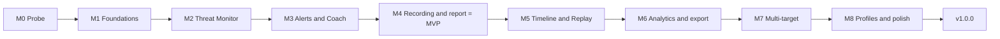

# Development roadmap

One file per milestone; each file lists the **development steps** of that milestone. A step is one branch and one pull
request, shipped automatically with `tools/ship_step.py` when its checks are green
([ADR 0006](../adr/0006-git-flow-and-automated-shipping.md)). The short overview is in [ROADMAP.md](../../ROADMAP.md);
the behaviour every step implements is in the [specification](../specs/README.md) (Italian).

| Milestone | File | Goal | Steps | Release |
|---|---|---|---|---|
| **M0** | [M0-probe.md](M0-probe.md) | Verify the threat APIs in the real client | 7 | — |
| **M1** | [M1-foundations.md](M1-foundations.md) | Skeleton, tests, Compat, Config, languages, the ecosystem look, window, settings, credits | 9 + R | `v0.1.0` |
| **M2** | [M2-threat-monitor.md](M2-threat-monitor.md) | Threat on the target, tank, percentages, states, trend, the threat list | 8 + R | `v0.2.0` |
| **M3** | [M3-alerts-coach.md](M3-alerts-coach.md) | Thresholds, alert channels, cooldowns, rule-based Coach | 6 + R | `v0.3.0` |
| **M4** | [M4-recording-report.md](M4-recording-report.md) | Recorder, sessions, storage limits, combat report (**MVP**) | 7 + R | `v0.4.0` |
| **M5** | [M5-timeline-replay.md](M5-timeline-replay.md) | Threat Timeline and Threat Replay | 6 + R | `v0.5.0` |
| **M6** | [M6-analytics-export.md](M6-analytics-export.md) | Descriptive metrics, comparison, export | 6 + R | `v0.6.0` |
| **M7** | [M7-multi-target.md](M7-multi-target.md) | Several mobs and the dungeon focus, **only if M0 allows it** | 5 + R | `v0.7.0` |
| **M8** | [M8-profiles-polish.md](M8-profiles-polish.md) | Role profiles, heatmap, accessibility, translations, CurseForge page | 8 + R | `v0.8.0`, then `v1.0.0` |



M0 can change the plan: each probe check names the specs and ADRs it may revise, and M0.7 rewrites the milestones the
results contradict (above all M2 if threat values are secret, M7 if other mobs cannot be queried). M1 may start while
the owner runs the probe, because it does not read threat yet. **M2 also starts before M0.7**, by the owner's decision
of 2026-11-25 ("Parti con M2"): its specification (M2.1) is designed for every probe outcome, and M0.7 revises M2 where
the results contradict it.

## Rules every step follows

1. **Take the first unticked step** of the current milestone and tick it in the same pull request, with a short
   *Done* note.
2. Every milestone opens with a **specification step** (`M<N>.1`) and closes with its **in-game checklist**
   (`docs/checklists/M<N>.md`), followed by the **release preparation** `M<N>.R` ([ADR 0014](../adr/0014-one-version-per-milestone-and-feature-switches.md)).
3. Parts of later milestones stay switched off in `Core/Features.lua`; a release never carries half a feature.
4. **No change without tests**; `python -I -X utf8 tools/check_docs.py` always passes.

## How a step is written

```
### M<N>.<k> — Title
- Branch:      step/m<N>-<k>-<short-name>
- Session:     model and effort (table below)
- Depends on:  previous steps
- Spec:        the sections it implements
- Scope:       what it creates or changes
- Done when:   acceptance criteria (checkboxes)
- Tests:       offline tests that must exist and pass
- Real client: what only the game can confirm (listed in the PR as "not verified")
```

## Definition of done (every step)

- [ ] The acceptance criteria of the step are met.
- [ ] `python -I -X utf8 tools/check_docs.py` and, from M1.3 on, `python -X utf8 Tests/run_tests.py` pass locally and
      in CI.
- [ ] `CHANGELOG.md` ("Unreleased"), the affected specs and ADRs (and the ADR index), both READMEs when features or
      status change, and `docs/wiki/` **in both languages** for anything a user can see are updated in the same PR.
- [ ] The pull request lists what was **not** verified in the real client.
- [ ] No personal data; every new API is checked against the Forever dump and guarded by Compat.
- [ ] The step's checkboxes in its milestone file are ticked in the same pull request.

## Sessions: one fresh session per step

The coordinating session does not implement steps. For each step it starts **one new session** (fresh context, same
folder, no worktree, one at a time, because every step touches `CHANGELOG.md` and the roadmap), with this brief:

- "Only this step": the step's section of the milestone file, the specs to read, the feature switches to respect;
- the flow of [CLAUDE.md](../../CLAUDE.md) and `tools/ship_step.py`; no `gh pr merge`; never run `tools/sync_wiki.py`;
- the report, in Italian: pull request, commit on `main`, number of tests, what is not verified in the game.

After the session the coordinator checks: `git fetch`, `git checkout main`, `git merge --ff-only origin/main`; the
noreply author in `git log`; the ticked box; a clean checkout. Only then the next step starts. An owner's answer that
changes while a step runs is forwarded to that session. A step waiting for the owner may let a later independent step
go first.

### Model and effort per kind of step

| Kind of step | Model | Effort |
|---|---|---|
| Specification, architecture, protected APIs, secret values or taint, security, data migrations | Opus | high |
| Non-trivial data logic | Opus | medium |
| UI views, standard features on existing foundations | Sonnet | medium |
| Features with many edge cases or heavy tests | Sonnet | high |
| Checklists, documentation, release preparation | Sonnet | low or medium |

Each milestone file repeats the table for its own steps.
