# Interface previews

The threat monitor, the alerts and the Coach, the window, the Settings page and the Info page of Azeroth Threatwarden, in both languages of the interface (the monitor's players and mob are invented).

> **Design previews, not screenshots.** Drawn from the addon's layout, colours (`UI/Theme.lua`) and texts (`Locales/`), with original art only (CSS shapes, the addon's logo, the NEBULA logos and the fonts the addon ships). Nothing has been run in WoW Forever yet, so the real window may differ in small details (fonts, textures, exact spacing). Every image says so in its bottom strip.

Written by `python -X utf8 tools/make_mockups.py`: do not edit this file.

## The threat monitor

| Preview | What it shows |
|---|---|
|  | **monitor-values-nebula** The monitor with threat values: a damage dealer in WARNING with a prediction, one in DANGER (Nebula) |
|  | **monitor-values-aurora** The monitor with threat values: a damage dealer in WARNING with a prediction, one in DANGER (Aurora) |
| [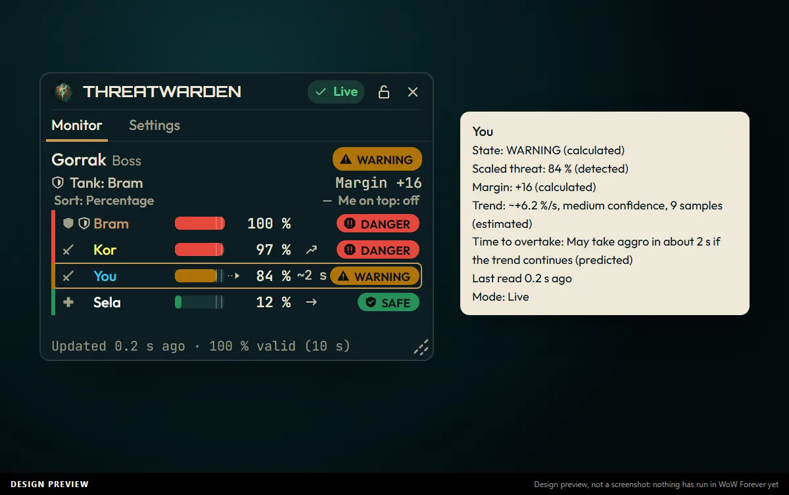](monitor-values-warden.webp) | **monitor-values-warden** The monitor with threat values: a damage dealer in WARNING with a prediction, one in DANGER (Warden) |
| [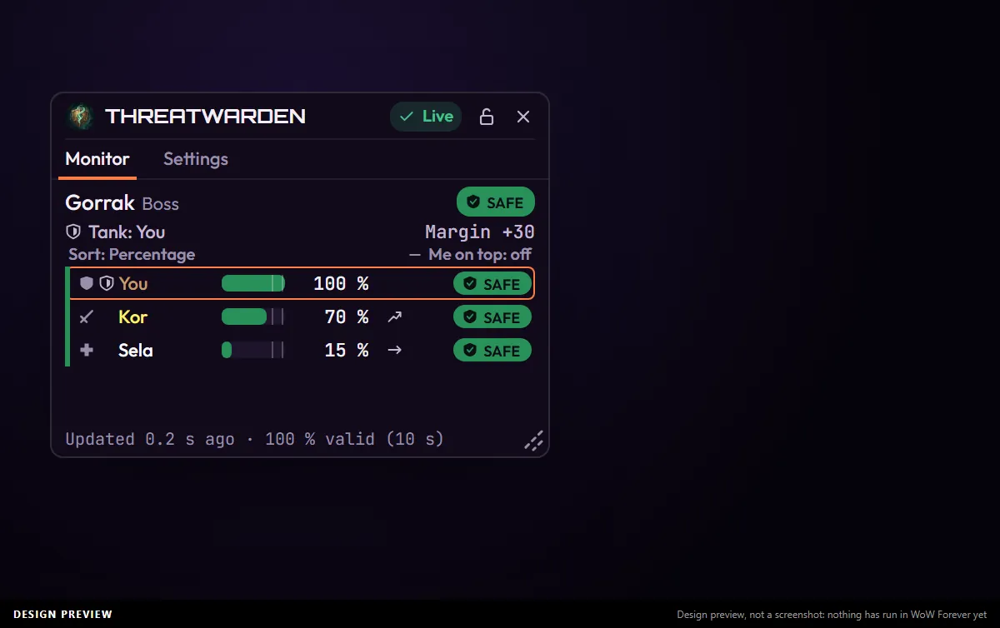](monitor-tank-nebula.webp) | **monitor-tank-nebula** The tank's view, with the margin over the second (Nebula) |
|  | **monitor-tank-warden** The tank's view, with the margin over the second (Warden) |
|  | **monitor-state-nebula** State only: the client hides the values, the monitor shows the game's state (Nebula) |
|  | **monitor-state-warden** State only: the client hides the values, the monitor shows the game's state (Warden) |
| [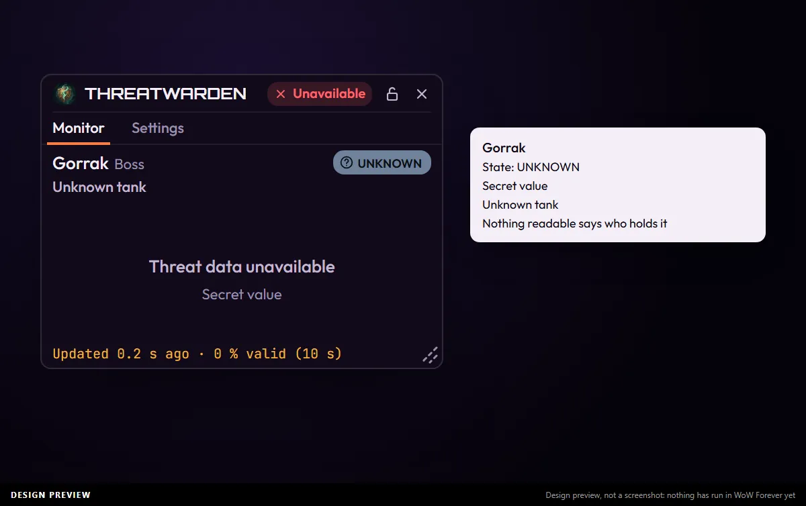](monitor-unknown-nebula.webp) | **monitor-unknown-nebula** Nothing readable: threat data unavailable (Nebula) |
| [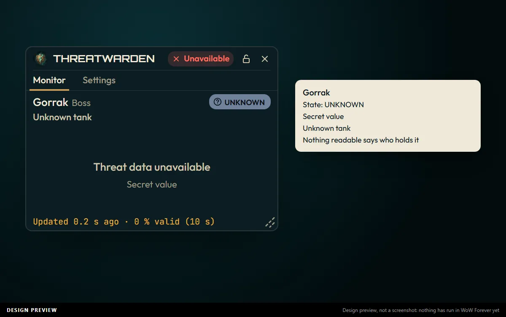](monitor-unknown-warden.webp) | **monitor-unknown-warden** Nothing readable: threat data unavailable (Warden) |
|  | **monitor-no-target-nebula** No target (Nebula) |
| [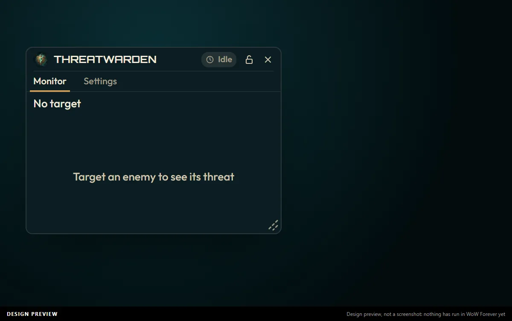](monitor-no-target-warden.webp) | **monitor-no-target-warden** No target (Warden) |
|  | **monitor-demo-nebula** Demo mode: an invented fight, said to be one (Nebula) |
|  | **monitor-demo-warden** Demo mode: an invented fight, said to be one (Warden) |
|  | **monitor-values-nebula-it** Il monitor con i valori di threat: un DPS in ATTENZIONE con la previsione, uno in PERICOLO (Nebula) |
|  | **monitor-values-aurora-it** Il monitor con i valori di threat: un DPS in ATTENZIONE con la previsione, uno in PERICOLO (Aurora) |
|  | **monitor-values-warden-it** Il monitor con i valori di threat: un DPS in ATTENZIONE con la previsione, uno in PERICOLO (Warden) |
|  | **monitor-tank-nebula-it** La vista del tank, con il margine sul secondo (Nebula) |
| [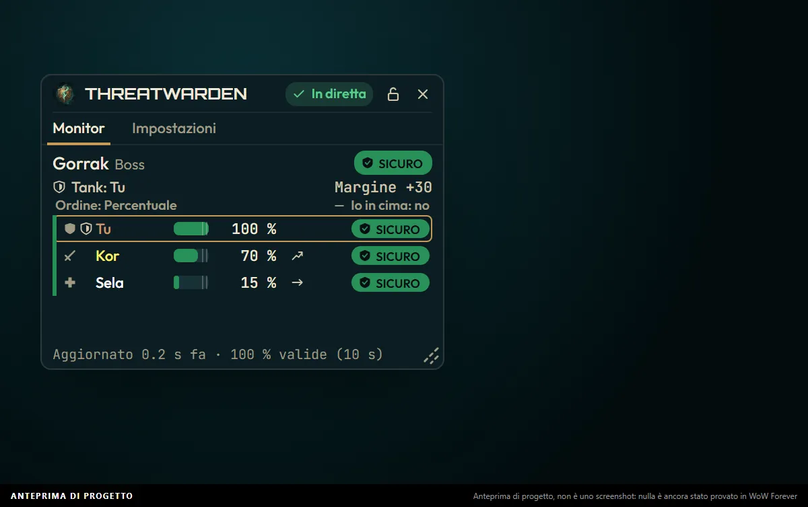](monitor-tank-warden-it.webp) | **monitor-tank-warden-it** La vista del tank, con il margine sul secondo (Warden) |
|  | **monitor-state-nebula-it** Solo stato: il client nasconde i valori, il monitor mostra lo stato del gioco (Nebula) |
|  | **monitor-state-warden-it** Solo stato: il client nasconde i valori, il monitor mostra lo stato del gioco (Warden) |
|  | **monitor-unknown-nebula-it** Nulla di leggibile: dati di threat non disponibili (Nebula) |
|  | **monitor-unknown-warden-it** Nulla di leggibile: dati di threat non disponibili (Warden) |
| [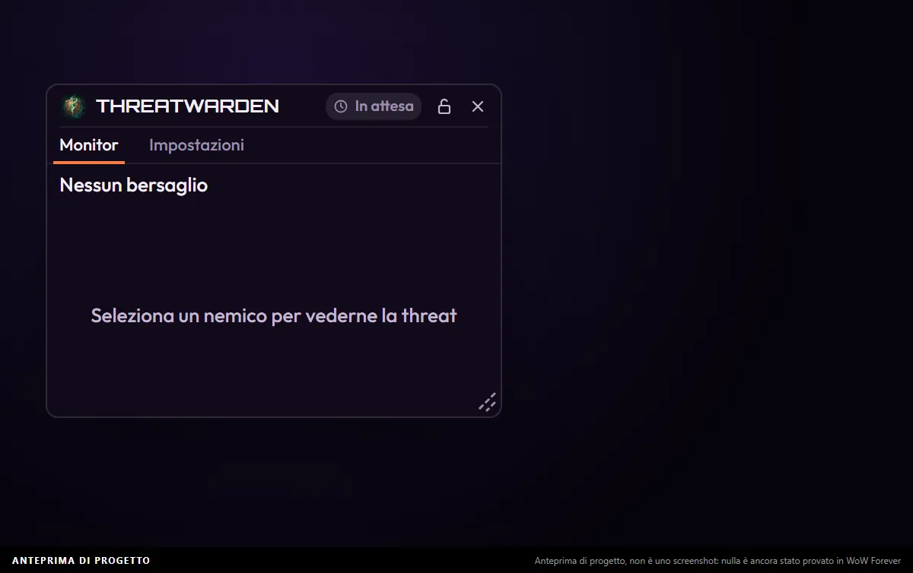](monitor-no-target-nebula-it.webp) | **monitor-no-target-nebula-it** Nessun bersaglio (Nebula) |
|  | **monitor-no-target-warden-it** Nessun bersaglio (Warden) |
|  | **monitor-demo-nebula-it** Modalità demo: uno scontro inventato, dichiarato tale (Nebula) |
| [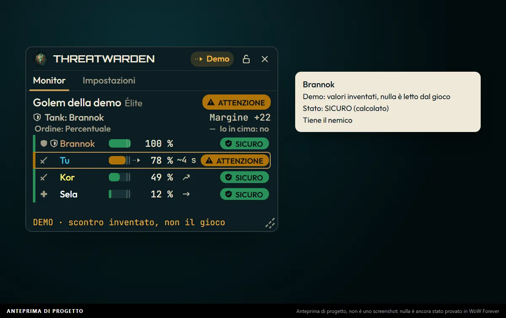](monitor-demo-warden-it.webp) | **monitor-demo-warden-it** Modalità demo: uno scontro inventato, dichiarato tale (Warden) |

## Alerts and Coach

| Preview | What it shows |
|---|---|
|  | **coach-dps-nebula** The Coach strip of a damage dealer: a predicted rise with its confidence (Nebula) |
| [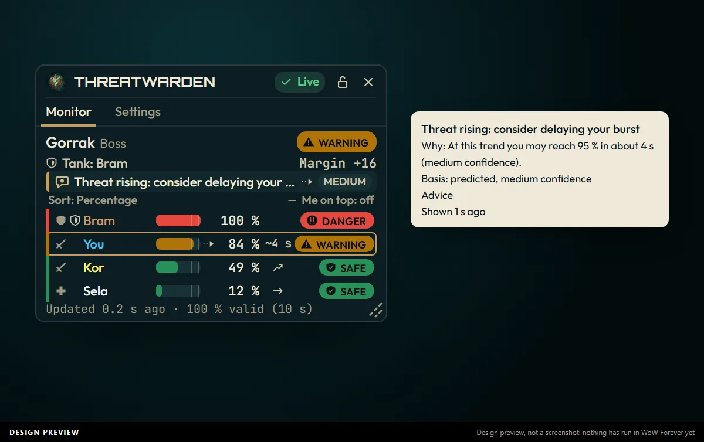](coach-dps-warden.webp) | **coach-dps-warden** The Coach strip of a damage dealer: a predicted rise with its confidence (Warden) |
| [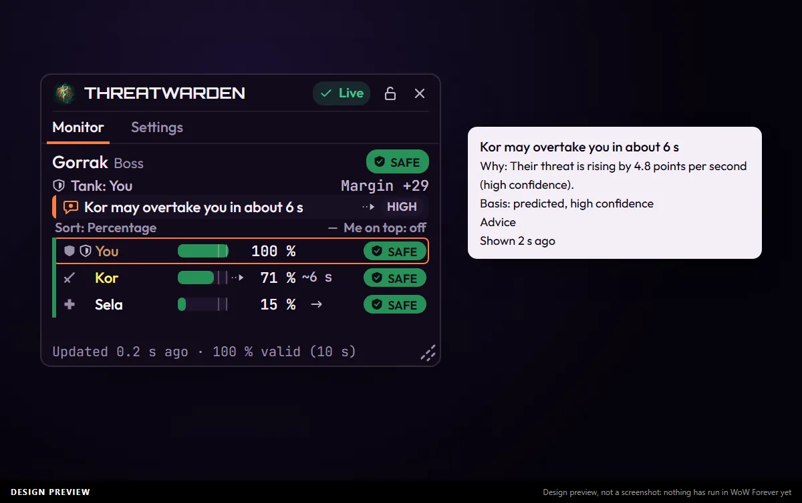](coach-tank-nebula.webp) | **coach-tank-nebula** The Coach strip of a tank: the second may overtake, with the margin (Nebula) |
| [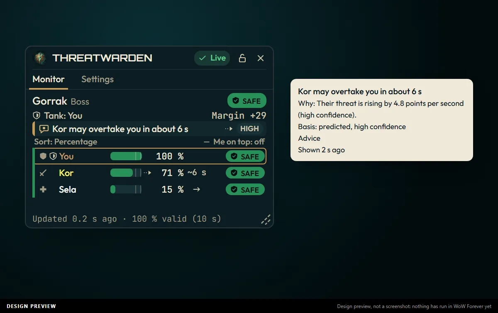](coach-tank-warden.webp) | **coach-tank-warden** The Coach strip of a tank: the second may overtake, with the margin (Warden) |
|  | **coach-unknown-nebula** Not enough data for advice, and why (Nebula) |
|  | **coach-unknown-warden** Not enough data for advice, and why (Warden) |
| [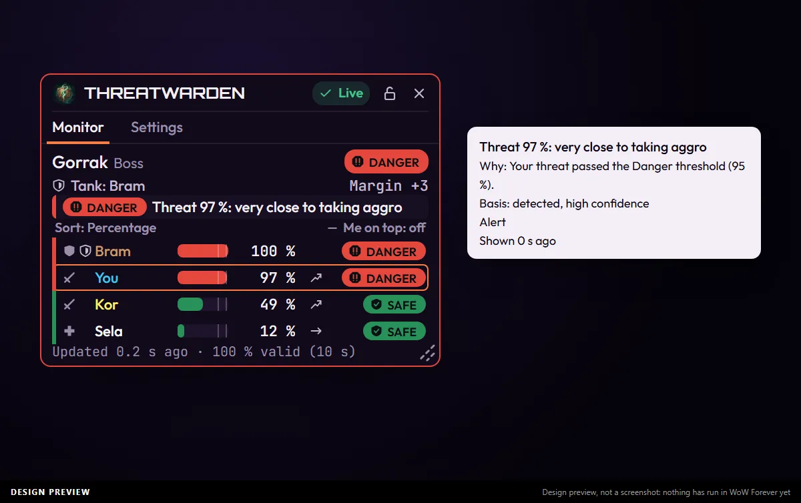](alert-danger-nebula.webp) | **alert-danger-nebula** An alert in the strip, with the border in the colour of its state (Nebula) |
|  | **alert-danger-warden** An alert in the strip, with the border in the colour of its state (Warden) |
| [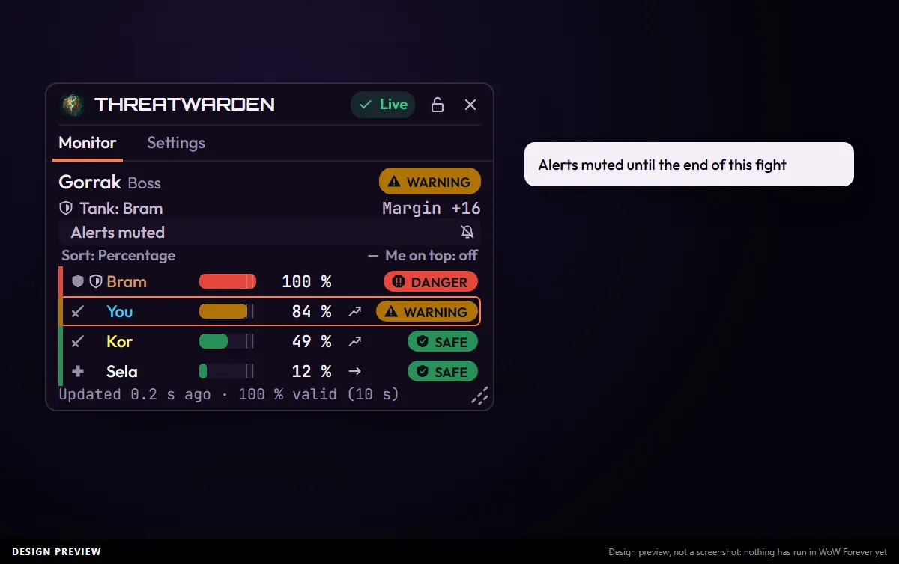](alert-muted-nebula.webp) | **alert-muted-nebula** Alerts muted until the end of the fight (Nebula) |
|  | **alert-muted-warden** Alerts muted until the end of the fight (Warden) |
|  | **coach-dps-nebula-it** La striscia del Coach per un DPS: un aumento previsto con la sua affidabilità (Nebula) |
| [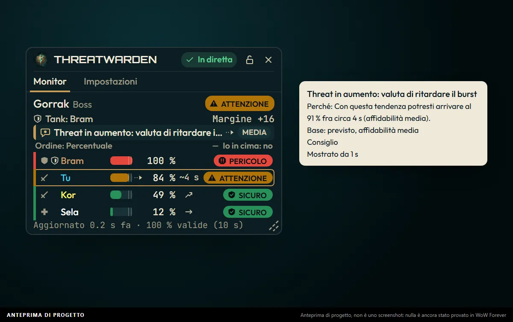](coach-dps-warden-it.webp) | **coach-dps-warden-it** La striscia del Coach per un DPS: un aumento previsto con la sua affidabilità (Warden) |
| [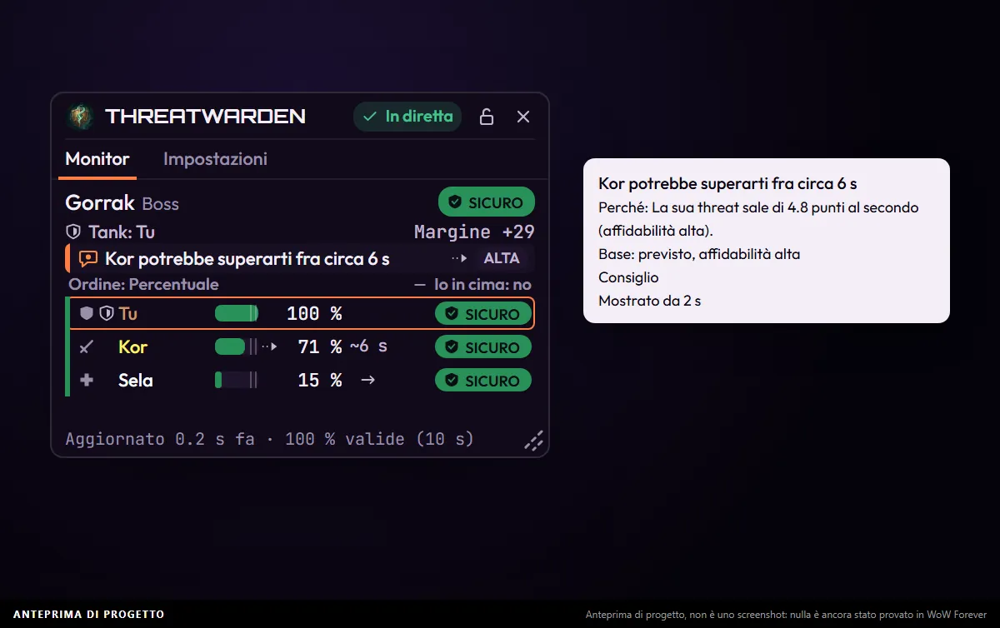](coach-tank-nebula-it.webp) | **coach-tank-nebula-it** La striscia del Coach per un tank: il secondo potrebbe superarti, con il margine (Nebula) |
|  | **coach-tank-warden-it** La striscia del Coach per un tank: il secondo potrebbe superarti, con il margine (Warden) |
|  | **coach-unknown-nebula-it** Dati insufficienti per un consiglio, e perché (Nebula) |
|  | **coach-unknown-warden-it** Dati insufficienti per un consiglio, e perché (Warden) |
| [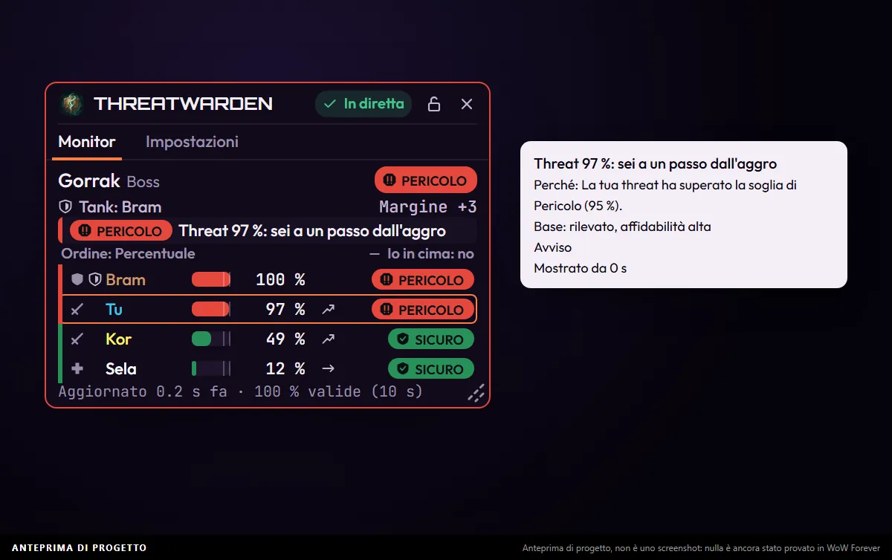](alert-danger-nebula-it.webp) | **alert-danger-nebula-it** Un avviso nella striscia, con il bordo nel colore del suo stato (Nebula) |
|  | **alert-danger-warden-it** Un avviso nella striscia, con il bordo nel colore del suo stato (Warden) |
|  | **alert-muted-nebula-it** Avvisi silenziati fino alla fine del combattimento (Nebula) |
|  | **alert-muted-warden-it** Avvisi silenziati fino alla fine del combattimento (Warden) |

## The window

| Preview | What it shows |
|---|---|
|  | **window-nebula** The window of v0.1.0: the Monitor tab before threat monitoring arrives (Nebula) |
| [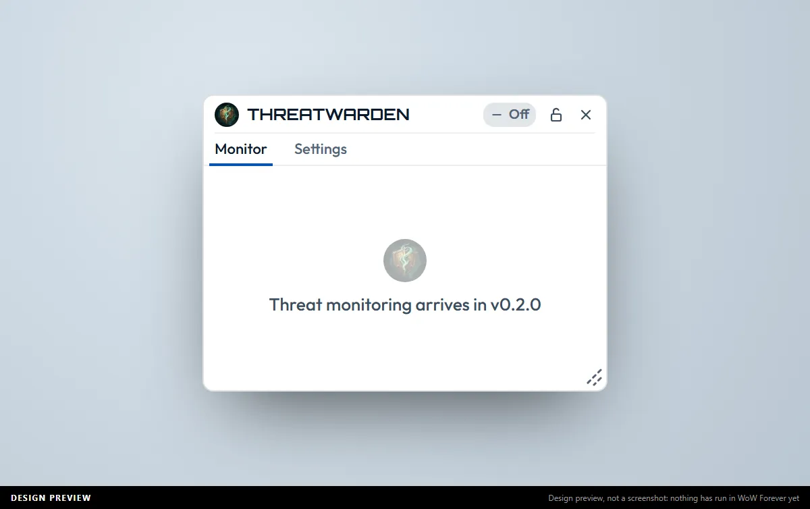](window-aurora.webp) | **window-aurora** The window of v0.1.0: the Monitor tab before threat monitoring arrives (Aurora) |
|  | **window-warden** The window of v0.1.0: the Monitor tab before threat monitoring arrives (Warden) |
|  | **window-nebula-it** La finestra della v0.1.0: la scheda Monitor prima che arrivi il monitor della threat (Nebula) |
| [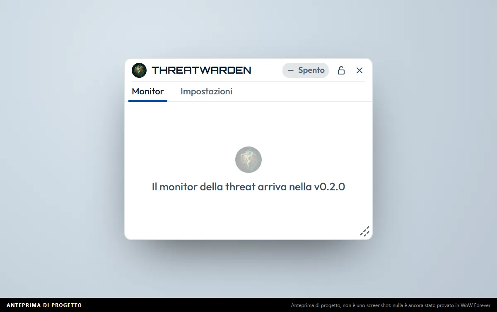](window-aurora-it.webp) | **window-aurora-it** La finestra della v0.1.0: la scheda Monitor prima che arrivi il monitor della threat (Aurora) |
|  | **window-warden-it** La finestra della v0.1.0: la scheda Monitor prima che arrivi il monitor della threat (Warden) |

## Settings

| Preview | What it shows |
|---|---|
|  | **settings-nebula** Settings: the top of the page and the page scrolled down (Nebula) |
| [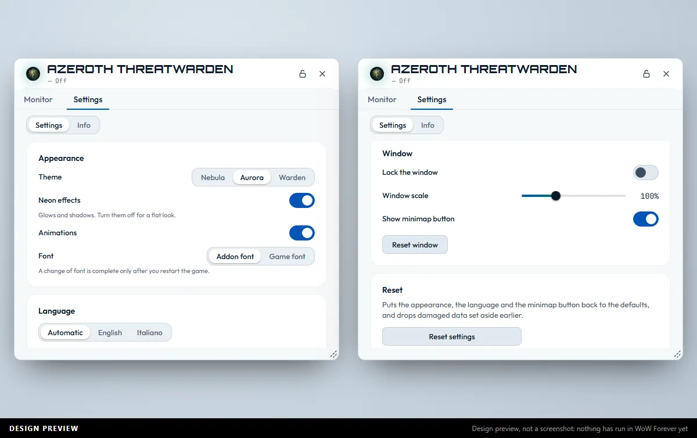](settings-aurora.webp) | **settings-aurora** Settings: the top of the page and the page scrolled down (Aurora) |
|  | **settings-warden** Settings: the top of the page and the page scrolled down (Warden) |
|  | **settings-monitor-nebula** Settings: the Monitor card, its top and the page scrolled down (Nebula) |
| [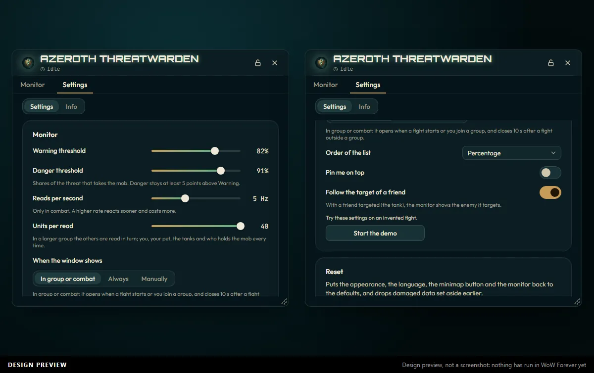](settings-monitor-warden.webp) | **settings-monitor-warden** Settings: the Monitor card, its top and the page scrolled down (Warden) |
|  | **settings-alerts-nebula** Settings: the Alerts card with the note of the game's own threat warning (Nebula) |
| [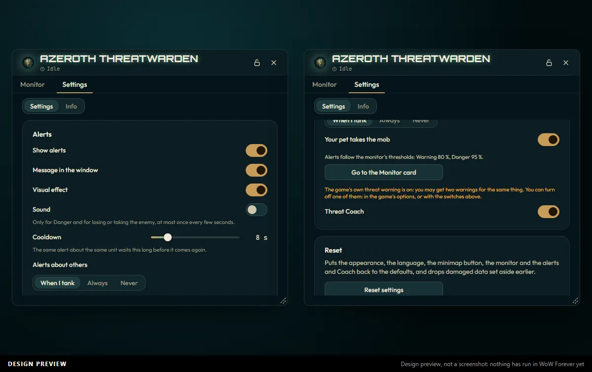](settings-alerts-warden.webp) | **settings-alerts-warden** Settings: the Alerts card with the note of the game's own threat warning (Warden) |
|  | **settings-nebula-it** Impostazioni: la parte alta della pagina e la pagina scorsa in basso (Nebula) |
| [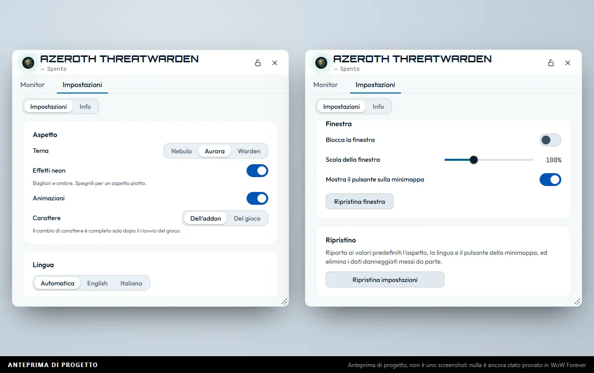](settings-aurora-it.webp) | **settings-aurora-it** Impostazioni: la parte alta della pagina e la pagina scorsa in basso (Aurora) |
|  | **settings-warden-it** Impostazioni: la parte alta della pagina e la pagina scorsa in basso (Warden) |
|  | **settings-monitor-nebula-it** Impostazioni: la card Monitor, la parte alta e la pagina scorsa in basso (Nebula) |
|  | **settings-monitor-warden-it** Impostazioni: la card Monitor, la parte alta e la pagina scorsa in basso (Warden) |
|  | **settings-alerts-nebula-it** Impostazioni: la card Avvisi con la nota dell'avviso della threat del gioco (Nebula) |
| [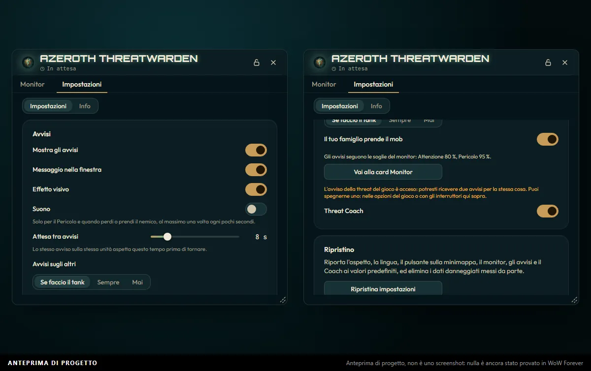](settings-alerts-warden-it.webp) | **settings-alerts-warden-it** Impostazioni: la card Avvisi con la nota dell'avviso della threat del gioco (Warden) |

## Info and credits

| Preview | What it shows |
|---|---|
|  | **about-nebula** Info and credits: the top of the page and the page scrolled down (Nebula) |
|  | **about-aurora** Info and credits: the top of the page and the page scrolled down (Aurora) |
| [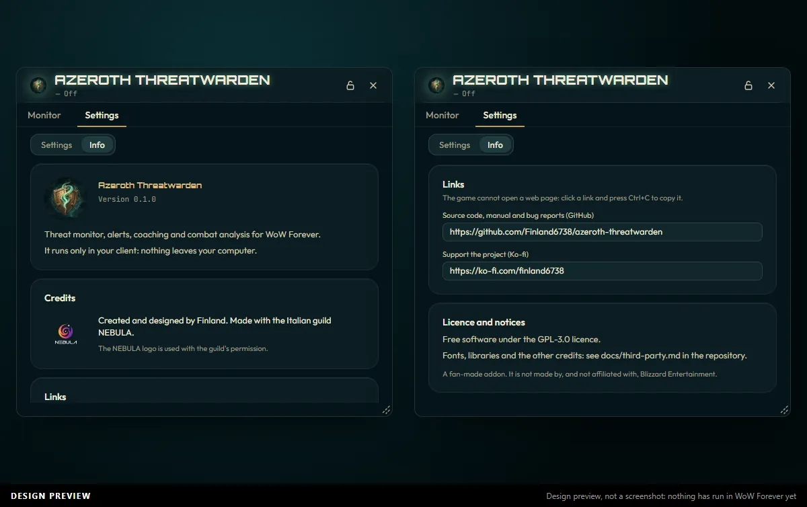](about-warden.webp) | **about-warden** Info and credits: the top of the page and the page scrolled down (Warden) |
| [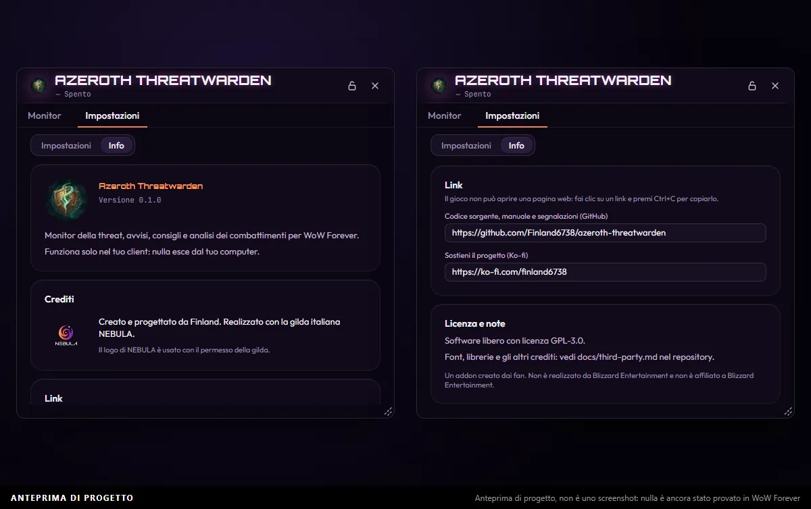](about-nebula-it.webp) | **about-nebula-it** Info e crediti: la parte alta della pagina e la pagina scorsa in basso (Nebula) |
|  | **about-aurora-it** Info e crediti: la parte alta della pagina e la pagina scorsa in basso (Aurora) |
|  | **about-warden-it** Info e crediti: la parte alta della pagina e la pagina scorsa in basso (Warden) |
