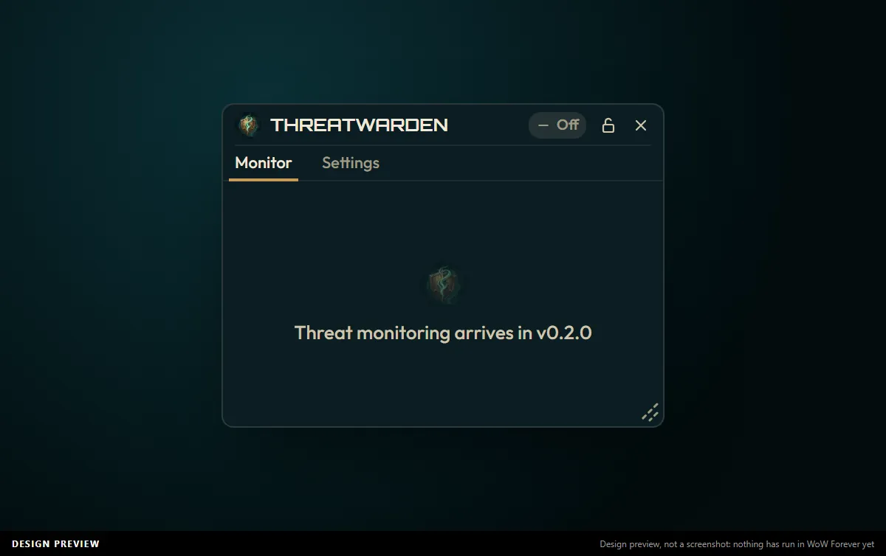
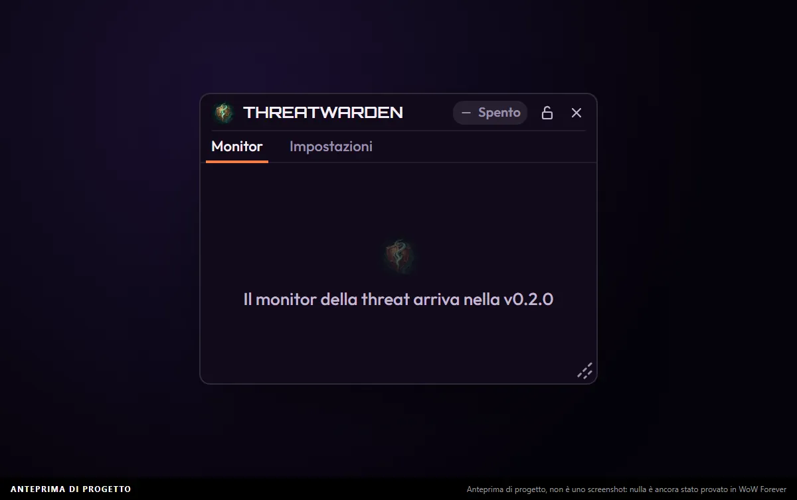
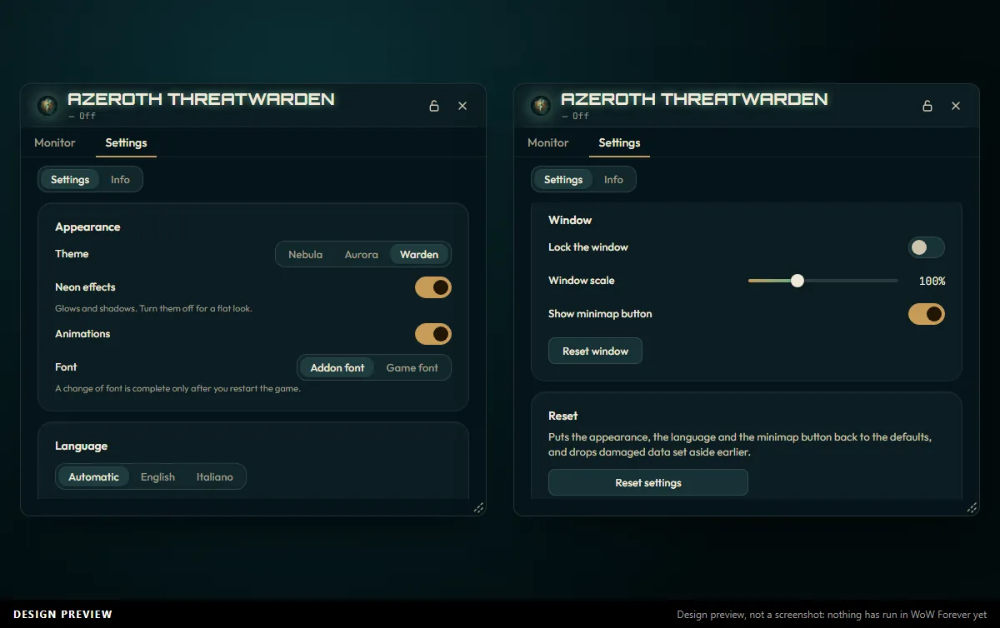
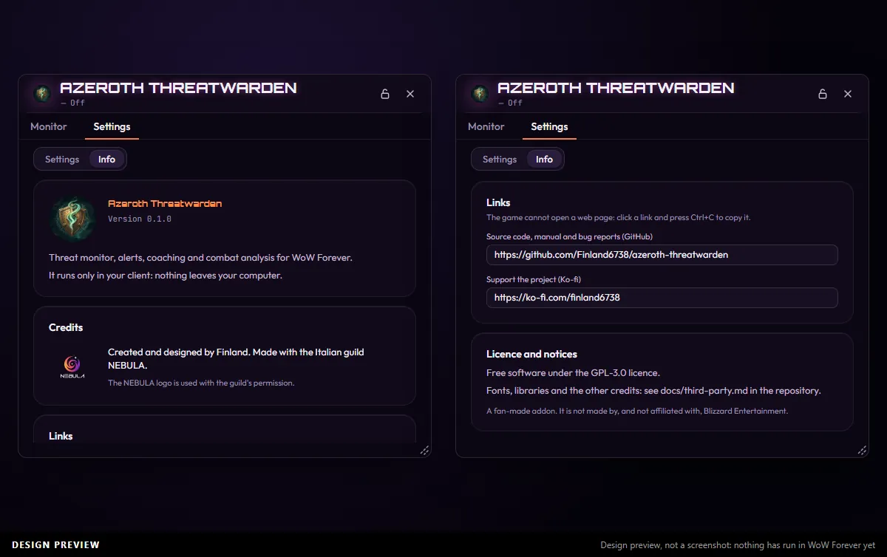
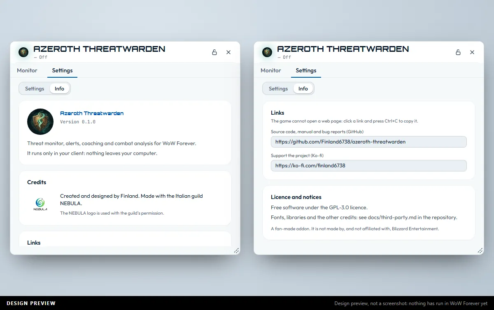

# Interface previews

The window, the Settings page and the Info page of Azeroth Threatwarden, in the three themes and in both languages of the interface.

> **Design previews, not screenshots.** Drawn from the addon's layout, colours (`UI/Theme.lua`) and texts (`Locales/`), with original art only (CSS shapes, the addon's logo, the NEBULA logos and the fonts the addon ships). Nothing has been run in WoW Forever yet, so the real window may differ in small details (fonts, textures, exact spacing). Every image says so in its bottom strip.

Written by `python -X utf8 tools/make_mockups.py`: do not edit this file.

## The window

| Preview | What it shows |
|---|---|
|  | **window-nebula** The window of v0.1.0: the Monitor tab before threat monitoring arrives (Nebula) |
|  | **window-aurora** The window of v0.1.0: the Monitor tab before threat monitoring arrives (Aurora) |
|  | **window-warden** The window of v0.1.0: the Monitor tab before threat monitoring arrives (Warden) |
|  | **window-nebula-it** La finestra della v0.1.0: la scheda Monitor prima che arrivi il monitor della threat (Nebula) |
|  | **window-aurora-it** La finestra della v0.1.0: la scheda Monitor prima che arrivi il monitor della threat (Aurora) |
|  | **window-warden-it** La finestra della v0.1.0: la scheda Monitor prima che arrivi il monitor della threat (Warden) |

## Settings

| Preview | What it shows |
|---|---|
|  | **settings-nebula** Settings: the top of the page and the page scrolled down (Nebula) |
|  | **settings-aurora** Settings: the top of the page and the page scrolled down (Aurora) |
|  | **settings-warden** Settings: the top of the page and the page scrolled down (Warden) |
|  | **settings-nebula-it** Impostazioni: la parte alta della pagina e la pagina scorsa in basso (Nebula) |
|  | **settings-aurora-it** Impostazioni: la parte alta della pagina e la pagina scorsa in basso (Aurora) |
|  | **settings-warden-it** Impostazioni: la parte alta della pagina e la pagina scorsa in basso (Warden) |

## Info and credits

| Preview | What it shows |
|---|---|
|  | **about-nebula** Info and credits: the top of the page and the page scrolled down (Nebula) |
|  | **about-aurora** Info and credits: the top of the page and the page scrolled down (Aurora) |
|  | **about-warden** Info and credits: the top of the page and the page scrolled down (Warden) |
|  | **about-nebula-it** Info e crediti: la parte alta della pagina e la pagina scorsa in basso (Nebula) |
|  | **about-aurora-it** Info e crediti: la parte alta della pagina e la pagina scorsa in basso (Aurora) |
|  | **about-warden-it** Info e crediti: la parte alta della pagina e la pagina scorsa in basso (Warden) |
