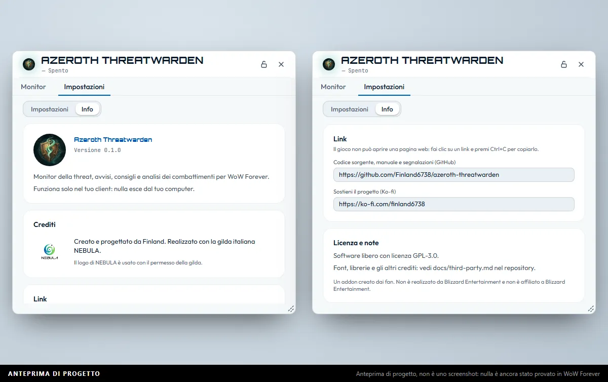

# Informazioni e crediti

*English: [[About and credits|About]]*

**Azeroth Threatwarden** è un addon per World of Warcraft: Forever con monitor della threat, avvisi, consigli e analisi
dei combattimenti. Funziona solo nel tuo client: nulla esce dal tuo computer
([[Privacy e dati|Privacy-and-Data-it]]).

## Crediti

- **Creato e disegnato da Finland.**
- **Fatto con la gilda italiana NEBULA** ([la pagina della gilda](https://nebula-community.github.io/giochi/wow-forever/)).
  Il logo NEBULA è usato con il permesso della gilda.

## In gioco

Gli stessi crediti sono nella pagina **Info** delle Impostazioni: si apre con `/atw about`, o con la pillola **Info** in
cima alla scheda Impostazioni (anche nella finestra delle impostazioni del gioco). Mostra il logo e la versione, i
crediti con il logo NEBULA (quello scuro nei temi Nebula e Warden, quello chiaro in Aurora), i link, la licenza e le
note.

*Anteprime di progetto, non screenshot: disegnate dal layout e dai testi dell'addon, perché l'addon non è ancora stato provato in gioco ([tutte le anteprime](https://github.com/Finland6738/azeroth-threatwarden/blob/main/docs/specs/mockups/previews/README.md)).*

Il gioco non può aprire una pagina web, quindi ogni link è una casella: fai clic, il testo è selezionato, premi
**Ctrl+C** e incollalo nel browser. Le caselle non si possono modificare.

## Link

| Cosa | Indirizzo |
|---|---|
| Codice sorgente, manuale e segnalazioni | https://github.com/Finland6738/azeroth-threatwarden |
| Sostieni il progetto (Ko-fi) | https://ko-fi.com/finland6738 |

## Licenza e note

Azeroth Threatwarden è software libero con licenza **GNU GPL v3.0**. I caratteri, le immagini e le librerie che porta
con sé, con la licenza di ciascuno, sono elencati in
[docs/third-party.md](https://github.com/Finland6738/azeroth-threatwarden/blob/main/docs/third-party.md).

È un addon creato dai fan. Non è realizzato da Blizzard Entertainment e non è affiliato a Blizzard Entertainment.
