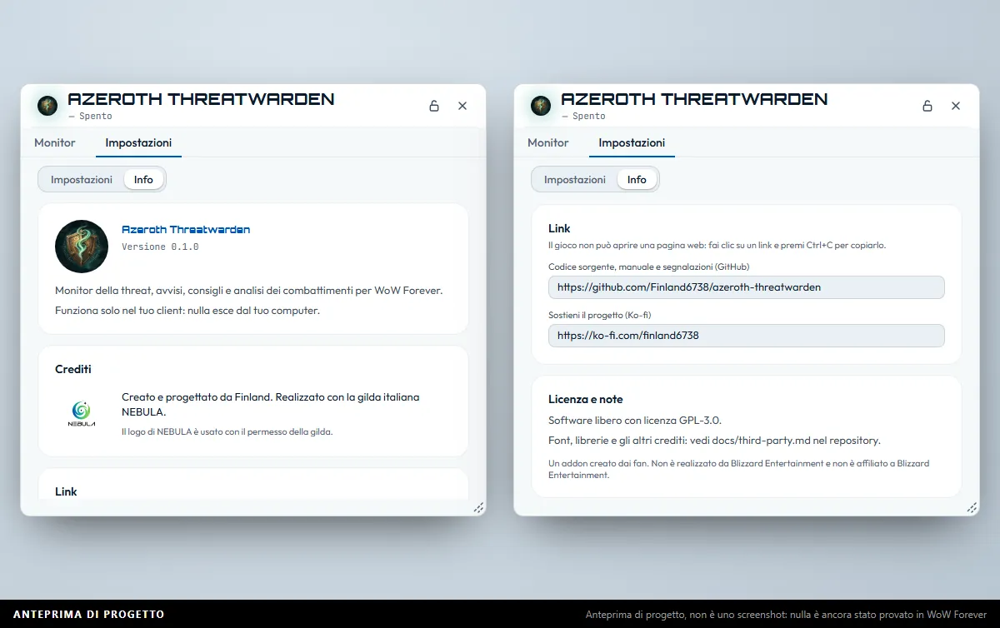

# About and credits

*Italiano: [[Informazioni e crediti|About-it]]*

**Azeroth Threatwarden** is a threat monitor, alerts, coaching and combat analysis addon for World of Warcraft:
Forever. It runs only in your client: nothing leaves your computer ([[Privacy and Data|Privacy-and-Data]]).

## Credits

- **Created and designed by Finland.**
- **Made with the Italian guild NEBULA** ([the guild's page](https://nebula-community.github.io/giochi/wow-forever/)).
  The NEBULA logo is used with the guild's permission.

## In the game

The same credits are on the **Info** page of Settings: open it with `/atw about`, or with the **Info** pill at the top of
the Settings tab (also in the game's own settings window). It shows the logo and the version, the credits with the
NEBULA logo (the dark one on the Nebula and Warden themes, the light one on Aurora), the links, the licence and the
notices.

*Design previews, not screenshots: drawn from the addon's own layout and texts, because the addon has not been run in the game yet ([all previews](https://github.com/Finland6738/azeroth-threatwarden/blob/main/docs/specs/mockups/previews/README.md)).*

The game cannot open a web page, so every link is a box: click it, the text is selected, press **Ctrl+C** and paste it
into your browser. The boxes cannot be edited.

## Links

| What | Address |
|---|---|
| Source code, manual and bug reports | https://github.com/Finland6738/azeroth-threatwarden |
| Support the project (Ko-fi) | https://ko-fi.com/finland6738 |

## Licence and notices

Azeroth Threatwarden is free software under the **GNU GPL v3.0**. The fonts, the pictures and the libraries that come
with it, and the licence of each, are listed in
[docs/third-party.md](https://github.com/Finland6738/azeroth-threatwarden/blob/main/docs/third-party.md).

It is a fan-made addon. It is not made by, and not affiliated with, Blizzard Entertainment.
