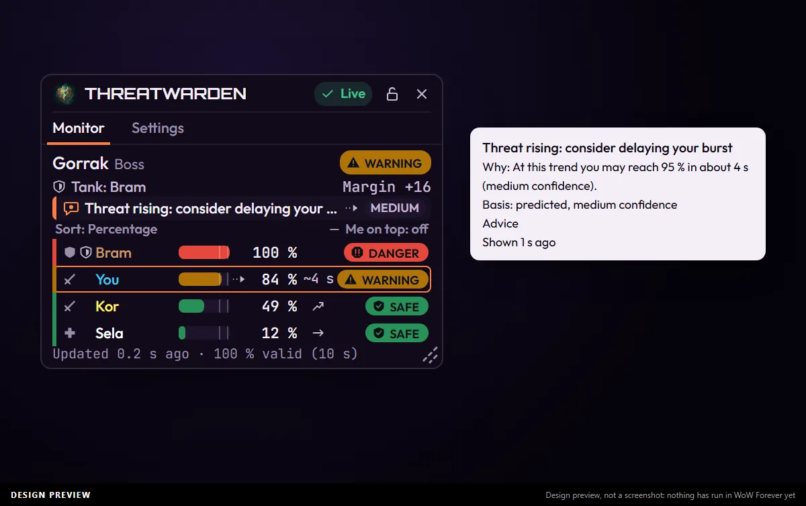
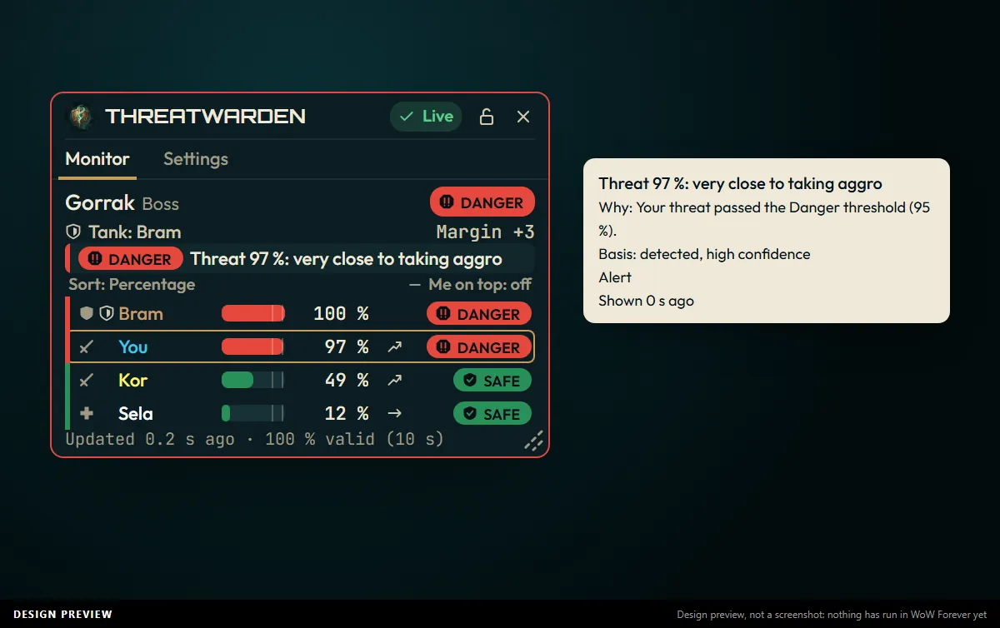
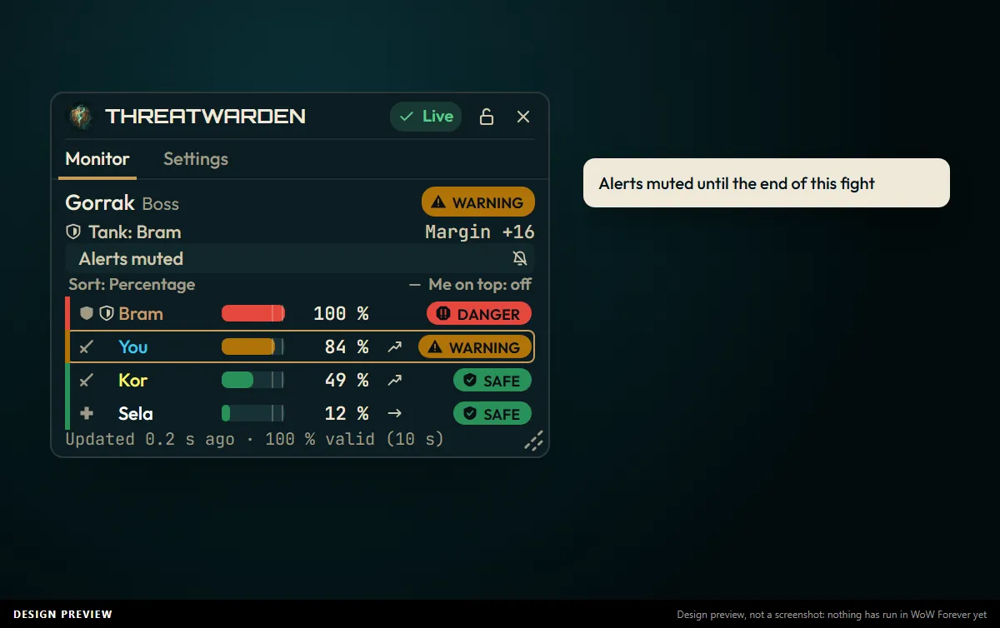
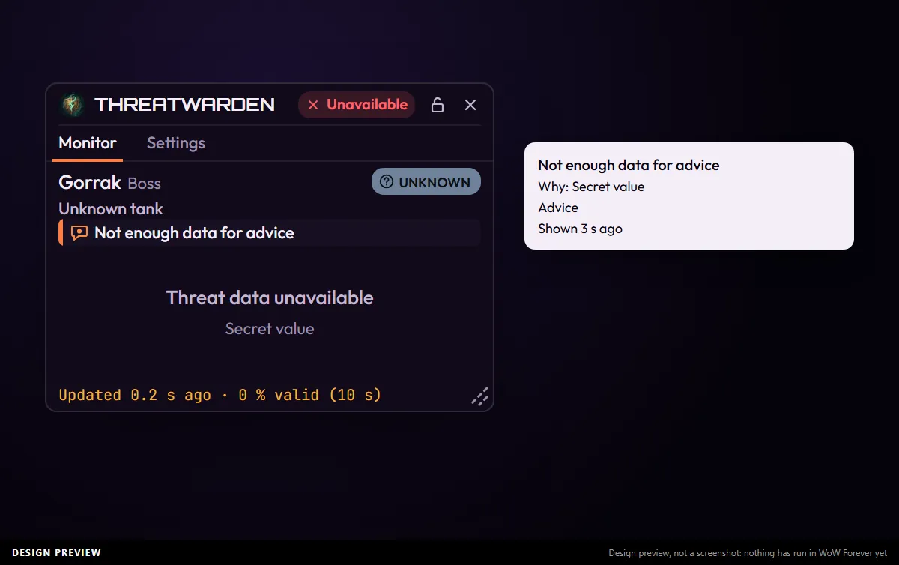
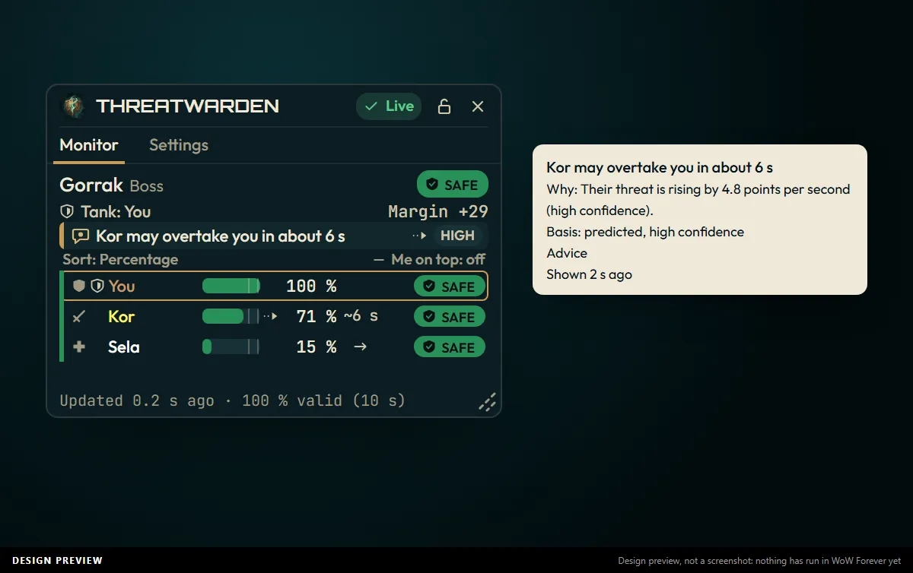

# Avvisi e Coach

*English: [[Alerts and Coach|Alerts-and-Coach]]*

> **Nuovo nella `v0.3.0`, non verificato in gioco.** Quali dati di threat WoW Forever dia davvero a un addon, e se i
> messaggi aiutino in un combattimento vero, è ancora da verificare; cooldown e testi sono provvisori.

Un **avviso** quando un rischio comincia, e un breve **consiglio** con il suo motivo. Tutti e due compaiono in una
striscia della scheda [[Monitor della threat|Threat-Monitor-it]], fra l'intestazione del nemico e l'elenco. Nulla viene
mai scritto in chat, nemmeno nella tua, e l'addon non apre mai la finestra per mostrarti un avviso.

## La striscia

| Nella striscia | Significato |
|---|---|
| Barretta arancione e fumetto | un **consiglio** del Coach |
| Barretta colorata e distintivo di stato (icona e parola) | un **avviso**: resta 4 secondi, poi torna il consiglio |
| Freccia a puntini | la base è una *previsione* |
| *ALTA* / *MEDIA* | l'affidabilità di una stima o di una previsione |
| Campana barrata | gli avvisi sono silenziati |
| *I consigli compaiono in combattimento* | fuori dal combattimento |

Una striscia vuota in combattimento vuol dire che ora non c'è nulla da consigliare. Passa sopra la striscia per leggere
il messaggio intero, il **perché** (su quali dati poggia), il tipo (*rilevato*, *calcolato*, *stimato*, *previsto*),
l'affidabilità e da quanto si vede. Il perché non dice mai la causa di qualcosa: l'addon non può saperla.

In una finestra molto bassa la striscia resta e l'intestazione dell'elenco si nasconde per lasciare posto alle righe.

## Gli avvisi

Un avviso scatta solo quando qualcosa **comincia**: il tuo stato sale ad Attenzione o Pericolo, o cambia chi tiene il
nemico. Quali ricevi dipende dal ruolo: tu vicino alla cima della lista della threat del nemico o in cima, il tuo
margine da tank, il nemico che hai perso, il tuo famiglio che lo prende, o un altro giocatore in Pericolo (di base solo
quando sei il tank). Lo stesso tipo di avviso sulla stessa unità aspetta 8 secondi prima di tornare.

Di base l'avviso compare nella striscia e il **bordo** della finestra prende una volta il colore del suo stato, per circa
due secondi, senza lampeggi. Con il messaggio spento, la pillola in alto mostra per lo stesso tempo l'icona dello stato,
così il colore non porta mai da solo il significato. Il **suono** è spento di base; se acceso, suona solo per Pericolo e
quando si perde o si prende il nemico.

### Cosa fare ad Attenzione e Pericolo

A chi fa danni o cura gli avvisi sulla propria threat dicono cosa fare:

| La tua threat | DPS | Guaritore |
|---|---|---|
| **Attenzione** (dall'82 %) | *Threat 85 %: rallenta, meno lanci o rank più bassi* | lo stesso |
| **Pericolo** (dal 91 %) | *Threat 93 %: smetti di fare danni per un attimo* | *Threat 93 %: smetti di curare per un attimo* |

"Rank più bassi" vuol dire un rank più basso dello stesso incantesimo, che genera meno threat; l'addon non nomina mai
un incantesimo o una classe. Al tank non si dice mai di fermarsi: se tiene il nemico riceve gli avvisi sul margine del
secondo (dall'82 % e dal 91 %); un tank che non lo tiene riceve solo *ti avvicini all'aggro* o *sei a un passo
dall'aggro*. Con i dati *solo stato* l'avviso dice ciò che mostra il gioco, senza numeri.

### Silenziare

- `/atw mute`, o il [tasto che gli assegni](Commands-it#assegnazione-di-un-tasto), silenzia tutti gli avvisi **fino
  alla fine del combattimento in corso**; fuori dal combattimento, fino alla fine del prossimo. Di nuovo per
  riaccenderli prima. Anche una ricarica lo toglie. Il Coach non si silenzia: è testo nella striscia (si spegne nelle
  [Impostazioni](Settings-it#avvisi)).
- **Una sola unità**: clic destro sulla sua riga nell'elenco, poi **Silenzia su questa unità gli avvisi** (di nuovo per
  riaccenderli). Vale fino a una ricarica e nessun nome viene salvato. La tua riga non ha questo menu.

### L'avviso di threat del gioco

World of Warcraft ha un suo avviso della threat nelle opzioni del gioco. Se è acceso, potresti ricevere due avvisi per
la stessa cosa: spegnine uno. L'addon non cambia mai l'impostazione del gioco.

## Il Coach

Un consiglio alla volta per il tuo ruolo (tank, DPS o guaritore), per esempio *Threat in aumento: valuta di ritardare il
burst*, *Rallenta: meno danni, meno lanci o rank più bassi* (dall'82 %), *A un passo dall'aggro: smetti di fare danni per
un attimo* (dal 91 %; un guaritore legge *curare* invece di *fare danni*) o, per un tank, *il secondo potrebbe
superarti*. Ogni consiglio ha il suo motivo. Non nomina mai un'abilità o
una classe (l'unico consiglio sugli incantesimi è il generico *rank più bassi*), e dice *Dati insufficienti per formulare un consiglio* (con il perché) quando il gioco non dà abbastanza.

Quali dati di threat dia WoW Forever è ancora da verificare: con dati *solo stato* i messaggi non hanno numeri, e con
dati illeggibili non c'è nulla di cui avvisare.
