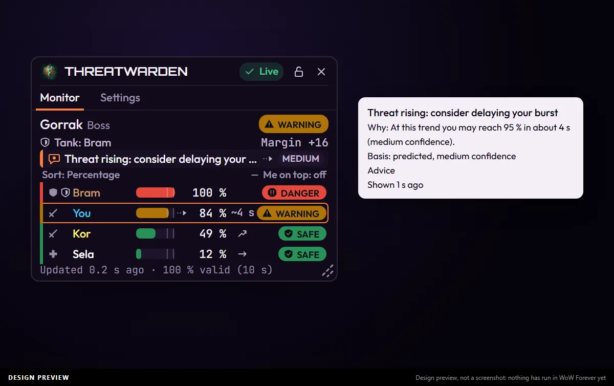
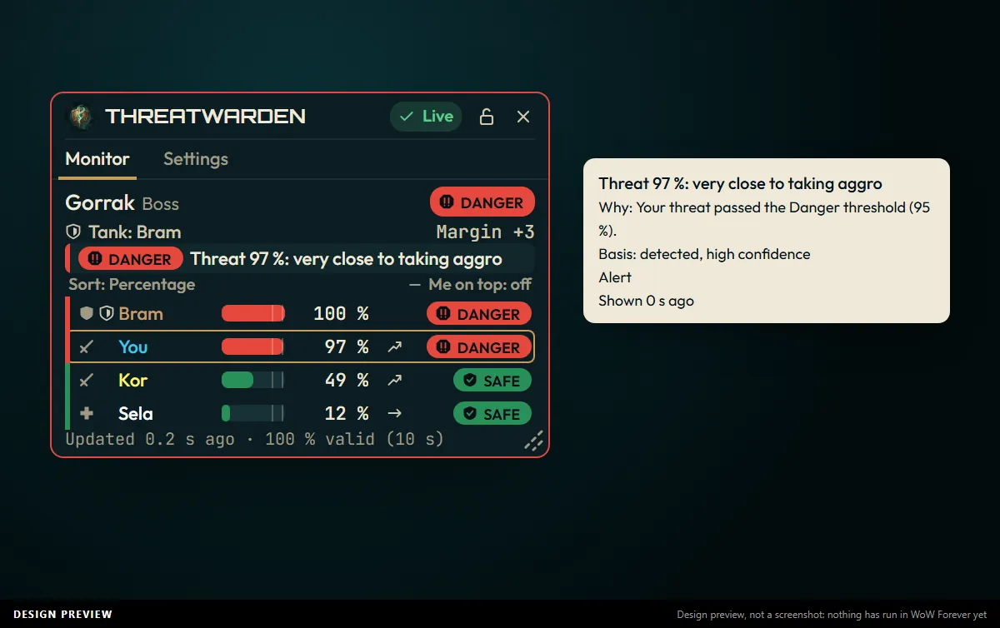
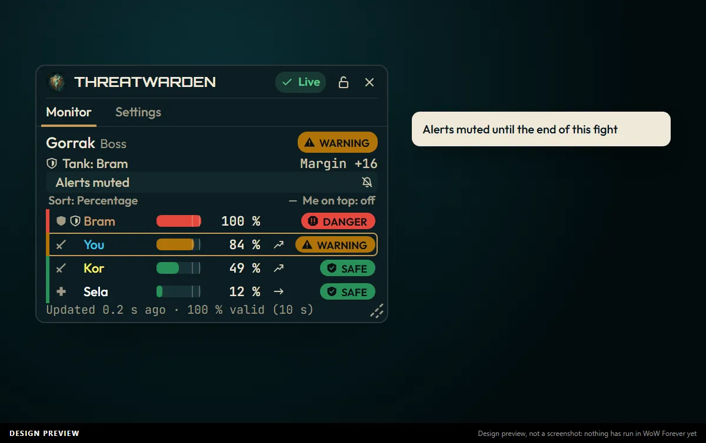
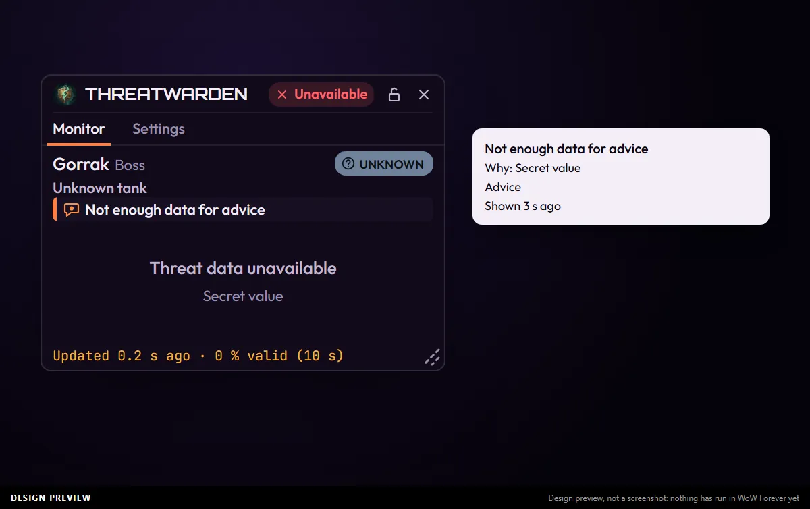
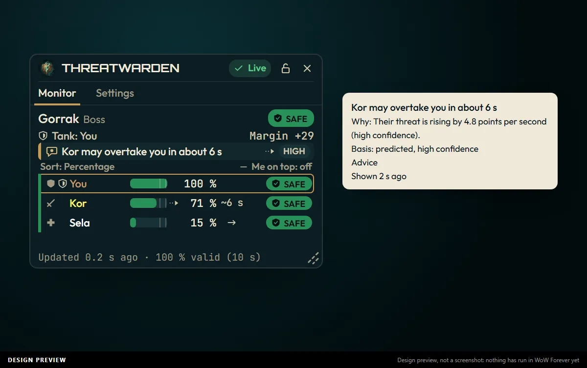

# Alerts and Coach

*Italiano: [[Avvisi e Coach|Alerts-and-Coach-it]]*

> **New in `v0.3.0`, not verified in game.** Which threat data WoW Forever really gives an addon, and whether the
> messages help in a real fight, are still to be checked; the cooldown and the wording are provisional.

A **warning** when a risk begins, and one short **piece of advice** with its reason. Both appear in a strip of the
[[Threat Monitor|Threat-Monitor]] tab, between the header of the enemy and the list. Nothing is ever written in chat,
yours included, and the addon never opens its window to show you an alert.

## The strip

| In the strip | Meaning |
|---|---|
| Orange strip and speech bubble | **advice** from the Coach |
| Coloured strip and a state badge (icon and word) | an **alert**: it stays 4 seconds, then the advice comes back |
| Arrow of dots | the base is a *prediction* |
| *HIGH* / *MEDIUM* | the confidence of an estimate or a prediction |
| Struck bell | the alerts are muted |
| *Advice appears during combat* | out of combat |

An empty strip in combat means there is nothing to advise right now. Hover the strip to read the whole message, **why**
(on which data it rests), its kind (*detected*, *calculated*, *estimated*, *predicted*), its confidence, and since when
it shows. The reason never says what caused anything: the addon cannot know it.

In a very low window the strip stays and the header of the list is hidden to keep the rows.

## Alerts

An alert is raised only when something **begins**: your state rises to Warning or Danger, or the unit holding the enemy
changes. Which ones you get depends on your role: you near or on top of the enemy's threat list, your margin as a tank,
the enemy you lost, your pet taking it, or another player in Danger (by default only when you are the tank). The same
kind of alert about the same unit waits 8 seconds before it comes again.

By default the alert shows in the strip and the **border** of the window takes the colour of its state once, for about
two seconds, without flashing. With the message turned off, the pill at the top shows the state's icon for the same
time, so colour never carries the meaning alone. A **sound** is off by default; when on, it plays only for Danger and
for losing or taking the enemy.

### Muting

- `/atw mute`, or the [key you bind to it](Commands#key-binding), silences every alert **until the end of the current
  fight**; out of combat, until the end of the next one. Again to unmute sooner. A reload also ends it. The Coach is
  not muted: it is text in the strip (turn it off in [Settings](Settings#alerts)).
- **One unit**: right-click its row in the list and choose **Mute alerts about this unit** (again to unmute). It lasts
  until a reload, and no name is saved. Your own row has no such menu.

### The game's own threat warning

World of Warcraft has its own threat warning in the game options. If it is on, you may get two warnings for the same
thing: turn off one of them. The addon never changes the game's setting.

## The Coach

One tip at a time for your role (tank, damage dealer or healer), for example *Threat rising: consider delaying your
burst* or, for a tank, *the second may overtake you*. Every tip has its reason. It never names an ability or a class,
and it says *Not enough data for advice* (with why) when the game does not give enough.

Which threat data WoW Forever gives is still being checked: with *state only* data the messages have no numbers, and
with unreadable data there is nothing to alert about.
