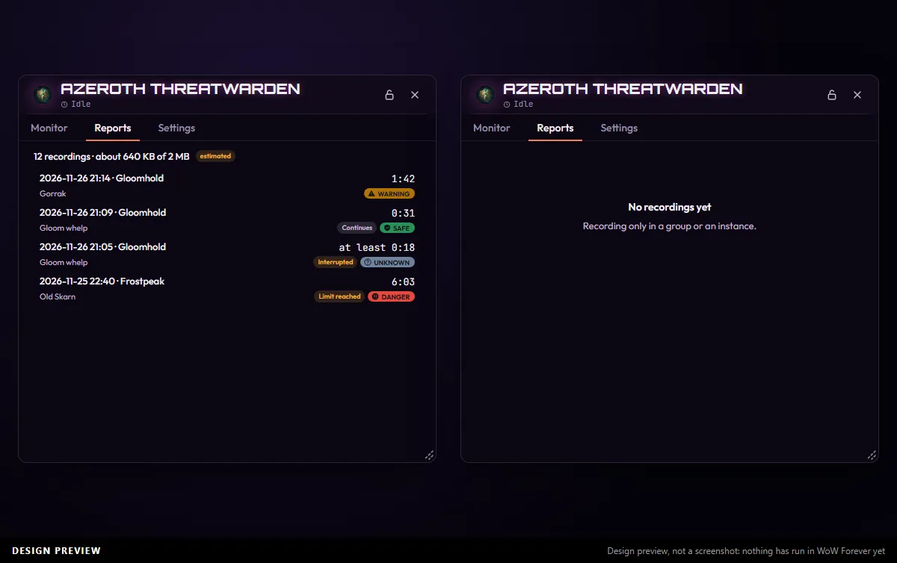
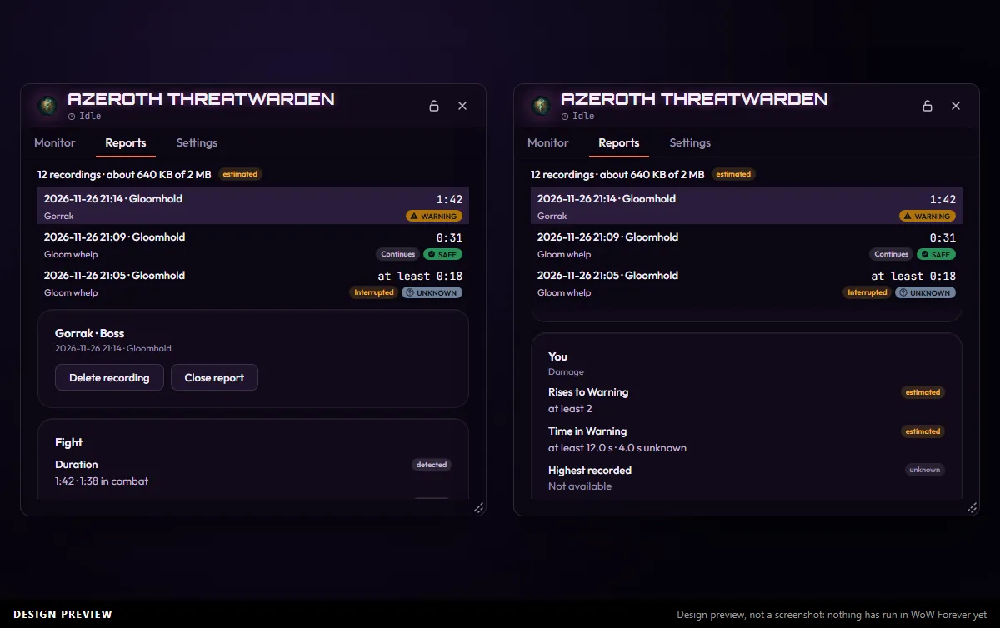
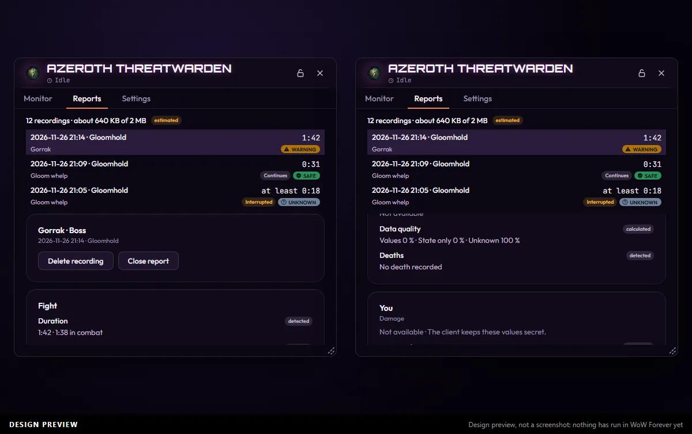
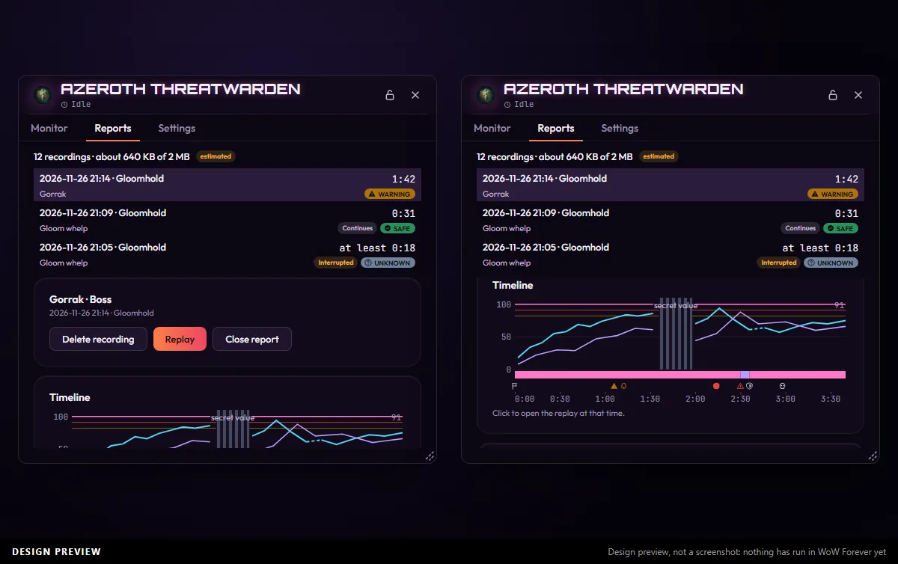

# Report dei combattimenti

*English: [[Combat Reports|Combat-Reports]]*

> **Nuovo nella `v0.4.0`**, non verificato in gioco.

L'addon registra ciò che il monitor ha letto durante uno scontro e ne mostra un breve report, nella scheda **Report**
(`/atw reports`, o un clic su *Apri report* nell'avviso di fine scontro). Tutto resta sul tuo computer. Le
registrazioni contengono i nomi dei compagni ([[Privacy e dati|Privacy-and-Data-it]]).

*Anteprime di progetto, non screenshot: disegnate dal layout e dai testi dell'addon con scontri inventati, perché
l'addon non è ancora stato provato in gioco ([tutte le anteprime](https://github.com/Finland6738/azeroth-threatwarden/blob/main/docs/specs/mockups/previews/README.md)).*

## Che cosa si registra

Di predefinito uno scontro si registra solo **in un gruppo o in un'istanza**; questo, la frequenza e i limiti si
cambiano nella [card Registrazione](Settings-it#registrazione) delle Impostazioni. I pull a meno di 5 secondi l'uno
dall'altro sono una sola registrazione, e uno scontro sotto i 3 secondi non si tiene. La registrazione salva solo ciò
che il monitor ha letto: nulla viene aggiunto dopo.

## L'elenco

La testata dice quante registrazioni ci sono e circa quanto spazio occupano (una stima). La più recente viene prima,
con data e ora, zona, nemico principale, durata e **il tuo stato peggiore**. Distintivi:

| Distintivo | Significato |
|---|---|
| In registrazione | lo scontro è ancora aperto: il report arriva quando finisce |
| Interrotta | un `/reload`, un'uscita o un crash ha fermato la registrazione; la durata dice *almeno* |
| Limite raggiunto | i campioni si fermano prima della fine |
| Continua | segue una registrazione interrotta |

Passa il mouse su una riga per vedere ogni valore con la sua categoria.

## Il report

Un clic apre il report sotto l'elenco. Uno lungo si prepara in più fotogrammi (*Preparazione del report…*), anche in
combattimento. **Chiudi report** torna all'elenco intero. C'è una card **Scontro** (durata, nemico principale, tank
osservati, cambi di tank, perdite dell'aggro, qualità dei dati, morti, avvisi) e una card per ogni membro osservato
(salite e tempo in Attenzione e Pericolo, percentuale massima registrata, prese dell'aggro, qualità dei dati).

Ogni metrica ha un **indicatore di categoria** (*rilevato*, *calcolato*, *stimato* o *sconosciuto*); passando il mouse
si legge che cosa vuol dire la categoria e perché un valore manca:

- **Non disponibile**: il gioco non l'ha mai dato in questo scontro (per esempio le percentuali quando si legge solo lo
  stato).
- **Dati insufficienti**: ce n'era troppo poco.
- **almeno …**: parte del tempo era sconosciuta, quindi il valore è un limite inferiore.

Il report dice cosa è successo e quando; non dice mai perché.

## Timeline e replay

> **Nuovo nella `v0.5.0`**, non verificato in gioco.

Sotto la prima card di un report, la card **Timeline** mostra lo scontro intero: la threat di al più sei membri, chi
teneva il nemico e gli eventi. Un clic apre il [[Replay della threat|Threat-Replay-it]] in quel momento; il pulsante
**Replay** della prima card lo apre dall'inizio. Entrambi sono spenti per lo scontro in registrazione.

## Analytics

> **In arrivo con la `v0.6.0`**, non ancora pubblicata e non verificata in gioco.

Un report avrà anche una card **Analytics**, e la scheda una pagina che confronta gli scontri contro lo stesso nemico:
[[Analytics della threat|Threat-Analytics-it]].

## Eliminare

**Elimina registrazione** chiede un secondo clic entro 8 secondi. L'eliminazione è definitiva e toglie i nomi dai dati
salvati. *Elimina tutte le registrazioni* è nella [card Registrazione](Settings-it#registrazione). La registrazione in
corso non si può eliminare.

## Niente da mostrare

Senza registrazioni la scheda dice perché: *La registrazione è spenta*, *Si registra solo in un gruppo o in
un'istanza* (o *solo in un'istanza*), oppure che i dati salvati sono in sola lettura. Se i dati salvati vengono da una
versione più nuova dell'addon, le registrazioni si vedono ma non si possono cambiare. Una registrazione danneggiata si
mette da parte e si conta; le altre non si toccano.
