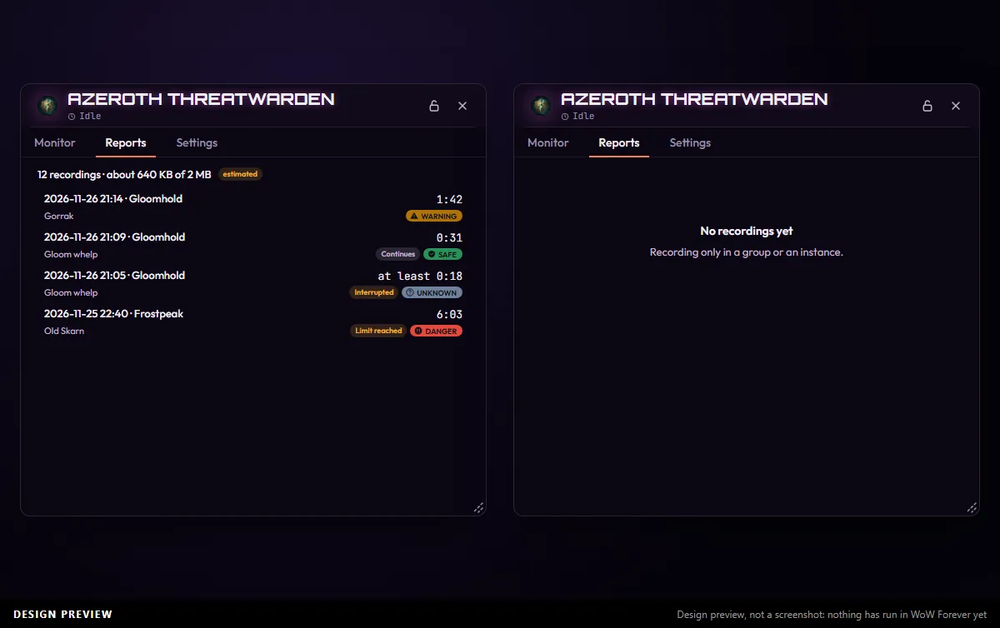
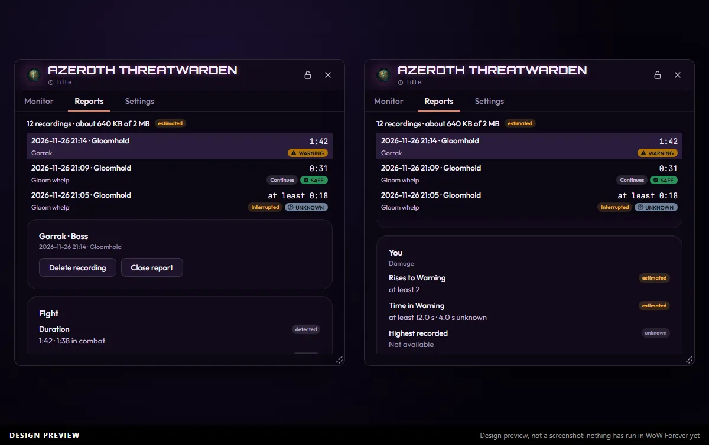
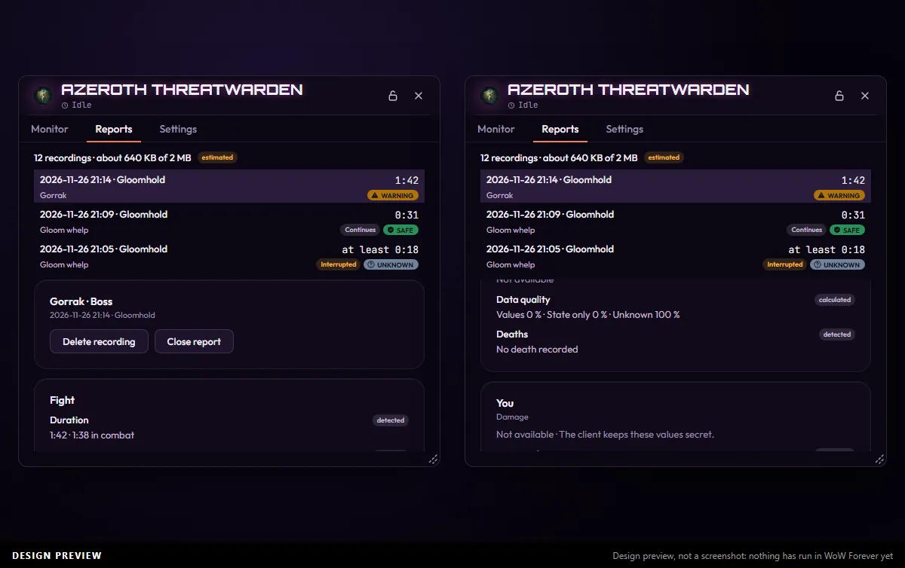
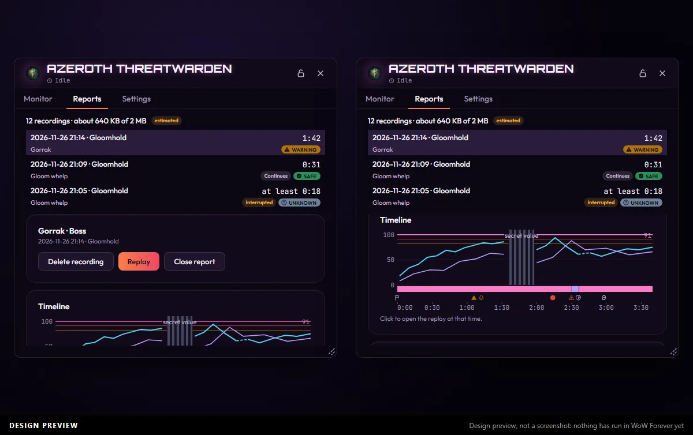

# Combat Reports

*Italiano: [[Report dei combattimenti|Combat-Reports-it]]*

> **New in `v0.4.0`**, not verified in game.

The addon records what the monitor read during a fight and shows a short report of it, in the **Reports** tab
(`/atw reports`, or a click on *Open report* in the notice after a fight). Everything stays on your computer. The
recordings keep the names of your companions ([[Privacy and Data|Privacy-and-Data]]).

*Design previews, not screenshots: drawn from the addon's own layout and texts with invented fights, because the addon
has not been run in the game yet ([all previews](https://github.com/Finland6738/azeroth-threatwarden/blob/main/docs/specs/mockups/previews/README.md)).*

## What gets recorded

By default a fight is recorded only **in a group or an instance**; you can change this, the rate and the limits in the
[Recording card](Settings#recording) of Settings. Pulls less than 5 seconds apart are one recording, and a fight
shorter than 3 seconds is not kept. The recording stores only what the monitor read: nothing is filled in afterwards.

## The list

The header says how many recordings there are and about how much space they take (an estimate). The newest comes
first, with its date and time, zone, main enemy, length and **your worst state**. Badges:

| Badge | Meaning |
|---|---|
| Recording | this fight is still open: its report comes when it ends |
| Interrupted | a `/reload`, a logout or a crash stopped the recording; the length says *at least* |
| Limit reached | the samples stop before the end |
| Continues | it follows an interrupted recording |

Hold the mouse over a row to see each value with its category.

## The report

A click opens the report under the list. A long one is built over a few frames (*Building report…*), in combat too.
**Close report** goes back to the full list. It has a **Fight** card (duration, main enemy, tanks observed, tank
changes, aggro losses, data quality, deaths, alerts) and one card for each member observed (rises to and time in
Warning and Danger, highest percentage recorded, aggro taken, data quality).

Every metric has a **category marker** (*detected*, *calculated*, *estimated* or *unknown*); hold the mouse over it to
see what the category means and why a value is missing:

- **Not available**: the game never gave it during this fight (for example percentages when only the state is
  readable).
- **Insufficient data**: there was too little of it.
- **at least …**: part of the time was unknown, so the value is a lower bound.

The report says what happened and when; it never says why.

## Timeline and replay

> **New in `v0.5.0`**, not verified in game.

Under the first card of a report a **Timeline** card shows the whole fight: the threat of up to six members, who held the
enemy and the events. A click on it opens the [[Threat Replay|Threat-Replay]] at that moment; the **Replay** button of
the first card opens it from the start. Both are off for the fight being recorded.

## Analytics

> **Coming in `v0.6.0`**, not released yet and not verified in game.

A report will also have an **Analytics** card, and the tab a page that compares fights against the same enemy:
[[Threat Analytics|Threat-Analytics]].

## Deleting

**Delete recording** asks for a second click within 8 seconds. Deletion cannot be undone, and it removes the names from
the saved data. *Delete all recordings* is in the [Recording card](Settings#recording). The recording being made
cannot be deleted.

## Nothing to show

With no recordings the tab says why: *Recording is off*, *Recording only in a group or an instance* (or *only in an
instance*), or that your saved data is read-only. If the saved data was written by a newer version of the addon, the
recordings are shown but cannot be changed. A damaged recording is set aside and counted; the others are not touched.
