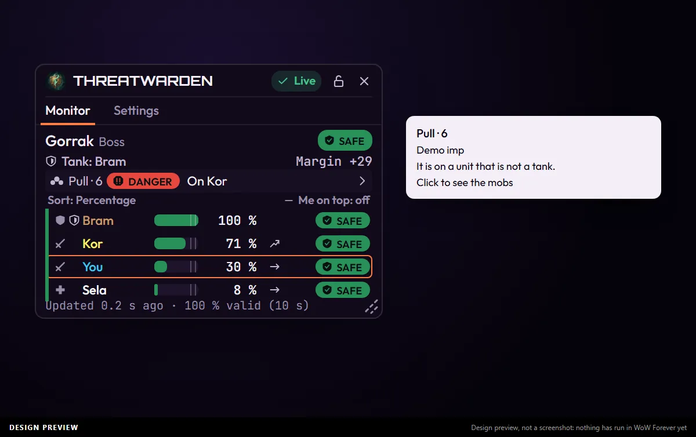
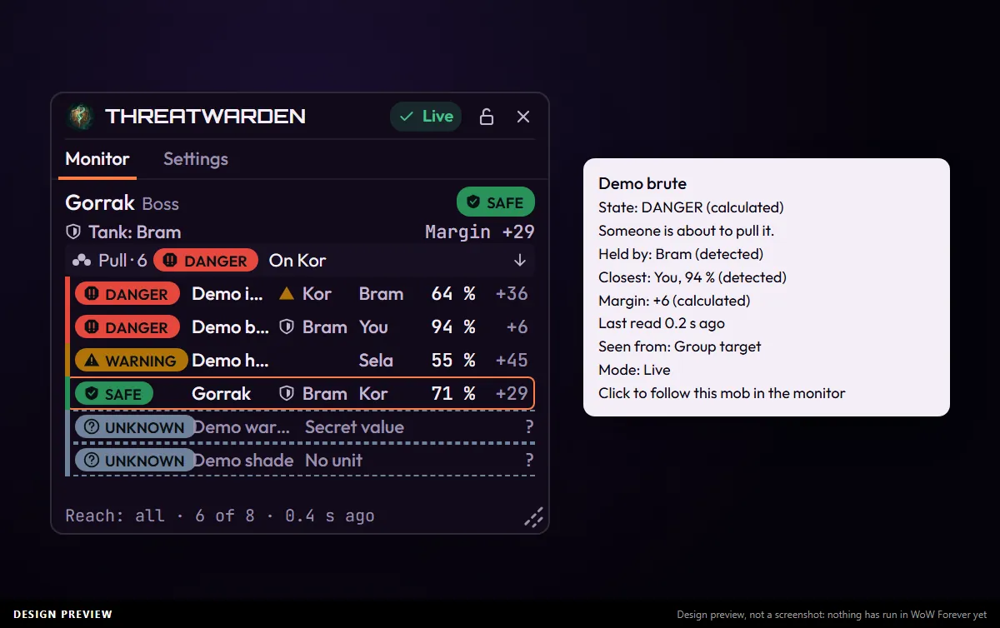

# Dungeon Focus

*English: [[Dungeon Focus|Dungeon-Focus]]*

> **In arrivo nella `v0.7.0`, spento fino ad allora e non verificato in gioco.** Che WoW Forever permetta a un addon di
> leggere la threat di mob diversi dal tuo bersaglio è ancora da verificare (la sonda M0). La vista è fatta per ogni
> risposta: mostra ciò che si può leggere e dice perché quando non si può.

In un pull di un dungeon il **Dungeon Focus** mostra i mob che il gruppo rischia di più di perdere: uno su un DPS o un
guaritore, uno che qualcuno sta per strappare, uno che nessun tank ha preso. Sta nel [Monitor della threat](Threat-Monitor-it)
e mostra soltanto: il monitor continua a seguire un mob solo.

## La barra del pull

Mentre combatti, sotto l'intestazione della scheda Monitor compare una barra quando c'è un mob oltre a quello
monitorato. Dice **Pull · 6** (i mob seguiti, compreso il monitorato), poi lo stato del **mob più a rischio fra gli
altri** con una parola: **Su Kor** (è su qualcuno che non è un tank), **Vicino** (qualcuno sta per strapparlo),
**Senza tank** (nessun tank è nel suo elenco) o **Si avvicina**. Quando tutti gli altri sono al sicuro dice **Tutto al
sicuro**; se alcuni non si leggono dice quanti sono ignoti, e non dice mai *Tutto al sicuro* quando non si può
sapere. Un pull con un solo mob non ha la barra.

**Clicca la barra** (o scrivi `/atw focus`) per vedere l'elenco; clicca di nuovo per tornare all'elenco della threat.

## L'elenco

Una riga per mob, dal più a rischio: **Pericolo** (prima un mob su chi non fa il tank, poi uno che qualcuno sta per
strappare), poi **Attenzione** (senza tank, poi chi si avvicina), **Sicuro**, e i mob **sconosciuti** in fondo.
L'ordine cambia al più una volta al secondo, e subito quando un mob entra in Pericolo. Una riga mostra lo stato, il
nome, chi tiene il mob (uno scudo per un tank, un triangolo di attenzione per chiunque altro), il più vicino fra gli
altri con la sua quota di threat e il margine rimasto. Il mob monitorato ha un anello. Una finestra stretta accorcia o
toglie i nomi, mai lo stato. Se i mob non ci stanno, l'ultima riga dice *+N altri* (i meno a rischio). Il piede dice la
**portata**, i mob seguiti sul limite e l'età dei dati.

Passando il mouse su una riga vedi ogni valore con il suo tipo (*rilevato*, *calcolato*), l'età, dove è stato trovato
il mob (il tuo focus, un boss, una targa, il bersaglio di un compagno) e che cosa fa un clic.

Un mob **sconosciuto** non mostra mai un numero: la riga dice il motivo. *Valore segreto*: il gioco ne nasconde la
threat. *Senza unità ora*: nessuna unità lo indica più (la sua targa è uscita dallo schermo e nessuno lo ha come
bersaglio). *Dato vecchio*: l'ultima lettura è troppo vecchia. *In attesa*: non è ancora stato letto. Gli ultimi
valori, con la loro età, restano solo nel suggerimento.

## Seguire un mob

**Clicca una riga** per **fissare** quel mob: il monitor lo segue, con la sua intestazione e le sue righe, e accanto al
nome compare una puntina. **Il tuo bersaglio nel gioco non cambia**: un addon non può cambiarlo. Il mob si lascia con un
clic sulla puntina (o di nuovo sulla sua riga), quando scegli **un altro nemico** come bersaglio, quando il mob muore o
non si trova più, e alla fine del combattimento. Un mob senza un'identità stabile non si può seguire, e il suggerimento
lo dice.

## Che cosa deve permettere il gioco

I mob si trovano dal tuo focus, dai boss, dai bersagli del gruppo e dalle **targhe dei nemici** (il tasto delle targhe
del gioco le mostra; l'addon non le accende mai). Quando il gioco non permette di leggerne alcuni, la vista si riduce e
dice che cosa può fare, con il motivo nel suggerimento:

| La barra dice | Che cosa significa |
|---|---|
| *Solo focus e boss* | rispondono solo il tuo focus e i boss |
| *Qui si legge solo il tuo bersaglio* | nessun altro mob risponde: funziona solo il monitor |
| *Qui la threat non si legge* | nemmeno il tuo bersaglio si può leggere |

Quale di questi casi capiti dipende dalle risposte della sonda M0: quali fonti rispondono, se nelle istanze l'identità
dei mob è nascosta, se la loro threat è segreta. Finché non è eseguita, nulla qui è verificato in gioco. Il Dungeon
Focus **mostra soltanto**: nulla viene salvato o registrato, e si seguono al più 8 mob insieme.

## Impostazioni e demo

La [card Dungeon Focus](Settings-it#dungeon-focus) delle Impostazioni lo spegne e stabilisce quanti mob seguire e se
usare le targhe. La [modalità demo](Threat-Monitor-it#modalità-demo) (`/atw demo`) aggiunge accanto al golem della demo
un pull inventato di cinque mob, per vedere la barra e l'elenco senza un combattimento; lì un mob non si può fissare.

*Anteprime di progetto, non screenshot: disegnate con la disposizione e i testi dell'addon, con mob inventati, perché l'addon non è ancora stato provato nel gioco ([tutte le anteprime](https://github.com/Finland6738/azeroth-threatwarden/blob/main/docs/specs/mockups/previews/README.md)).*
