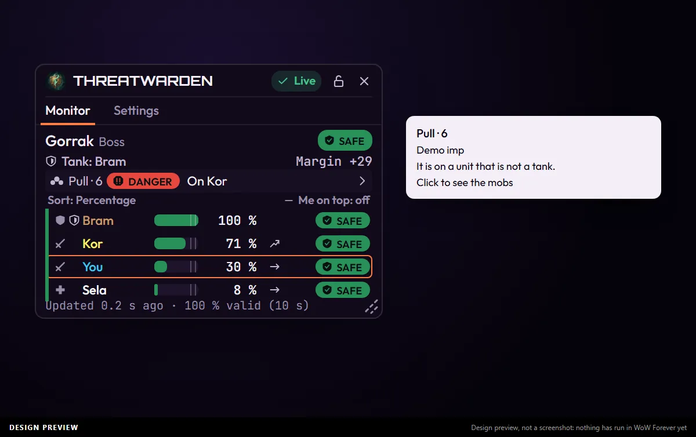
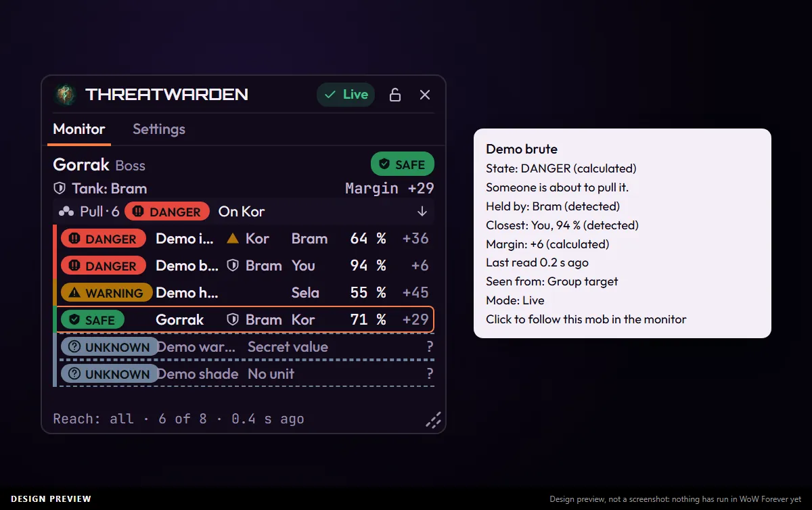

# Dungeon Focus

*Italiano: [[Dungeon Focus|Dungeon-Focus-it]]*

> **New in `v0.7.0`, not verified in game.** Whether WoW Forever lets an addon read the
> threat of mobs other than your target is still to be checked (the M0 probe). The view is made for every answer: it
> shows what can be read and says why when it cannot.

In a dungeon pull the **Dungeon Focus** shows the mobs your group is closest to losing: one on a damage dealer or a
healer, one about to be pulled, one no tank has picked up. It sits in the [Threat Monitor](Threat-Monitor), and only
shows: the monitor keeps following one mob.

## The pull bar

While you fight, a bar appears under the header of the Monitor tab when there is a mob besides the one you monitor. It
says **Pull · 6** (the mobs followed, the monitored one included), then the state of the **riskiest other mob** with a
word: **On Kor** (it is on someone who is not a tank), **Close** (someone is about to pull it), **No tank** (no tank
is on its threat list) or **Getting close**. When every other mob is safe it says **All safe**; if some cannot be read
it says how many are unknown, and never *All safe* when that cannot be known. A pull with a single mob has no bar.

**Click the bar** (or type `/atw focus`) to see the list; click again to go back to the threat list.

## The list

One line per mob, from the riskiest: **Danger** (a mob on a non-tank first, then one about to be pulled), then
**Warning** (no tank, then getting close), **Safe**, and the **unknown** ones last. The order changes at most once a
second, and at once when a mob enters Danger. A line shows the state, the name, who holds the mob (a shield for a tank,
a warning triangle for anyone else), the closest of the others with their share of threat and the margin left. The
monitored mob has a ring. A narrow window shortens or drops names, never the state. If the mobs do not fit, the last
line says *+N more* (the least risky ones). The footer says the **reach**, the mobs followed out of the limit and how
old the data is.

Hover a line to see every value with its kind (*detected*, *calculated*), the age, where the mob was found (your focus,
a boss, a nameplate, a group member's target) and what a click does.

An **unknown** mob never shows a number: its line says why. *Secret value*: the game hides its threat. *No unit*: no
unit names it any more (its nameplate left the screen and nobody targets it). *Stale*: the last reading is too old.
*Waiting*: not read yet. The last values, with their age, stay in the tooltip only.

## Following a mob

**Click a line** to **pin** that mob: the monitor follows it, with its header and rows, and a pin appears next to its
name. **Your target in the game does not change**: an addon cannot change it. The pin is released when you click the pin
(or the mob's line again), when you pick **another enemy** as your target, when the mob dies or can no longer be
found, and at the end of the fight. A mob without a stable identity cannot be followed, and its tooltip says so.

## What the game must allow

The mobs are found through your focus, the bosses, your group's targets and the **enemy nameplates** (the game's
nameplate key shows them; the addon never turns them on). When the game does not let an addon read some of them, the
view reduces itself and says what it can do, with the reason in the tooltip:

| The bar says | What it means |
|---|---|
| *Focus and boss only* | only your focus and the bosses answer |
| *Only your target can be read here* | no other mob answers: only the monitor works |
| *Threat cannot be read here* | not even your target can be read |

Which of these happens depends on the answers of the M0 probe: which sources reply at all, whether the identity of mobs
is hidden in instances, whether their threat is secret. Until it is run, nothing here is verified in the game. The
Dungeon Focus is **only shown**: nothing of it is saved or recorded, and at most 8 mobs are followed at once.

## Alerts

The bar is enough to see the other mobs, so by default the [alerts](Alerts-and-Coach) speak only about the monitored
one. Turn on **Alerts about other mobs** in the [Alerts card](Settings#alerts) to be warned when another mob goes onto
someone who is not a tank, when someone is about to pull one, when no tank has picked one up, or when your own threat on
one is very high: see [Alerts about other mobs](Alerts-and-Coach#alerts-about-other-mobs).

## Settings and demo

The [Dungeon Focus card](Settings#dungeon-focus) of Settings turns it off, sets how many mobs are followed and whether
nameplates are used. [Demo mode](Threat-Monitor#demo-mode) (`/atw demo`) adds an invented pull of five mobs beside the
demo golem, to see the bar and the list without a fight; a mob cannot be pinned there.

*Design previews, not screenshots: drawn from the addon's own layout and texts, with invented mobs, because the addon has not been run in the game yet ([all previews](https://github.com/Finland6738/azeroth-threatwarden/blob/main/docs/specs/mockups/previews/README.md)).*
