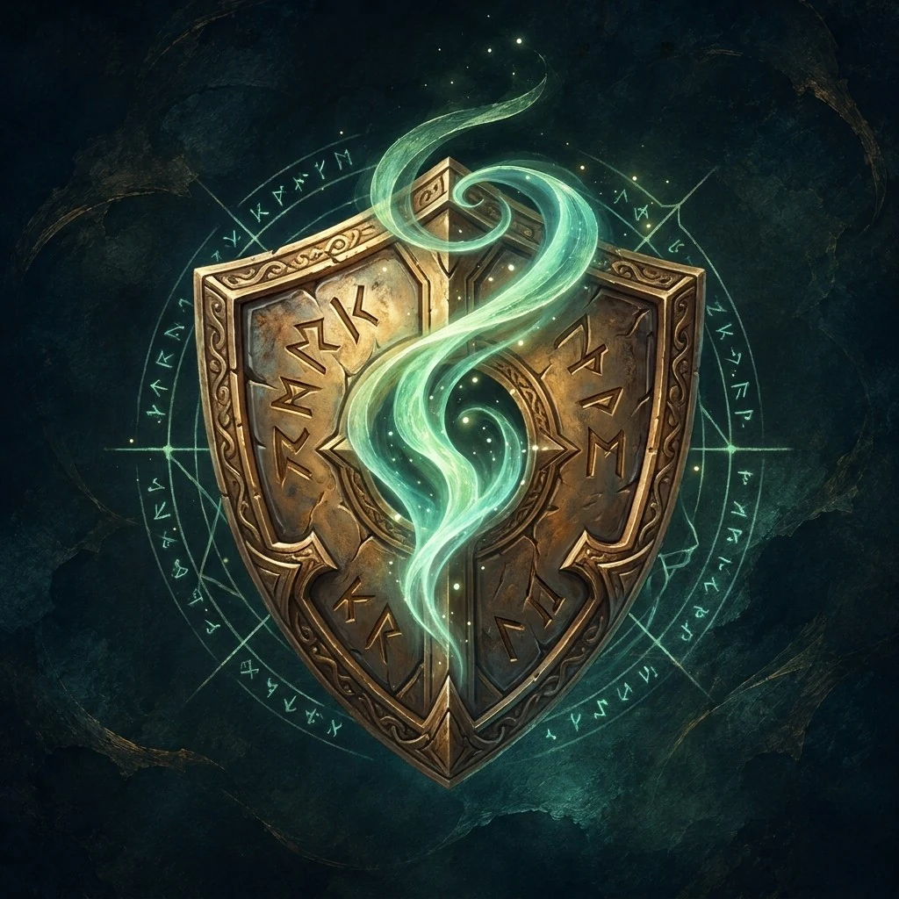

# Azeroth Threatwarden

*English: [[Home|Home]]*

**Conosci la tua threat. Capisci i tuoi errori. Non perdere l'aggro.** Azeroth Threatwarden è un addon di monitoraggio
della threat, di coaching e di analisi dei combattimenti per World of Warcraft: Forever.

> **Stato: sviluppo iniziale, ancora nulla da installare.** Per ora l'addon ha solo la finestra, i comandi e il pulsante della minimappa: non legge ancora la threat. Il primo passo verifica nel client vero quali dati di threat
> il gioco dà a un addon. La prima versione, `v0.1.0`, arriva dopo la milestone M1; l'MVP (monitor della threat,
> avvisi, Coach, registrazione e report di combattimento) è la `v0.4.0`. Questo manuale cresce a ogni versione.

## Cosa farà

- **Threat Monitor**: la threat di ogni membro del gruppo sul tuo target, il tank, quanto manca a ciascuno per prendere
  l'aggro, e uno stato: *Safe*, *Warning*, *Danger* o *Unknown*.
- **Avvisi e Coach**: un avviso prima di superare il tank, e brevi consigli con il loro motivo.
- **Combat Report, Timeline e Replay**: ogni combattimento registrato mentre accade, da rivedere dopo.
- **Dati onesti**: l'addon dice sempre se un numero è letto dal gioco, calcolato, stimato o previsto, e mostra
  *Unknown* invece di indovinare.

## Da dove cominciare

| Voglio… | Leggi |
|---|---|
| Sapere cosa posso scrivere e cosa fa la finestra | [[Comandi|Commands-it]] |
| Sapere cosa conserva l'addon e dove | [[Privacy e dati|Privacy-and-Data-it]] |
| Segnalare un problema o proporre un'idea | [[Segnalare bug e dare feedback|Reporting-Bugs-and-Feedback-it]] |
