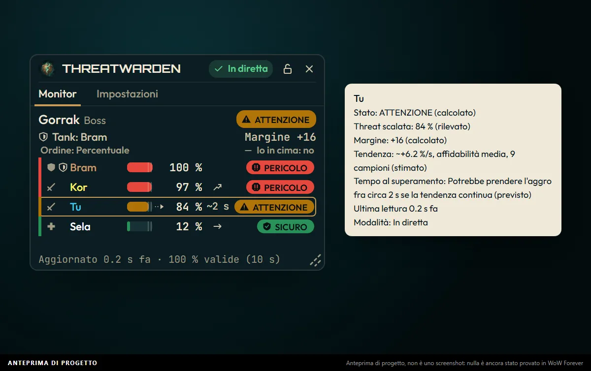

# Installazione

*English: [[Installation|Installation]]*

> **La `v0.2.0` è la seconda versione di prova: porta il [[monitor della threat|Threat-Monitor-it]].** Non è ancora
> stata verificata nel client vero.

## Da una versione pubblicata

1. Scarica lo zip dell'ultima versione (`AzerothThreatwarden-….zip`, non gli archivi *Source code*) da
   [GitHub Releases](https://github.com/Finland6738/azeroth-threatwarden/releases).
2. Estrai la cartella `AzerothThreatwarden` in `<WoW folder>/_forever_/Interface/AddOns/`.
3. Avvia il gioco; nella schermata del personaggio apri *AddOns* e controlla che Azeroth Threatwarden sia attivo.
4. In gioco scrivi `/atw`. Al primo accesso la finestra si apre da sola.

## Dal codice sorgente (per chi prova)

1. Copia `tools/local.example.ini` in `tools/local.ini` e scrivici il percorso della tua cartella AddOns.
2. Nella cartella del repository esegui:

```
python -I -X utf8 tools/fetch_libs.py
python -I -X utf8 tools/install_addon.py
```

3. In gioco, `/reload`.

## Aggiornare e rimuovere

Per aggiornare, sostituisci la cartella con quella nuova: le impostazioni restano nelle variabili salvate del gioco e,
se serve, vengono migrate ([[Privacy e dati|Privacy-and-Data-it]]). Per rimuovere l'addon, cancella la cartella
`AzerothThreatwarden`.

## Lingua

Inglese di base, italiano in un client italiano (`itIT`). La lingua si può scegliere nelle [[Impostazioni|Settings-it]].




*Anteprime di progetto, non screenshot: disegnate dal layout e dai testi dell'addon, perché l'addon non è ancora stato provato in gioco ([tutte le anteprime](https://github.com/Finland6738/azeroth-threatwarden/blob/main/docs/specs/mockups/previews/README.md)).*
