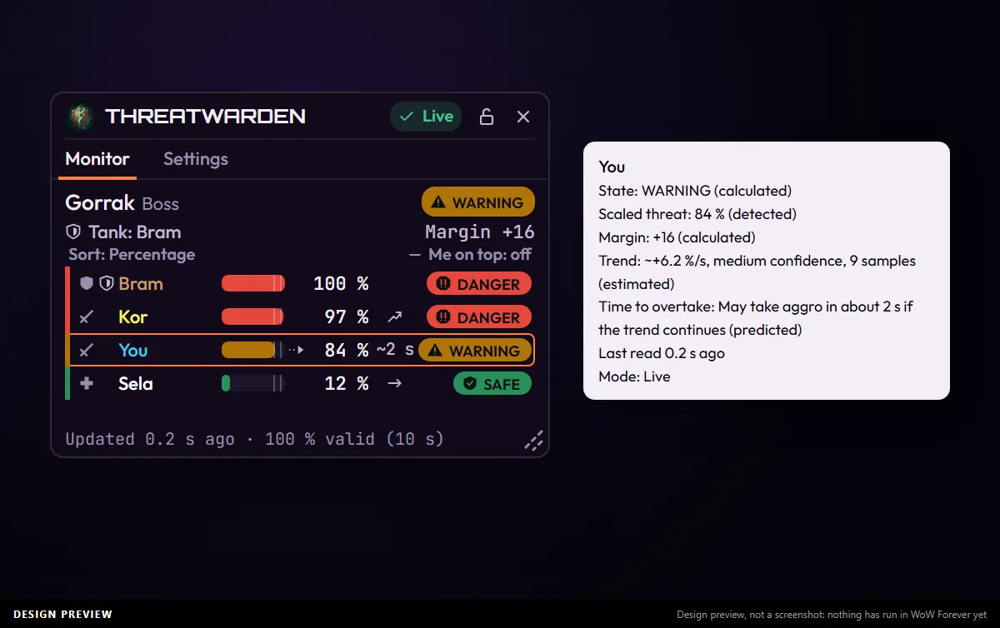
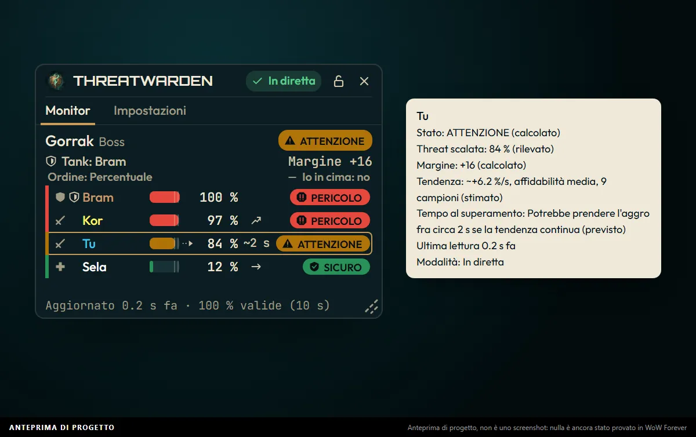

# Installation

*Italiano: [[Installazione|Installation-it]]*

> **`v0.4.0` is the fourth test version: it adds [[Combat Reports|Combat-Reports]] to the
> [[Threat Monitor|Threat-Monitor]] and [[Alerts and Coach|Alerts-and-Coach]].** It has not been checked in the real
> client yet.

## From a release

1. Download the zip of the latest release (`AzerothThreatwarden-….zip`, not the *Source code* archives) from
   [GitHub Releases](https://github.com/Finland6738/azeroth-threatwarden/releases).
2. Extract the `AzerothThreatwarden` folder into `<WoW folder>/_forever_/Interface/AddOns/`.
3. Start the game; at the character screen, open *AddOns* and check that Azeroth Threatwarden is enabled.
4. In game, type `/atw`. The window also opens by itself the first time you log in.

## From the source code (testers)

1. Copy `tools/local.example.ini` to `tools/local.ini` and write the path of your AddOns folder in it.
2. In the folder of the repository, run:

```
python -I -X utf8 tools/fetch_libs.py
python -I -X utf8 tools/install_addon.py
```

3. In game, `/reload`.

## Updating and removing

To update, replace the folder with the new one: your settings are kept in the game's saved variables and are migrated
if needed ([[Privacy and Data|Privacy-and-Data]]). To remove the addon, delete the `AzerothThreatwarden` folder.

## Language

English by default, Italian in an Italian client (`itIT`). You can choose the language in [[Settings|Settings]].





*Design previews, not screenshots: drawn from the addon's own layout and texts, because the addon has not been run in the game yet ([all previews](https://github.com/Finland6738/azeroth-threatwarden/blob/main/docs/specs/mockups/previews/README.md)).*
