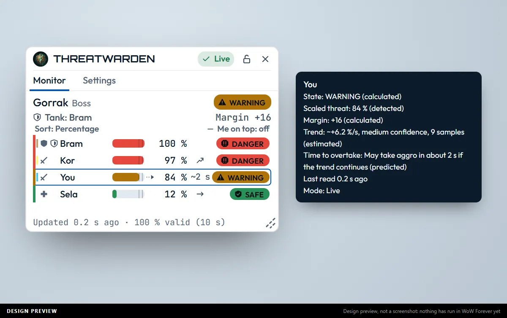
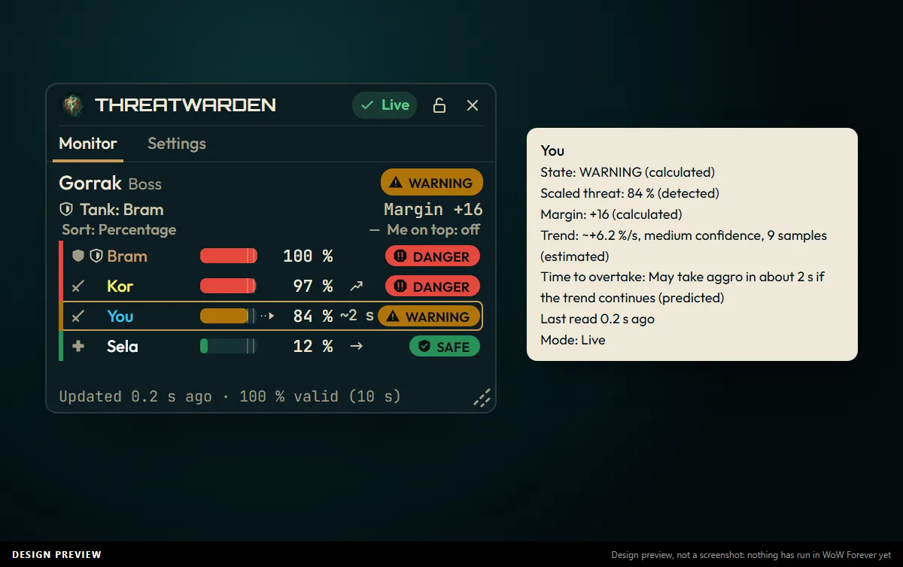
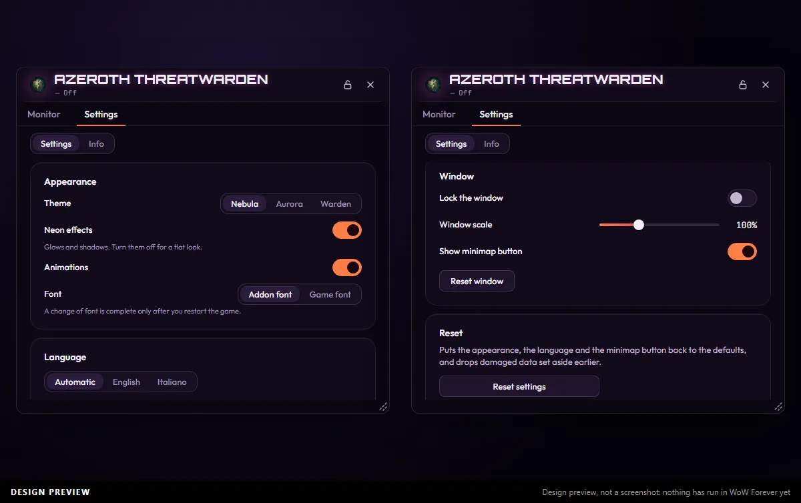
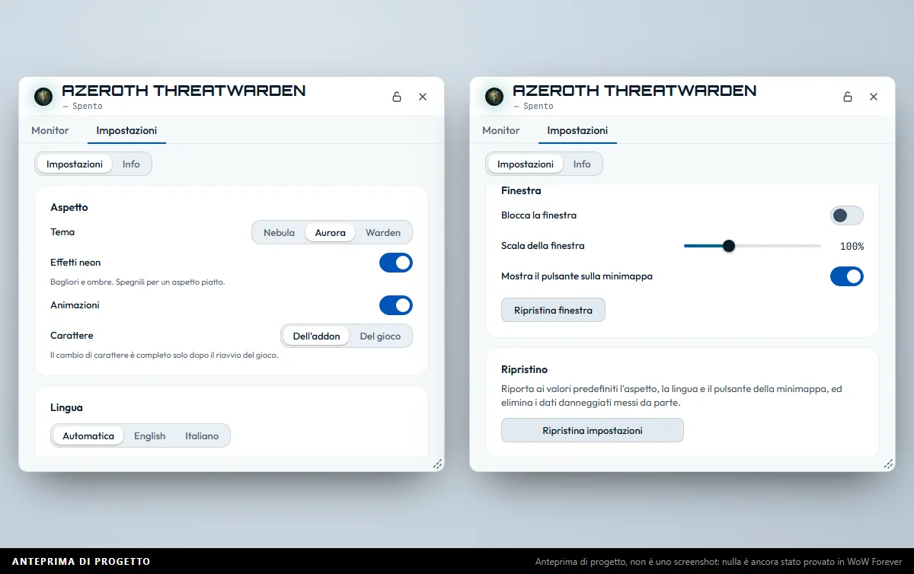

# Giro dell'interfaccia

*English: [[Interface tour|Interface-Tour]]*

Ciò che l'addon mostra oggi.

## La finestra

Si apre con `/atw`, con il pulsante della minimappa o dall'Addon Compartment. La **barra del titolo** ha il logo, lo
stato del [[monitor della threat|Threat-Monitor-it]] (*In attesa*, *In diretta*, *Solo stato*, *Non disponibile* o *Demo*), il lucchetto e la chiusura. La finestra si sposta dalla
barra del titolo e si ridimensiona dall'angolo tratteggiato; la pagina [[Comandi|Commands-it]] elenca i comandi.

La scheda **Monitor** è piccola, per stare sopra il gioco:

## Impostazioni e Info

La scheda **Impostazioni** è più grande e ha due pagine, scelte con le pillole in cima: [[Impostazioni|Settings-it]] e
[[Info|About-it]]. Si scorre con la rotella del mouse.

L'interfaccia è in inglese o in italiano:

*Anteprime di progetto, non screenshot: disegnate dal layout e dai testi dell'addon, perché l'addon non è ancora stato provato in gioco ([tutte le anteprime](https://github.com/Finland6738/azeroth-threatwarden/blob/main/docs/specs/mockups/previews/README.md)).*
