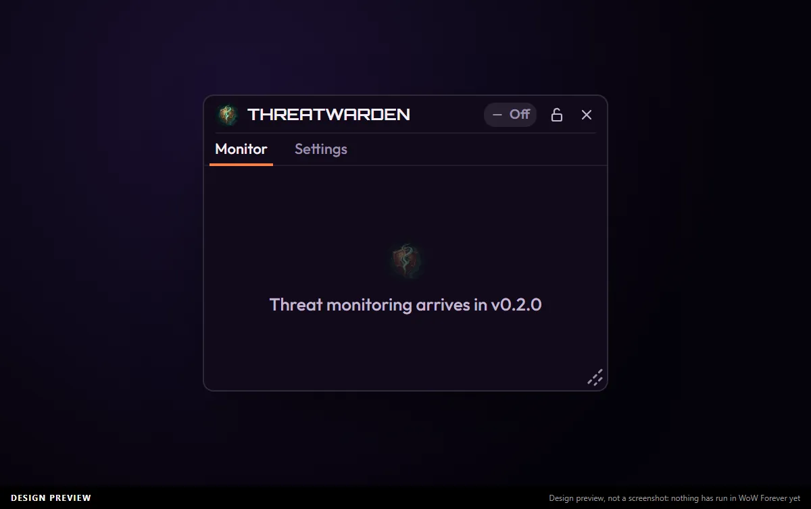
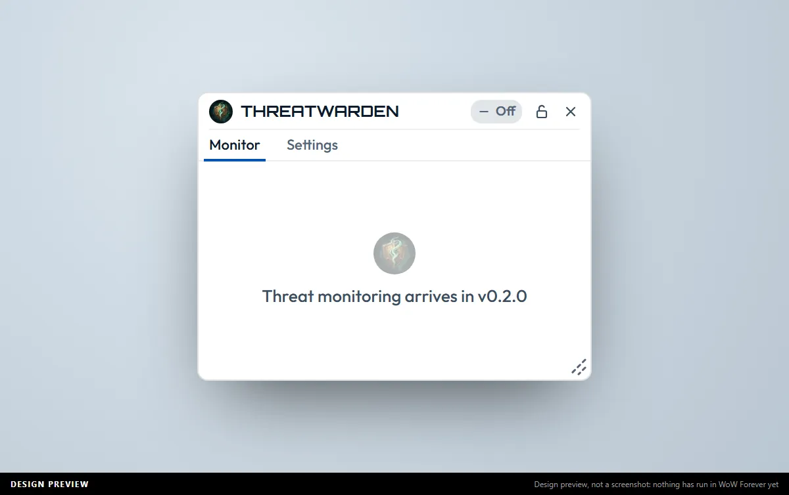
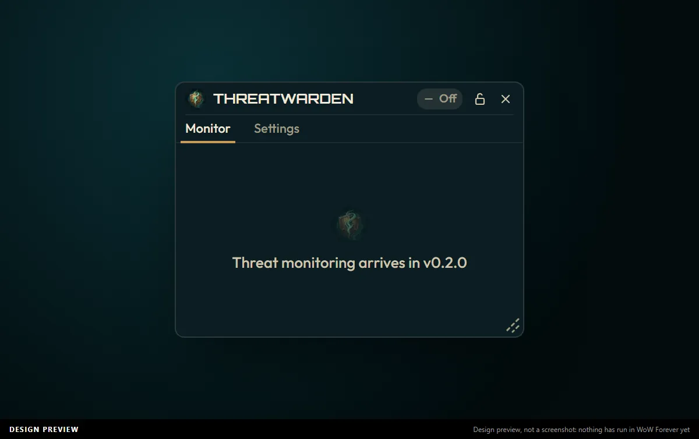
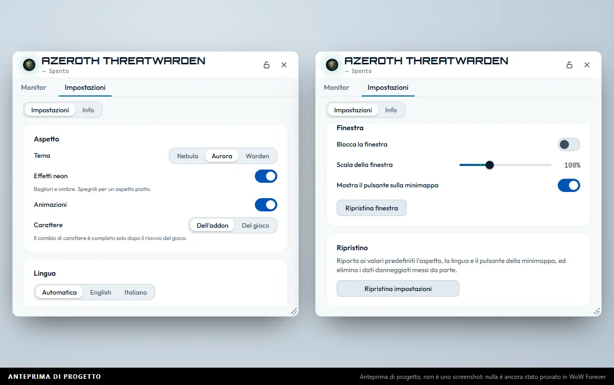

# Interface tour

*Italiano: [[Giro dell'interfaccia|Interface-Tour-it]]*

What the addon shows today. The threat monitor itself arrives in `v0.2.0`.

## The window

Open it with `/atw`, the minimap button or the Addon Compartment. The **title bar** has the logo, the state of the
threat monitor (*Off* in this version), the lock and the close button. Move the window by its title bar and resize it
from the dashed corner; the [[Commands|Commands]] page lists the commands.

The **Monitor** tab is small, to sit over the game:

## Settings and Info

The **Settings** tab is larger and has two pages, chosen with the pills at its top: [[Settings|Settings]] and
[[Info|About]]. Scroll with the mouse wheel.

The interface is in English or Italian:

*Design previews, not screenshots: drawn from the addon's own layout and texts, because the addon has not been run in the game yet ([all previews](https://github.com/Finland6738/azeroth-threatwarden/blob/main/docs/specs/mockups/previews/README.md)).*
