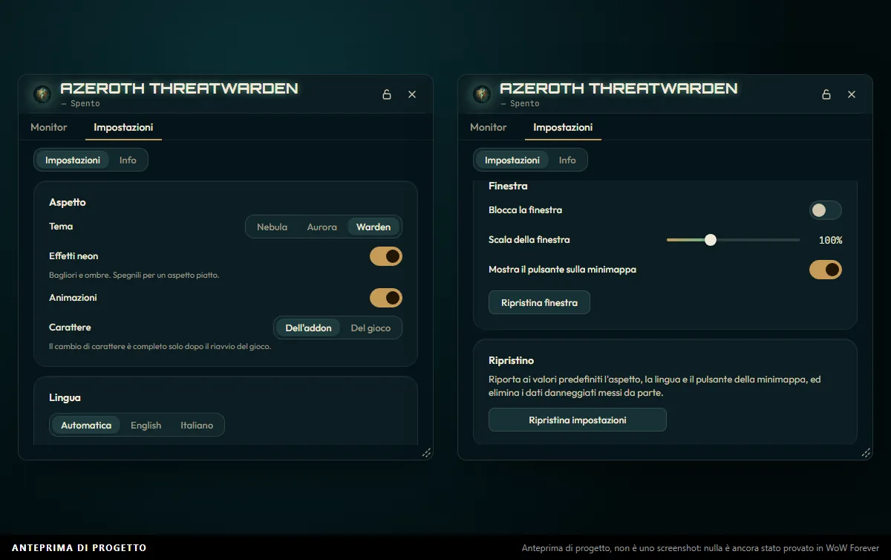
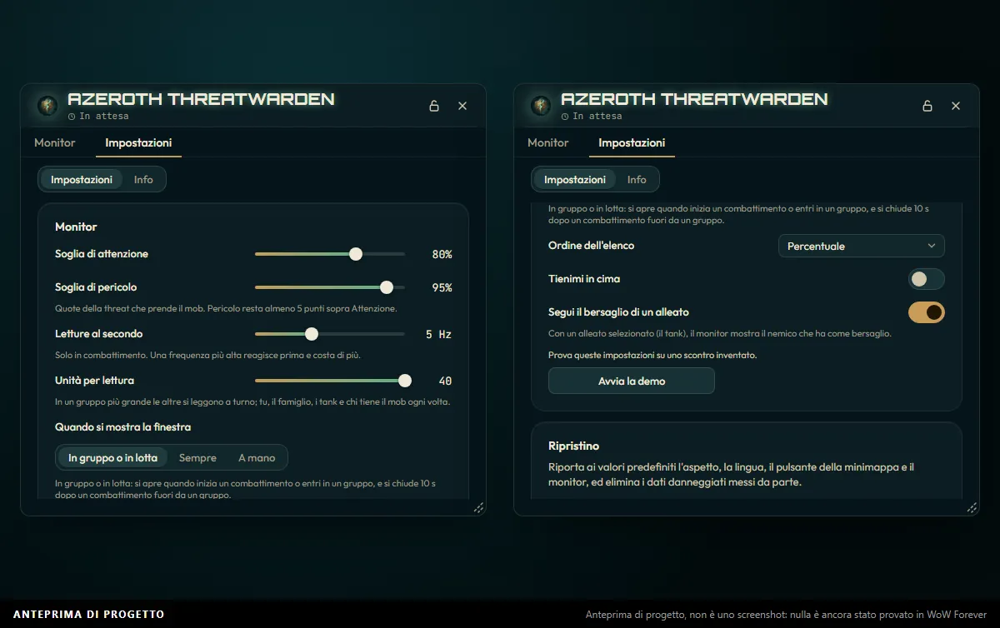
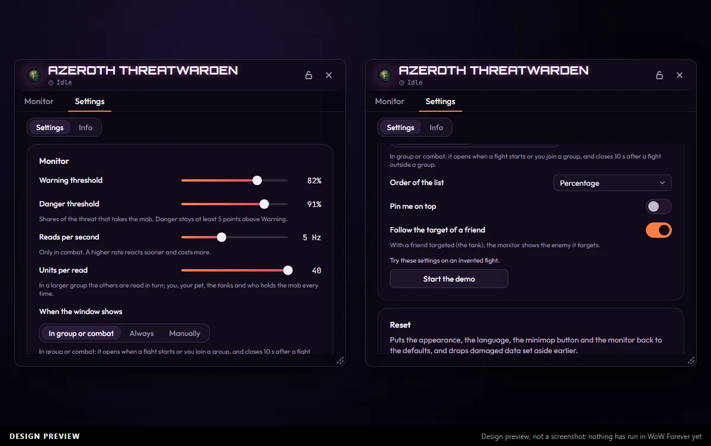
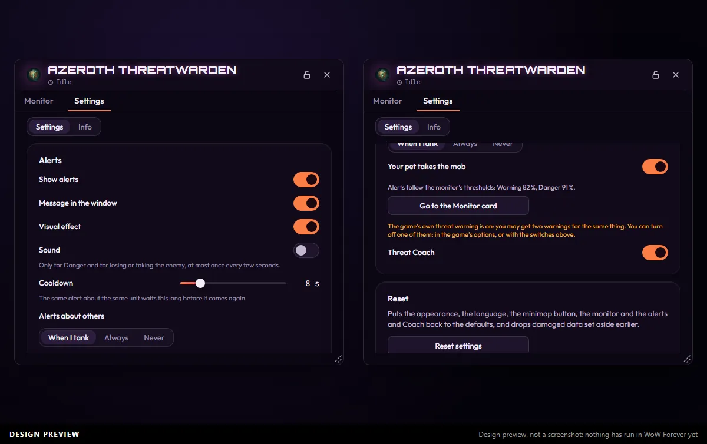
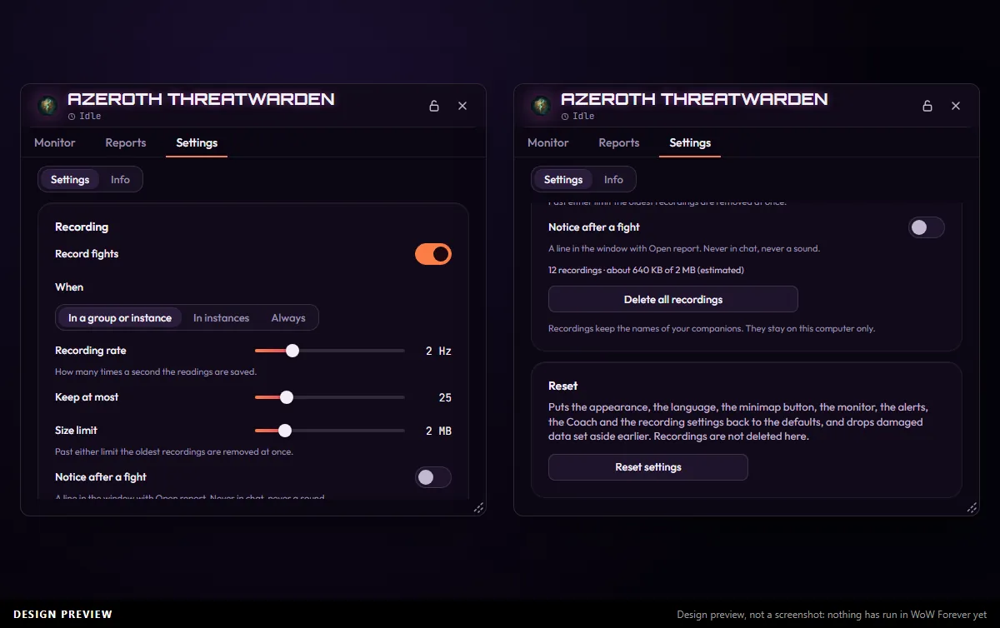

# Impostazioni

*English: [[Settings|Settings]]*

Si aprono con `/atw settings`, con un clic destro sul pulsante della minimappa o dalla scheda **Impostazioni** della
finestra. La stessa pagina è nella finestra delle impostazioni del gioco, in *Opzioni → AddOns → Azeroth
Threatwarden*, se il tuo client lo permette. Una modifica fatta in un posto si vede nell'altro, e ogni modifica viene
salvata subito. Si applica **subito**, tranne il carattere (completo dopo il riavvio del gioco) e la lingua (dopo aver
ricaricato l'interfaccia). La pagina si scorre con la rotella del mouse.

*Anteprime di progetto, non screenshot: disegnate dal layout e dai testi dell'addon, perché l'addon non è ancora stato provato in gioco ([tutte le anteprime](https://github.com/Finland6738/azeroth-threatwarden/blob/main/docs/specs/mockups/previews/README.md)).*

## Aspetto

Salvato per tutto l'account.

| Opzione | Scelte | Predefinito |
|---|---|---|
| Tema | **Nebula** (scuro, viola e arancio), **Aurora** (chiaro, blu e verde acqua), **Warden** (scuro, dai colori del logo) | Nebula |
| Effetti neon | sì / no: bagliori e ombre; spenti danno un aspetto piatto | sì |
| Animazioni | sì / no: dissolvenze e scorrimenti; spente rendono ogni cambio immediato | sì |
| Carattere | **Dell'addon** (Orbitron, Outfit, JetBrains Mono) o **Del gioco** | Dell'addon |

Il cambio di **carattere** è completo solo dopo il **riavvio del gioco**: il gioco legge i nuovi file dei caratteri
solo quando parte. I colori degli stati della threat non cambiano con il tema.

## Lingua

**Automatica** (segue la lingua del gioco: inglese, o italiano in un client italiano), **English** o **Italiano**. Il
cambio vale dopo aver ricaricato l'interfaccia: premi **Ricarica ora** (è attivo solo se la scelta è diversa dalla
lingua a schermo) o scrivi `/reload`.

## Finestra

Salvata per personaggio, tranne il pulsante della minimappa (tutto l'account).

| Opzione | Cosa fa | Predefinito |
|---|---|---|
| Blocca la finestra | la finestra non si sposta né si ridimensiona (anche il lucchetto nella barra del titolo, `/atw lock`) | no |
| Scala della finestra | dal 50 % al 200 %, a passi del 5 %; si applica quando rilasci il cursore | 100 % |
| Mostra il pulsante sulla minimappa | mostra o nasconde il pulsante | sì |
| Ripristina finestra | posizione, dimensioni e scala predefinite, finestra al centro (come `/atw reset`) | — |

## Monitor

Salvato per tutto l'account. Ogni modifica si applica subito, anche a una
[demo](Threat-Monitor-it#modalità-demo) o a un combattimento in corso.

| Opzione | Cosa fa | Scelte | Predefinito |
|---|---|---|---|
| Soglia di attenzione | da questa quota della threat che prende il nemico una riga dice **Attenzione** | dal 50 % al 95 % | 82 % |
| Soglia di pericolo | da questa quota, **Pericolo** | dal 60 % al 100 % | 91 % |
| Letture al secondo | ogni quanto si legge la threat in combattimento: una frequenza più alta reagisce prima e costa di più | da 2 a 10 Hz | 5 Hz |
| Unità per lettura | quante unità si leggono ogni volta; in un gruppo più grande le altre si leggono a turno (tu, il famiglio, i tank e chi tiene il nemico ogni volta) | da 5 a 40 | 40 |
| Quando si mostra la finestra | vedi sotto | In gruppo o in lotta, Sempre, A mano | In gruppo o in lotta |
| Ordine dell'elenco | *Percentuale*, *Threat assoluta*, *Rischio*, *Variazione recente* (anche il pulsante **Ordine** dell'elenco) | | Percentuale |
| Tienimi in cima | la tua riga viene per prima (anche **Io in cima** nell'elenco) | sì / no | no |
| Segui il bersaglio di un alleato | con un alleato selezionato (il tank), il monitor mostra il nemico che ha come bersaglio | sì / no | sì |
| Avvia la demo | uno scontro inventato, per provare queste impostazioni ([modalità demo](Threat-Monitor-it#modalità-demo)) | pulsante | |

Pericolo resta almeno 5 punti sopra Attenzione: spostando un cursore l'altro si sposta di conseguenza. Soglie,
frequenza e numero di unità sono provvisori finché non vengono tarati in gioco.

**Quando si mostra la finestra:**

- **In gruppo o in lotta**: la finestra si apre da sola, sulla scheda Monitor, quando inizia un combattimento e quando
  entri in un gruppo. Fuori da un gruppo si chiude da sola 10 secondi dopo un combattimento, salvo che tu l'abbia
  riaperta o sia passato a un'altra scheda. Se la chiudi durante un combattimento, resta chiusa fino al successivo. Al
  login è come l'hai lasciata (e aperta se sei in un gruppo).
- **Sempre**: si mostra a ogni accesso e a ogni ricarica; la chiudi solo tu.
- **A mano**: resta aperta o chiusa come la lasci.

Le aperture e chiusure automatiche non cambiano mai la tua scelta a mano.

## Dungeon Focus

> **In arrivo nella `v0.7.0`**: la card compare con lei. Non verificata in gioco.

Salvata per tutto l'account, sotto *Monitor*. Che cosa mostra è in [[Dungeon Focus|Dungeon-Focus-it]].

| Opzione | Cosa fa | Scelte | Predefinito |
|---|---|---|---|
| Segui gli altri mob | la barra del pull e l'elenco degli altri mob, in combattimento; spento, di loro non si legge nulla | sì / no | sì |
| Mob seguiti | quanti mob insieme, compreso quello monitorato; si salva quando rilasci il cursore | da 2 a 12 | 8 |
| Usa le targhe dei nemici | trova i mob dalle targhe dei nemici; le mostra solo mentre le targhe dei nemici del gioco sono attive | sì / no | sì |

## Avvisi

> **Nuova nella `v0.3.0`**, non verificata in gioco.

Salvata per tutto l'account, sotto *Monitor*. Che cosa sono gli avvisi è in [[Avvisi e Coach|Alerts-and-Coach-it]].
Ogni modifica si applica subito.

| Opzione | Cosa fa | Scelte | Predefinito |
|---|---|---|---|
| Mostra gli avvisi | tutti gli avvisi accesi o spenti; spenti, i tre canali sotto restano visibili ma inattivi | sì / no | sì |
| Messaggio nella finestra | l'avviso compare nella striscia della scheda Monitor | sì / no | sì |
| Effetto visivo | il bordo della finestra prende una volta il colore dello stato | sì / no | sì |
| Suono | un suono del gioco, solo per il Pericolo e quando perdi o prendi il nemico | sì / no | no |
| Attesa tra avvisi | quanto aspetta lo stesso avviso sulla stessa unità prima di tornare; si salva quando rilasci il cursore | da 3 a 30 s | 8 s |
| Avvisi sugli altri | avvisi sugli altri giocatori | Se faccio il tank, Sempre, Mai | Se faccio il tank |
| Il tuo famiglio prende il mob | l'avviso quando il famiglio prende il nemico in un gruppo con un tank | sì / no | sì |
| Avvisi sugli altri nemici | *dalla `v0.7.0`*: [avvisi sugli altri nemici](Alerts-and-Coach-it#avvisi-sugli-altri-nemici) del pull, oltre a quello monitorato | sì / no | no |
| Vai alla card Monitor | gli avvisi usano le soglie di Attenzione e Pericolo di *Monitor*; la card le dice | pulsante | |
| Threat Coach | i consigli nella striscia | sì / no | sì |

Se l'avviso della threat del gioco è acceso (nelle opzioni del gioco), la card dice che potresti ricevere due avvisi
per la stessa cosa, e lascia a te la scelta: l'addon non cambia mai l'impostazione del gioco. Per silenziare gli
avvisi per un po', o quelli su una sola unità, vedi [[Avvisi e Coach|Alerts-and-Coach-it#silenziare]].

## Registrazione

> **Nuova nella `v0.4.0`**, non verificata in gioco.

Salvata per tutto l'account, sotto *Avvisi*. Che cosa sono le registrazioni è in
[[Report dei combattimenti|Combat-Reports-it]]. Ogni modifica si applica subito.

| Opzione | Cosa fa | Scelte | Predefinito |
|---|---|---|---|
| Registra gli scontri | registrazione accesa o spenta | sì / no | sì |
| Quando | quali scontri si registrano | In gruppo o istanza, In istanza, Sempre | In gruppo o istanza |
| Frequenza | quante volte al secondo si salvano le letture; si salva quando rilasci il cursore | da 1 a 5 Hz | 2 Hz |
| Tieni al massimo | quante registrazioni si tengono | da 5 a 100 | 25 |
| Limite di spazio | lo spazio stimato che possono occupare, a passi di 0,5 MB | da 0,5 a 8 MB | 2 MB |
| Avviso a fine scontro | una riga nella finestra con *Apri report*; mai in chat, mai un suono | sì / no | no |
| Elimina tutte le registrazioni | toglie tutte le registrazioni chiuse; chiede un secondo clic entro 8 secondi | pulsante | |

Oltre il numero o il limite di spazio le **registrazioni più vecchie si tolgono subito**. La card dice quanto spazio
occupano (una stima) e ricorda che contengono i nomi dei compagni, solo su questo computer.

## Ripristino

**Ripristina impostazioni** riporta ai valori predefiniti l'aspetto, la lingua, il pulsante della minimappa, le
impostazioni del monitor, quelle di avvisi e Coach e quelle della registrazione, ed elimina i dati danneggiati che
l'addon aveva messo da parte per le segnalazioni. Chiede un secondo clic entro pochi secondi. Le registrazioni non si
eliminano da qui; la posizione della finestra si ripristina con *Ripristina finestra*.

## Dati in sola lettura

Se i dati salvati vengono da una versione più recente dell'addon (o non si sono potuti aggiornare), la pagina lo dice:
l'addon funziona, ma le modifiche non vengono salvate ([[Privacy e dati|Privacy-and-Data-it]]).
