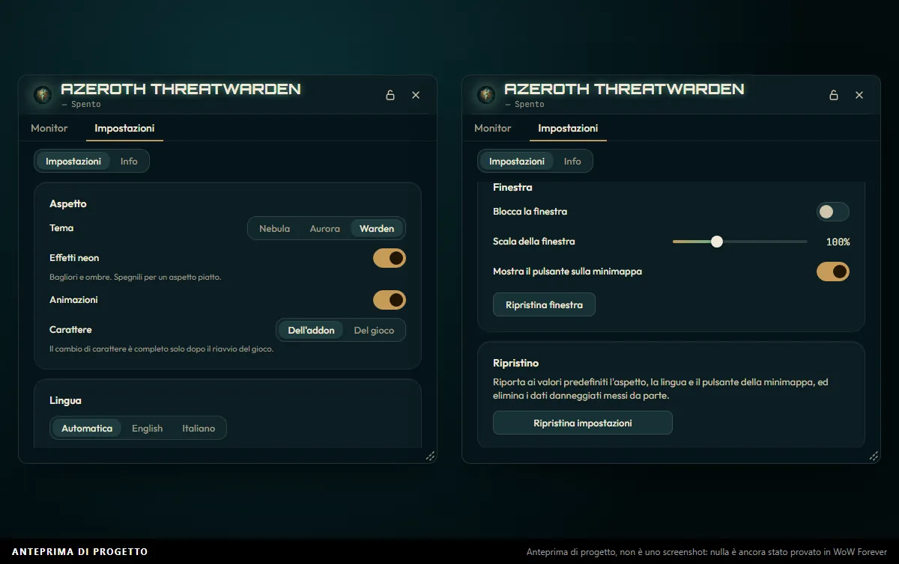
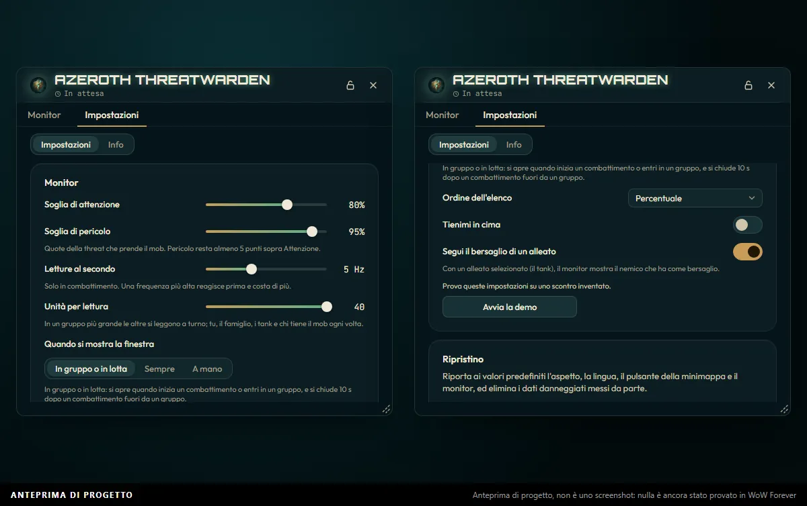
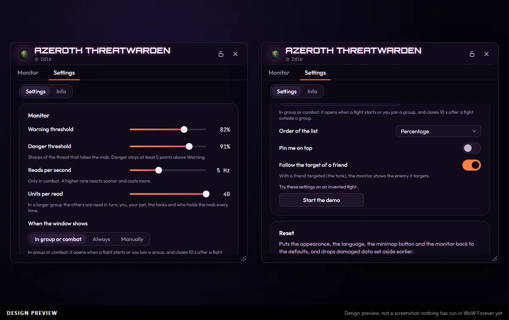
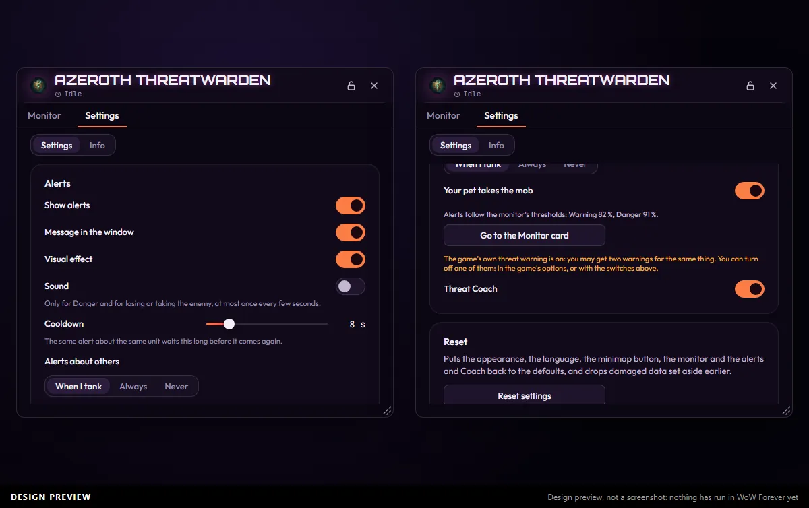
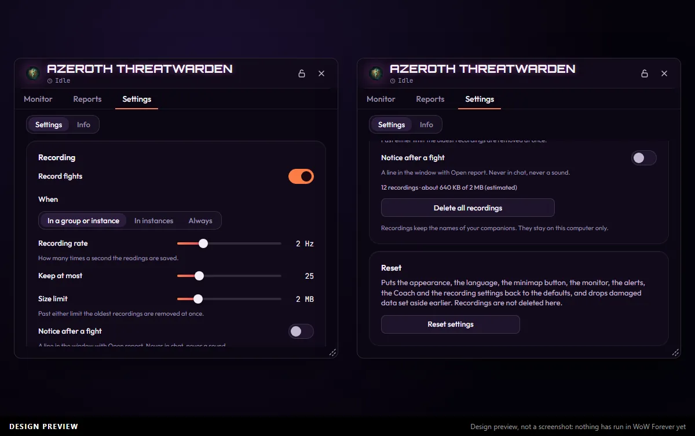

# Settings

*Italiano: [[Impostazioni|Settings-it]]*

Open it with `/atw settings`, with a right click on the minimap button, or from the **Settings** tab of the window. The
same page is in the game's own settings window, under *Options → AddOns → Azeroth Threatwarden*, if your client allows
it. A change made in one place shows in the other, and every change is saved as you make it. It applies **at once**,
except the font (complete after you restart the game) and the language (after a reload of the interface). The page
scrolls with the mouse wheel.

*Design previews, not screenshots: drawn from the addon's own layout and texts, because the addon has not been run in the game yet ([all previews](https://github.com/Finland6738/azeroth-threatwarden/blob/main/docs/specs/mockups/previews/README.md)).*

## Appearance

Saved for the whole account.

| Option | Choices | Default |
|---|---|---|
| Theme | **Nebula** (dark, violet and orange), **Aurora** (light, blue and teal), **Warden** (dark, from the colours of the logo) | Nebula |
| Neon effects | on / off: glows and shadows; off gives a flat look | on |
| Animations | on / off: fades and slides; off makes every change immediate | on |
| Font | **Addon font** (Orbitron, Outfit, JetBrains Mono) or **Game font** | Addon font |

A change of **font** is complete only after you **restart the game**: the game reads new font files only when it starts.
The colours of the threat states do not change with the theme.

## Language

**Automatic** (follows the language of your game: English, or Italian in an Italian client), **English** or
**Italiano**. The change takes effect after a reload of the interface: press **Reload now** (it is active only when the
choice differs from the language on screen) or type `/reload`.

## Window

Saved for each character, except the minimap button (whole account).

| Option | What it does | Default |
|---|---|---|
| Lock the window | the window cannot be moved or resized (also the lock in the title bar, `/atw lock`) | off |
| Window scale | 50 % to 200 %, in steps of 5 %; it applies when you release the slider | 100 % |
| Show minimap button | shows or hides the button on the minimap | on |
| Reset window | position, size and scale back to the defaults, the window in the centre (like `/atw reset`) | — |

## Monitor

Saved for the whole account. Every change applies at once, also to a
[demo](Threat-Monitor#demo-mode) or a fight in progress.

| Option | What it does | Choices | Default |
|---|---|---|---|
| Warning threshold | from this share of the threat that takes the mob, a row says **Warning** | 50 % to 95 % | 82 % |
| Danger threshold | from this share, **Danger** | 60 % to 100 % | 91 % |
| Reads per second | how often the threat is read in combat: a higher rate reacts sooner and costs more | 2 to 10 Hz | 5 Hz |
| Units per read | how many units are read each time; in a larger group the others are read in turn (you, your pet, the tanks and who holds the mob every time) | 5 to 40 | 40 |
| When the window shows | see below | In group or combat, Always, Manually | In group or combat |
| Order of the list | *Percentage*, *Absolute threat*, *Risk*, *Recent change* (also the **Sort** button of the list) | | Percentage |
| Pin me on top | your row comes first (also **Me on top** in the list) | on / off | off |
| Follow the target of a friend | with a friendly target (the tank), the monitor shows the enemy it targets | on / off | on |
| Start the demo | plays an invented fight, to try these settings ([demo mode](Threat-Monitor#demo-mode)) | button | |

Danger stays at least 5 points above Warning: moving one slider pushes the other. The thresholds, the rate and the
number of units are provisional until they are tuned in the game.

**When the window shows:**

- **In group or combat**: the window opens by itself, on the Monitor tab, when a fight starts and when you join a group.
  Outside a group it closes by itself 10 seconds after a fight, unless you opened it again or moved to another tab. If
  you close it during a fight, it stays closed until the next fight. At login it is as you left it (and open in a group).
- **Always**: it is shown every time you log in or reload; only you close it.
- **Manually**: it stays open or closed as you leave it.

Opening or closing by itself never changes what you chose by hand.

## Alerts

> **New in `v0.3.0`**, not verified in game.

Saved for the whole account, below *Monitor*. What the alerts are is on [[Alerts and Coach|Alerts-and-Coach]]. Every
change applies at once.

| Option | What it does | Choices | Default |
|---|---|---|---|
| Show alerts | all the alerts on or off; off, the three channels below stay visible but inactive | on / off | on |
| Message in the window | the alert shows in the strip of the Monitor tab | on / off | on |
| Visual effect | the border of the window takes the colour of the state once | on / off | on |
| Sound | a sound of the game, only for Danger and for losing or taking the enemy | on / off | off |
| Cooldown | how long the same alert about the same unit waits before it comes again; saved when you release the slider | 3 to 30 s | 8 s |
| Alerts about others | alerts about other players | When I tank, Always, Never | When I tank |
| Your pet takes the mob | the alert when your pet takes the enemy in a group with a tank | on / off | on |
| Go to the Monitor card | the alerts use the Warning and Danger thresholds of *Monitor*; the card says them | button | |
| Threat Coach | the advice in the strip | on / off | on |

If the game's own threat warning is on (in the game's options), the card says that you may get two warnings for the
same thing, and lets you choose: the addon never changes the game's setting. To mute the alerts for a while, or the
alerts about one unit, see [[Alerts and Coach|Alerts-and-Coach#muting]].

## Recording

> **Arrives with `v0.4.0`** (not published yet, so the card is not there in the current version), not verified in game.

Saved for the whole account, below *Alerts*. What the recordings are is on [[Combat Reports|Combat-Reports]]. Every
change applies at once.

| Option | What it does | Choices | Default |
|---|---|---|---|
| Record fights | recording on or off | on / off | on |
| When | which fights are recorded | In a group or instance, In instances, Always | In a group or instance |
| Recording rate | how many times a second the readings are saved; saved when you release the slider | 1 to 5 Hz | 2 Hz |
| Keep at most | how many recordings are kept | 5 to 100 | 25 |
| Size limit | the estimated space they may take, in steps of 0.5 MB | 0.5 to 8 MB | 2 MB |
| Notice after a fight | a line in the window with *Open report*; never in chat, never a sound | on / off | off |
| Delete all recordings | removes every closed recording; asks for a second click within 8 seconds | button | |

Past the number or the size limit the **oldest recordings are removed at once**. The card says how much space the
recordings take (an estimate) and reminds you that they keep the names of your companions, on this computer only.

## Reset

**Reset settings** puts the appearance, the language, the minimap button, the monitor settings and the
alerts and Coach back to the defaults, and drops the damaged
data the addon had set aside for bug reports (from `v0.4.0` also the
recording settings). It asks for a second
click, within a few seconds. Your recordings (from `v0.4.0`) are not deleted here; the window's place is reset with
*Reset window*.

## Read-only data

If your saved data was written by a newer version of the addon (or could not be updated), the page says so: the addon
works, but changes are not saved ([[Privacy and Data|Privacy-and-Data]]).
