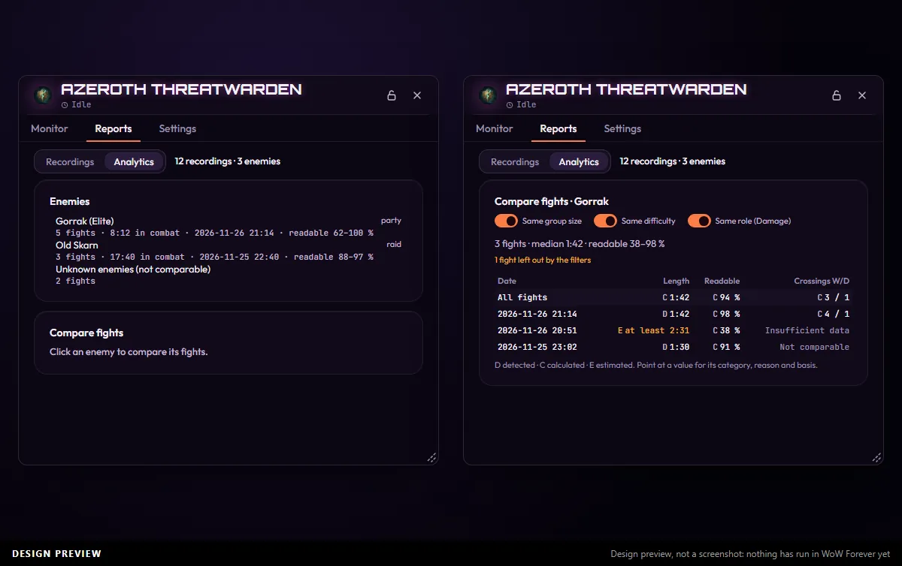
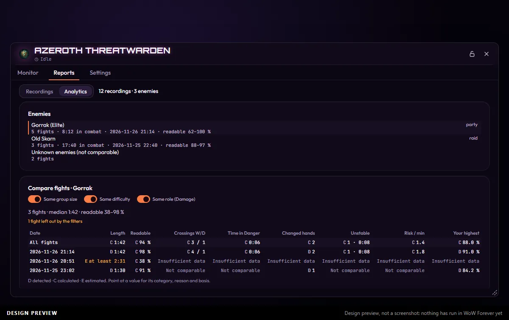
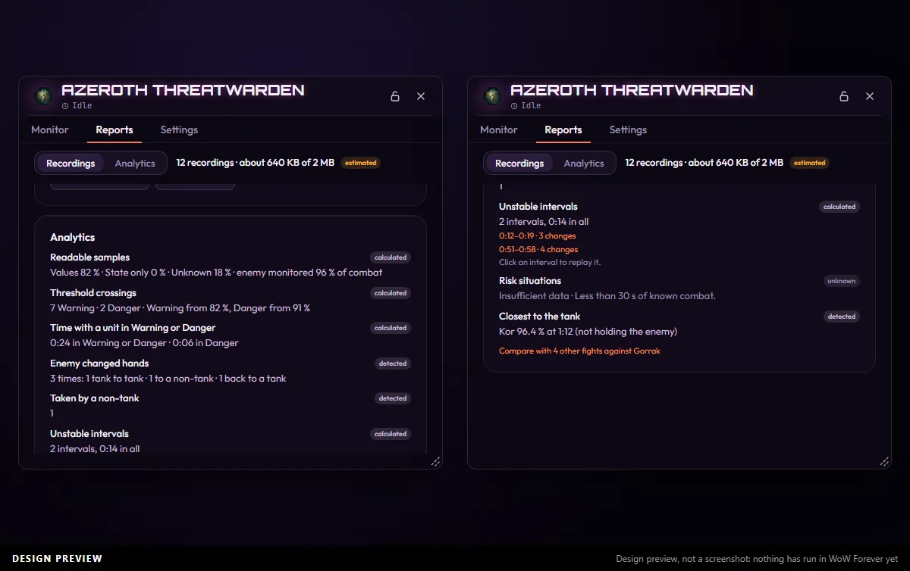
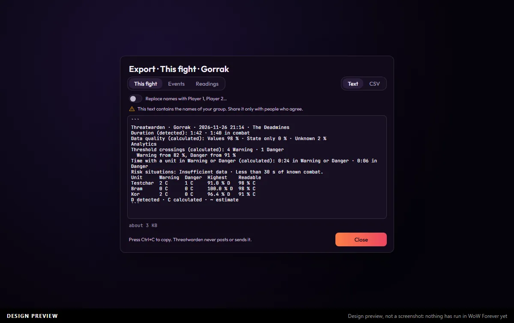

# Analytics della threat

*English: [[Threat Analytics|Threat-Analytics]]*

> **In arrivo con la `v0.6.0`**, non ancora pubblicata e non verificata in gioco. Nella versione attuale questa parte è
> spenta: non se ne vede nulla.

Analytics descrive gli scontri registrati con numeri che si possono controllare: una card in ogni
[[report|Combat-Reports-it]] e una pagina che confronta gli scontri contro lo stesso nemico. Legge soltanto le
registrazioni: non salva nulla e nulla esce dal tuo computer. Non fa classifiche di persone, non giudica nessuno e non
dice che le cose stanno migliorando o peggiorando.

*Anteprime di progetto, non screenshot: disegnate dall'impaginazione e dai testi dell'addon con scontri inventati,
perché l'addon non è ancora stato provato in gioco
([tutte le anteprime](https://github.com/Finland6738/azeroth-threatwarden/blob/main/docs/specs/mockups/previews/README.md)).*

## Dove si trova

Nella scheda **Report**, in alto, c'è il selettore *Registrazioni · Analytics*. *Registrazioni* è l'elenco con i report;
*Analytics* è la pagina descritta sotto. La scheda ricorda la scelta fino al prossimo `/reload`; `/atw reports` apre
*Registrazioni*.

## La card di un report

Viene dopo la card *Timeline* ed è calcolata dopo il report.

| Riga | Che cosa significa |
|---|---|
| Campioni leggibili | quante letture avevano un valore, solo uno stato o nulla, e per quanto del combattimento il nemico è stato monitorato |
| Superamenti di soglia | salite in Attenzione e in Pericolo di ogni unità con dati sufficienti |
| Tempo con un'unità in Attenzione o Pericolo | tempo con almeno un'unità in quegli stati, e in Pericolo |
| Cambi di chi tiene il nemico | un'altra unità ha preso il nemico da chi lo teneva: da tank a tank, a un non tank, di nuovo a un tank (il primo a tenerlo in un pull non è un cambio) |
| Preso da un non tank | quante volte un'unità non trattata da tank ha preso il nemico |
| Intervalli instabili | tratti con almeno 3 cambi di stato o di chi tiene il nemico entro 10 s; i primi tre sono elencati e un clic ne apre il replay |
| Situazioni di rischio | salite in Pericolo più le prese di un non tank, per minuto di combattimento noto |
| Più vicino al tank | la percentuale più alta di un'unità che non teneva il nemico |
| Confronta con … | apre la pagina sugli altri scontri contro questo nemico |

Dove il report ha già il valore, è lo stesso numero. Se nulla era leggibile la card ha solo i campioni leggibili e una
nota.

## Le categorie e i valori mancanti

Ogni valore ha la sua categoria: *rilevato* (letto o contato), *calcolato* (derivato), *stimato* (*almeno*, o *~* per
una mediana: mancava parte dei dati). La tabella le segna con una lettera (**R**, **C**, **S**) e passando il mouse su
un valore si leggono categoria, motivo e base (le soglie o gli stati del gioco).

- **Dati insufficienti**: con meno di **metà** dei campioni leggibili, o con il nemico monitorato per meno di metà del
  combattimento, Analytics non dà un numero, perché ingannerebbe. Il report può ancora mostrare un limite inferiore.
- **Non disponibile**: il gioco non l'ha mai dato (le percentuali quando si legge solo lo stato).
- **Non confrontabile**: nel confronto, lo scontro non ha la stessa base (altre soglie o stati del gioco) o, per le tue
  colonne, il tuo ruolo.

## Confrontare gli scontri

La card **Nemici** elenca ogni nemico registrato, il più recente per primo, con il numero di scontri, il tempo in
combattimento, l'ultima data e i campioni leggibili. Gli scontri contro un nemico sconosciuto sono raggruppati e non si
possono confrontare. Clicca un nemico per confrontare i suoi scontri:

- solo scontri contro **quel nemico**, al più i 20 più recenti;
- di predefinito con lo stesso **gruppo**, la stessa **difficoltà** e lo stesso **ruolo** del più recente (spegni un
  filtro per includerne altri);
- la prima riga, **Tutti gli scontri**, mostra le mediane (il rischio è su tutti gli scontri); passando il mouse su un
  valore si leggono mediana, totale, minimo e massimo con la data. Gli aggregati chiedono almeno 2 scontri
  confrontabili (*Un solo scontro confrontabile*);
- una riga per scontro, il più recente per primo; un clic apre il suo report. Una registrazione danneggiata ha una riga
  che non conta;
- in una finestra stretta le ultime colonne spariscono e restano nel suggerimento della riga.

Il confronto si calcola uno scontro alla volta e **si ferma durante il combattimento**. Una registrazione eliminata ne
esce; per quelle nuove compare il pulsante **Aggiorna**.

## Esportazione

*Esporta* trasforma ciò che vedi in un testo che copi tu. Si trova nella card di testa di un report (quello scontro) e
nella card **Confronto degli scontri** (il confronto con i suoi filtri). Apre una casella con il testo già selezionato:
premi **Ctrl+C** e incollalo dove vuoi. L'addon non può scrivere file né raggiungere gli appunti, e non pubblica, non
invia e non salva il testo: nulla esce dal gioco se non lo copi tu.

| Contenuto | Formati | Che cosa contiene |
|---|---|---|
| Questo scontro | testo, CSV | il contesto, le righe del report, le metriche di Analytics e una riga per ogni unità |
| Eventi | CSV | ogni evento dello scontro in ordine di tempo |
| Letture | CSV | ogni lettura registrata, anche quelle illeggibili con il motivo |
| Confronto | testo, CSV | una riga per scontro, il più recente prima; il testo ha anche gli aggregati su tutti gli scontri |

- Il **testo** è nella lingua dell'interfaccia, dentro blocchi di codice, diviso in parti di al più 1900 caratteri,
  così ognuna sta in un messaggio di chat. Nella tabella delle unità i nomi oltre 18 caratteri sono tagliati.
- Il **CSV** è per un foglio di calcolo: nomi delle colonne in inglese, la virgola fra le colonne, i tempi in secondi.
  Un testo che un foglio di calcolo potrebbe leggere come formula prende davanti un apostrofo.
- **Categorie e valori mancanti** restano con i numeri. Nel testo: **R** rilevato, **C** calcolato, *~* o *almeno* per
  una stima, e le parole *Non disponibile*, *Dati insufficienti* e *Non confrontabile* con il motivo. Nel CSV: le
  colonne `category`, `status`, `reason` e `at_least`; nel confronto le ultime colonne elencano quali valori sono *at
  least*, non disponibili, insufficienti, non confrontabili, rilevati o calcolati. Un valore che manca non è mai uno
  zero.
- **Dimensione.** Al più 256 KB di righe intere. Quando qualcosa non ci sta (le letture di uno scontro lungo) la riga
  sotto il testo dice quante righe sono rimaste fuori; questa nota non fa parte del testo. In uno scontro di raid lungo
  ci stanno circa le prime 6.000 letture.

### I nomi

La casella dice sempre che cosa contiene il testo. Di predefinito contiene i **nomi del tuo gruppo**: condividilo solo
con chi è d'accordo. Accendi **Sostituisci i nomi con Giocatore 1, Giocatore 2…** (spento di predefinito, ricordato
fino al prossimo `/reload`) e il tuo personaggio diventa *Tu*, il tuo famiglio *Il tuo famiglio*, gli altri famigli
*Famiglio 1, Famiglio 2…* e tutti gli altri *Giocatore 1, Giocatore 2…*, con lo stesso numero per lo stesso nome in
tutto il testo. Nel CSV queste parole sono sempre in inglese (*You*, *Your pet*, *Pet 1*, *Player 1*). **I nomi dei
nemici e della zona restano**, come classi e ruoli: la composizione del gruppo si può ancora leggere. Le registrazioni
salvate non cambiano.

L'esportazione non è ancora stata provata in gioco: come la casella regge un testo molto lungo e che aspetto ha il
testo incollato in una chat o in un foglio di calcolo.
