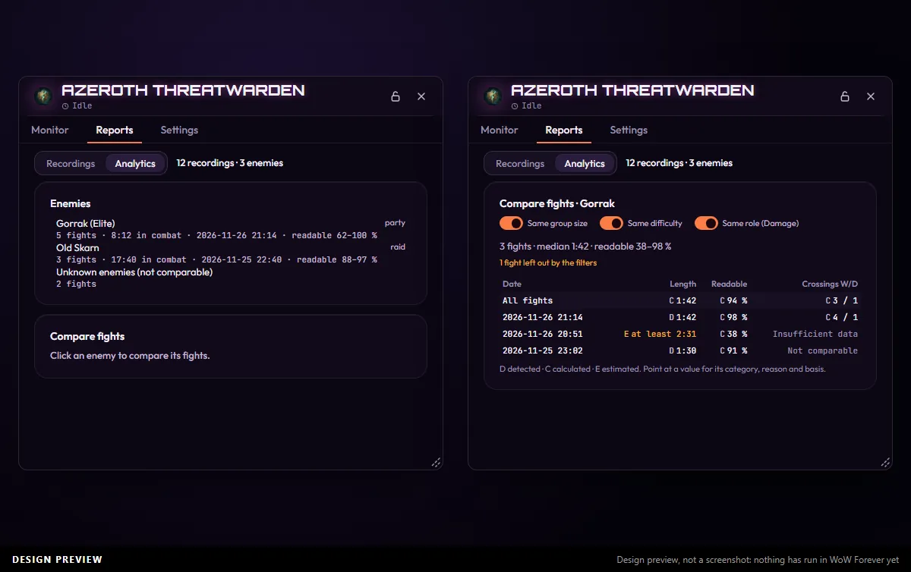
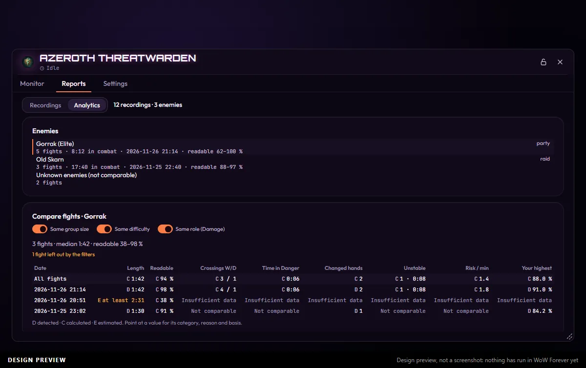
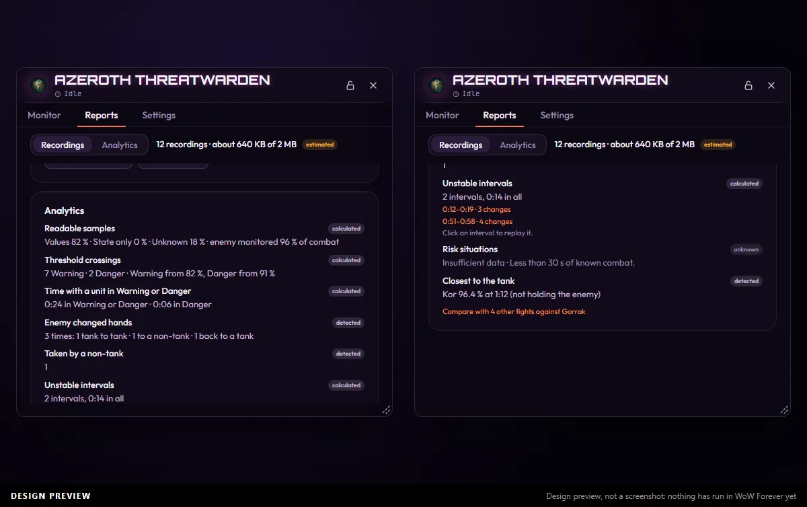
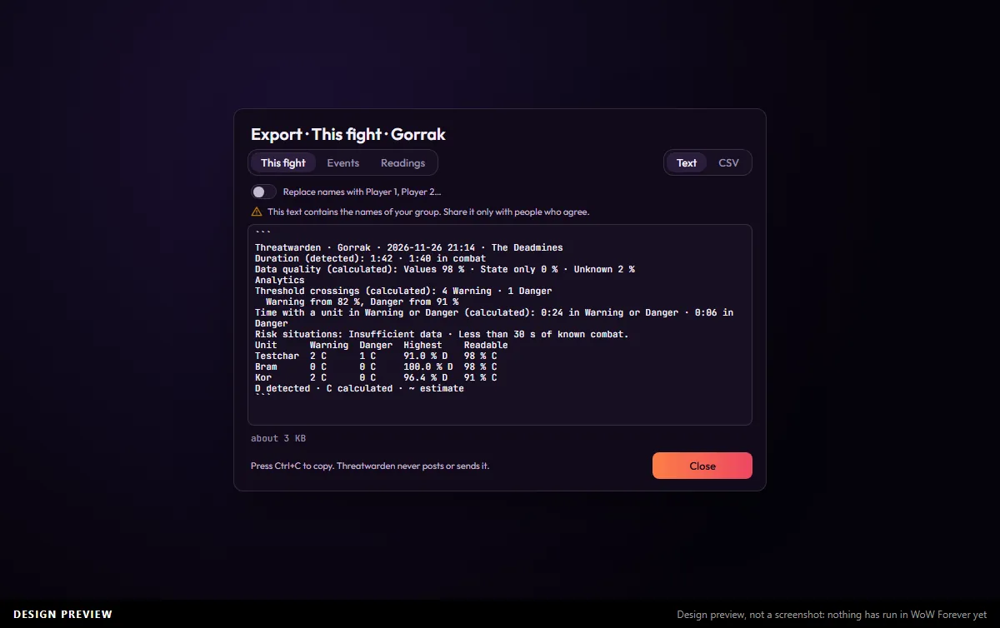

# Threat Analytics

*Italiano: [[Analytics della threat|Threat-Analytics-it]]*

> **Coming in `v0.6.0`**, not released yet and not verified in game. In the current version the part is switched off:
> nothing of it shows.

Analytics describes your recorded fights with numbers you can check: one card in each [[report|Combat-Reports]], and a
page that compares fights against the same enemy. It only reads the recordings: nothing is saved and nothing leaves
your computer. It never ranks people, judges anyone or says that things are getting better or worse.

*Design previews, not screenshots: drawn from the addon's own layout and texts with invented fights, because the addon
has not been run in the game yet ([all previews](https://github.com/Finland6738/azeroth-threatwarden/blob/main/docs/specs/mockups/previews/README.md)).*

## Where it is

In the **Reports** tab a *Recordings · Analytics* selector sits at the top. *Recordings* is the list and the reports;
*Analytics* is the page below. The tab remembers your choice until the next `/reload`; `/atw reports` opens
*Recordings*.

## The card of a report

It follows the *Timeline* card and is built after the report.

| Line | What it means |
|---|---|
| Readable samples | how many readings had a value, only a state, or nothing, and for how much of combat the enemy was monitored |
| Threshold crossings | rises to Warning and to Danger of every unit with enough data |
| Time with a unit in Warning or Danger | time with at least one unit in those states, and in Danger |
| Enemy changed hands | another unit took the enemy from its holder: tank to tank, to a non-tank, back to a tank (the first holder of a pull is not a change) |
| Taken by a non-tank | how often a unit not treated as a tank took the enemy |
| Unstable intervals | stretches with at least 3 changes of state or holder within 10 s; the first three are listed and a click replays one |
| Risk situations | rises to Danger plus takes by a non-tank, per minute of known combat |
| Closest to the tank | the highest percentage of a unit that was not holding the enemy |
| Compare with … | opens the page on the other fights against this enemy |

Where the report already has the figure, it is the report's own number. With nothing readable the card has only the
readable samples and a note.

## The categories and the missing values

Every value has its category: *detected* (read or counted), *calculated* (derived), *estimated* (*at least*, or *~*
for a median: part of the data were missing). The table marks them with a letter (**D**, **C**, **E**) and the mouse
over a value says the category, the reason and the basis (the thresholds, or the game's states).

- **Insufficient data**: with fewer than **half** the samples readable, or with the enemy monitored for less than half
  of combat, Analytics gives no number, because it would mislead. The report can still show a lower bound.
- **Not available**: the game never gave it (percentages when only the state is readable).
- **Not comparable**: in the comparison, the fight does not share the basis (other thresholds, or game states) or, for
  your own columns, your role.

## Comparing fights

The **Enemies** card lists every enemy you recorded, the most recent first, with the number of fights, the time in
combat, the latest date and the readable samples. Fights against an unknown enemy are shown together and cannot be
compared. Click an enemy to compare its fights:

- fights against **that enemy only**, at most the 20 most recent;
- by default with the same **group size**, **difficulty** and **role** as the most recent one (switch a filter off to
  include more);
- the first row, **All fights**, shows medians (the risk is over all fights); the mouse over a value gives the median,
  the total, the lowest and highest values with their date. Aggregates need at least 2 comparable fights
  (*Only one comparable fight*);
- one row per fight, newest first; a click opens its report. A damaged recording has a row that does not count;
- in a narrow window the last columns disappear and stay in the row's tooltip.

The comparison is built one fight at a time and **pauses during combat**. A deleted recording leaves it; for new ones a
**Refresh** button appears.

## Export

*Export* turns what you see into a text you copy yourself. It is in the head card of a report (that fight) and in the
**Compare fights** card (the comparison with its filters). It opens a box with the text already selected: press
**Ctrl+C** and paste it where you want. The addon cannot write files or reach your clipboard, and it never posts,
sends or saves the text: nothing leaves the game unless you copy it.

| Content | Formats | What is in it |
|---|---|---|
| This fight | text, CSV | the context, the lines of the report, the figures of Analytics and one row for each unit |
| Events | CSV | every event of the fight in order of time |
| Readings | CSV | every recorded reading, also the unreadable ones with their reason |
| Comparison | text, CSV | one row for each fight, the newest first; the text also has the totals over all fights |

- **Text** is in the language of the interface, inside code blocks, split into parts of at most 1900 characters so that
  each fits one chat message. Names longer than 18 characters are cut in the table of the units.
- **CSV** is for a spreadsheet: English column names, a comma between the columns, times in seconds. A text that a
  spreadsheet could read as a formula gets an apostrophe in front.
- **Categories and missing values** stay with the numbers. In the text: **D** detected, **C** calculated, *~* or
  *at least* for an estimate, and the words *Not available*, *Insufficient data* and *Not comparable* with the reason.
  In the CSV: the columns `category`, `status`, `reason` and `at_least`; in the comparison the last columns list which
  figures are *at least*, not available, insufficient, not comparable, detected or calculated. A missing value is never
  a zero.
- **Size.** At most 256 KB of whole rows. When something does not fit (the readings of a long fight) the line under the
  text says how many rows were left out; this note is not part of the text. With a long raid fight about the first
  6,000 readings fit.

### Names

The box always says what the text holds. By default it holds the **names of your group**: share it only with people who
agree. Switch on **Replace names with Player 1, Player 2…** (off by default, kept until the next `/reload`) and your
character becomes *You*, your pet *Your pet*, other pets *Pet 1, Pet 2…* and everybody else *Player 1, Player 2…*, the
same number for the same name everywhere in the text. In the CSV these words are always English. **Enemy names and zone
names stay**, and so do classes and roles, so the make-up of the group can still be read. Your saved recordings are not
changed.

The export has not been tried in the game yet: how the box copes with a very long text, and how the pasted text looks
in a chat or a spreadsheet.
