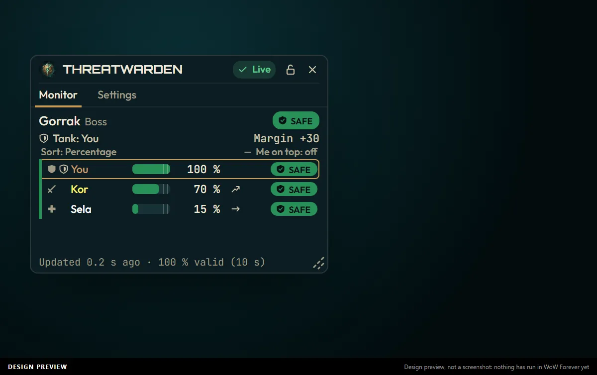
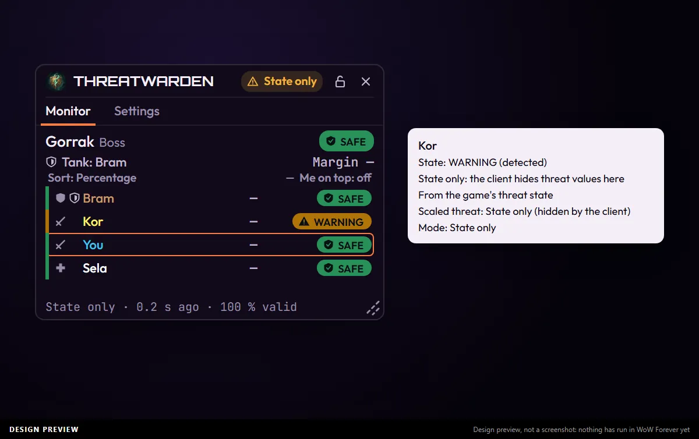
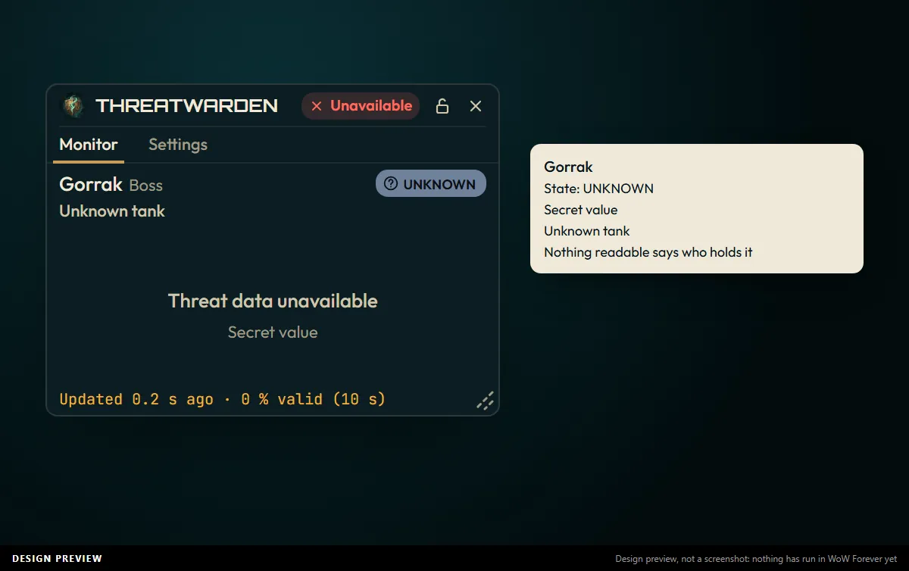
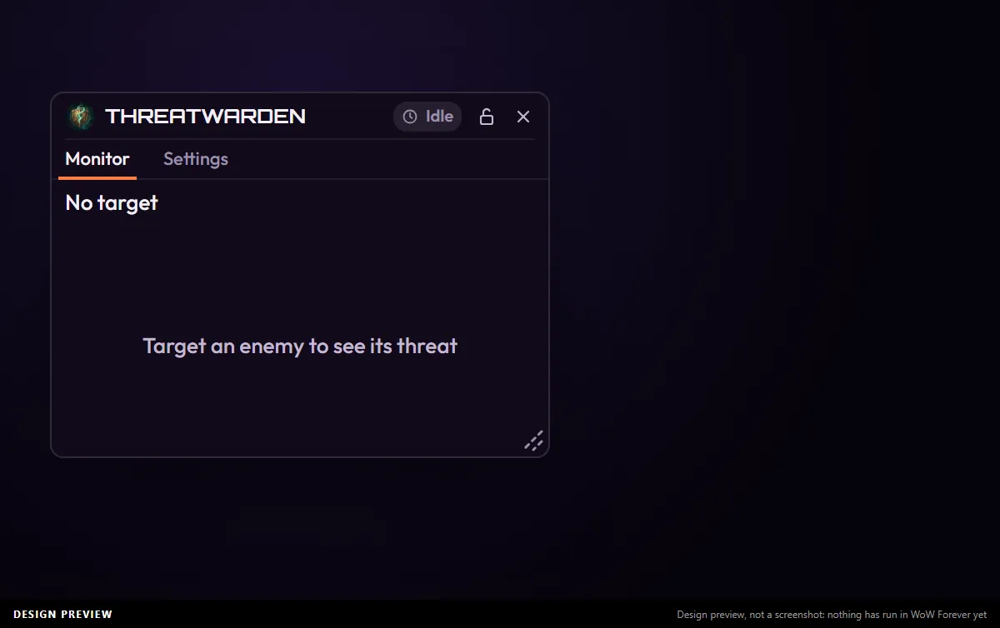
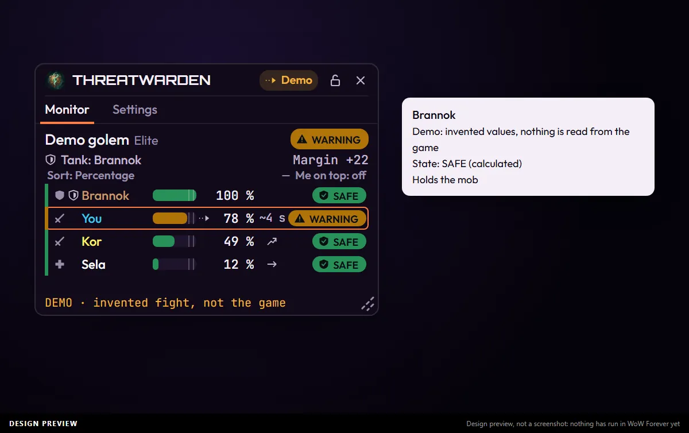
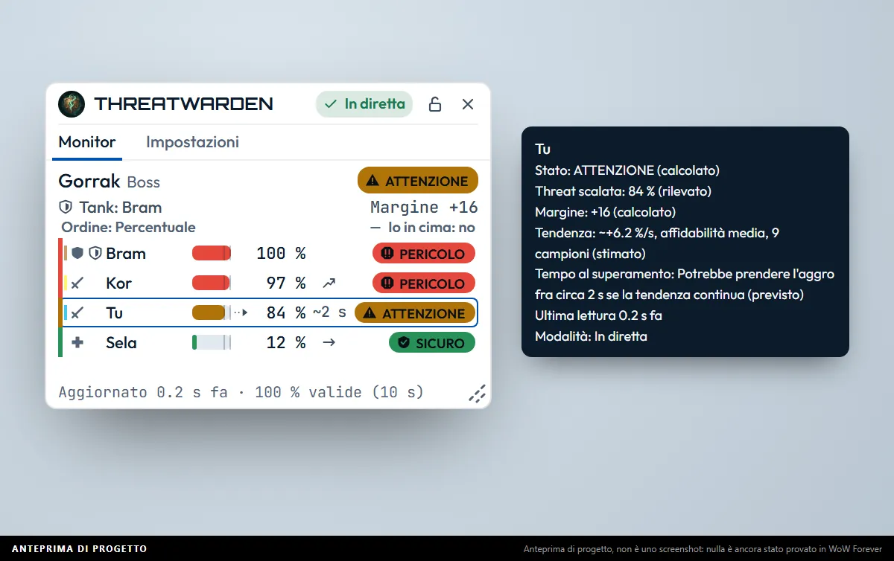
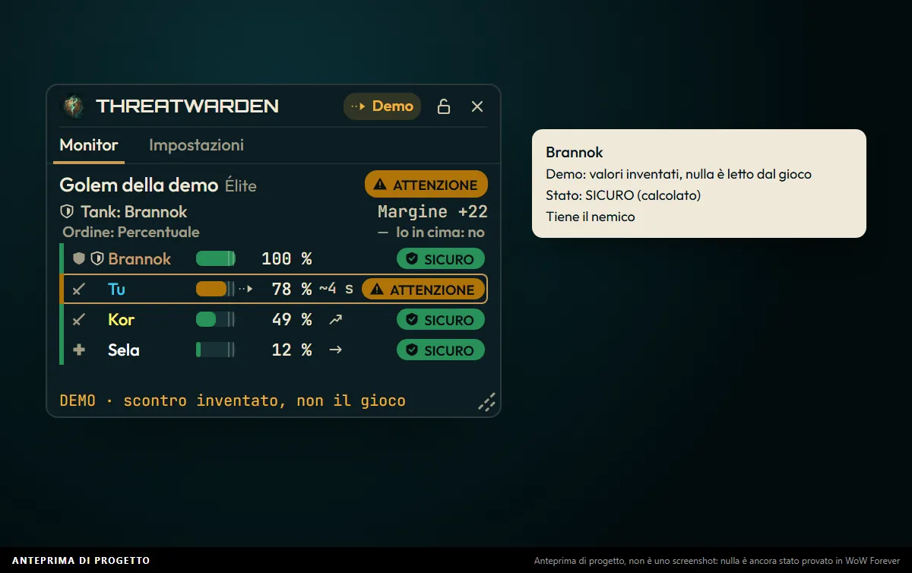

# Monitor della threat

*English: [[Threat Monitor|Threat-Monitor]]*

> **Nuovo nella `v0.2.0`, non verificato in gioco.** Quali dati di threat WoW Forever dia davvero a un addon è ancora
> da verificare (la sonda M0 e le verifiche in gioco sono aperte), perciò il monitor è fatto per ogni risposta: valori,
> *solo stato* o sconosciuto, con il motivo. Soglie e frequenza di lettura sono provvisorie.

La scheda **Monitor** mostra chi minaccia il nemico che stai combattendo. Legge il gioco quando sei in combattimento,
c'è un nemico monitorato e la finestra è aperta su questa scheda. Di base la finestra si apre da sola quando inizia un
combattimento o entri in un gruppo ([quando si mostra la finestra](Settings-it#monitor)); soglie, frequenza, ordine e il
resto sono nella [card Monitor delle Impostazioni](Settings-it#monitor).

## L'intestazione

- Il **nemico**: quello che selezioni o, se selezioni un alleato (un guaritore che seleziona il tank), il bersaglio
  dell'alleato. Il tipo (*Élite*, *Raro*, *Boss*) è scritto accanto al nome.
- Il **tuo stato**, con un'icona e una parola.
- **Tank**: chi tiene il nemico. Se non lo tiene nessuno del gruppo leggi *(non in elenco)* dopo il nome, e *Tank
  sconosciuto* quando nulla di leggibile dice chi sia.
- **Margine**: per un DPS o un guaritore, quanto sei lontano dal 100 % (prendere l'aggro); per il tank, quanto il
  secondo è lontano dal 100 %.

Dalla `v0.3.0` sotto l'intestazione c'è una striscia con [[avvisi e consigli|Alerts-and-Coach-it]]. Dalla `v0.7.0`
(spento fino ad allora), in un pull con più mob una barra sotto l'intestazione apre il [[Dungeon Focus|Dungeon-Focus-it]],
e una puntina accanto al nome segna un mob che hai scelto di seguire dal suo elenco.

## L'elenco

Una riga per ogni unità nella lista della threat del nemico (tu, il tuo famiglio, il gruppo o l'incursione):

| Parte della riga | Significato |
|---|---|
| Striscia a sinistra, distintivo a destra | lo stato: **Sicuro**, **Attenzione**, **Pericolo** o **Sconosciuto**, sempre con icona e parola |
| Icona del ruolo, icona dello scudo | il ruolo assegnato; lo scudo indica chi tiene il nemico |
| Nome | il colore di classe (la tua riga ha un contorno) |
| Barra e numero | la threat scalata: 100 % significa prendere l'aggro. Le tacche sono le soglie Attenzione (82 %) e Pericolo (91 %), o le tue |
| Freccia | la tendenza degli ultimi secondi (una *stima*); `~2 s` significa *potrebbe prendere l'aggro fra circa 2 s* (una *previsione*) |
| `?` e barra tratteggiata | sconosciuto: passa sulla riga per leggere il motivo |
| `—` senza barra | *solo stato*: il gioco dà lo stato ma nasconde i numeri |

Passa il mouse su una riga per vedere ogni valore con la sua categoria (*rilevato*, *calcolato*, *stimato*,
*previsto*) e, per ciò che manca, il motivo (*Valore segreto*, *Non disponibile*, *Dati insufficienti*, *Dato
vecchio*). Una finestra stretta toglie l'icona del ruolo, la tendenza e la barra prima delle parole.

Clicca **Ordine** per cambiarlo: *Percentuale*, *Threat assoluta* (solo dove il gioco la dà), *Rischio*, *Variazione
recente*. Le righe sconosciute sono sempre in fondo. **Io in cima** tiene la tua riga per prima. L'ordine cambia al
massimo una volta al secondo, e subito quando qualcuno entra in Pericolo. Entrambe le scelte vengono salvate. Quando l'elenco non ci sta, l'ultima riga dice *+N
altri* e la tua resta visibile.

## Gli stati

| Stato | Per un DPS o un guaritore | Per il tank che tiene il nemico |
|---|---|---|
| **Sicuro** | sotto l'82 % | il secondo è sotto l'82 % |
| **Attenzione** | dall'82 %, o si prevede che arrivi al 91 % entro 3 s | il secondo è dall'82 % |
| **Pericolo** | dal 91 %, o tiene il nemico | il secondo è dal 91 %, o ha più threat |
| **Sconosciuto** | il gioco non dà nulla di leggibile, o il dato è vecchio | lo stesso |

Le soglie vengono dal gioco: dall'**82 %** chi fa danni o cura rallenta (meno lanci, meno danni o cure, o incantesimi
di rank più basso), dal **91 %** smette per un attimo di fare danni o di curare; gli
[[avvisi e il Coach|Alerts-and-Coach-it]] lo dicono. Le puoi cambiare nelle [Impostazioni](Settings-it#monitor); se non
le avevi mai cambiate, i vecchi 80 % e 95 % sono diventati 82 % e 91 % con questa versione, mentre le soglie scelte da
te restano tue. Uno stato sale subito e scende solo dopo un secondo, così non lampeggia.

## Quando il gioco nasconde i numeri

In modalità **solo stato** il gioco dice chi tiene il nemico e lo stato di ognuno, ma nessun numero: niente barre,
margine o tendenza, e il piede dice *Solo stato*.

Quando nulla è leggibile vedi **Dati di threat non disponibili** con il motivo: mai un numero inventato, mai una barra
vuota che sembri 0 %.

## Prima e dopo un combattimento

Senza un nemico la finestra dice *Nessun bersaglio*. Fuori dal combattimento dice *Non in combattimento*; alla fine di
un combattimento le ultime righe restano, segnate come vecchie, sotto *Combattimento finito*. Un nemico morto o
scomparso mostra *Bersaglio morto* o *Bersaglio perso*.

## Modalità demo

Scrivi `/atw demo`, o premi **Avvia la demo** nella card Monitor delle Impostazioni, per guardare uno scontro inventato
senza essere in uno vero: un *Golem della demo*, un tank, un guaritore e un DPS inventati, e tu. Compaiono a turno
Attenzione, Pericolo, un tank che perde il nemico e lo riprende e le previsioni, poi lo scontro ricomincia. Serve a
vedere com'è il monitor e a provare le impostazioni.

- La pastiglia dice **Demo**, il piede *DEMO · scontro inventato, non il gioco* e i tooltip dicono che i valori sono
  inventati.
- Nulla è letto dal gioco e la demo non salva nulla. Ciò che cambi nel frattempo (un'impostazione, l'ordine
  dell'elenco, il posto della finestra) viene salvato come sempre.
- Finisce con `/atw demo stop` (o di nuovo `/atw demo`), quando chiudi la finestra e **da sola appena inizia un
  combattimento vero**. Non può partire in combattimento e non sopravvive a una ricarica.

## Il piede e la barra del titolo

Il piede dice quanto sono vecchi i dati e quante letture degli ultimi 10 s erano utilizzabili. La pastiglia nella barra
del titolo dice *In attesa*, *In diretta*, *Solo stato*, *Non disponibile* o *Demo*.

L'interfaccia è in italiano e in inglese:

*Anteprime di progetto, non screenshot: disegnate dal layout e dai testi dell'addon, con un combattimento inventato, perché l'addon non è ancora stato provato in gioco ([tutte le anteprime](https://github.com/Finland6738/azeroth-threatwarden/blob/main/docs/specs/mockups/previews/README.md)).*
