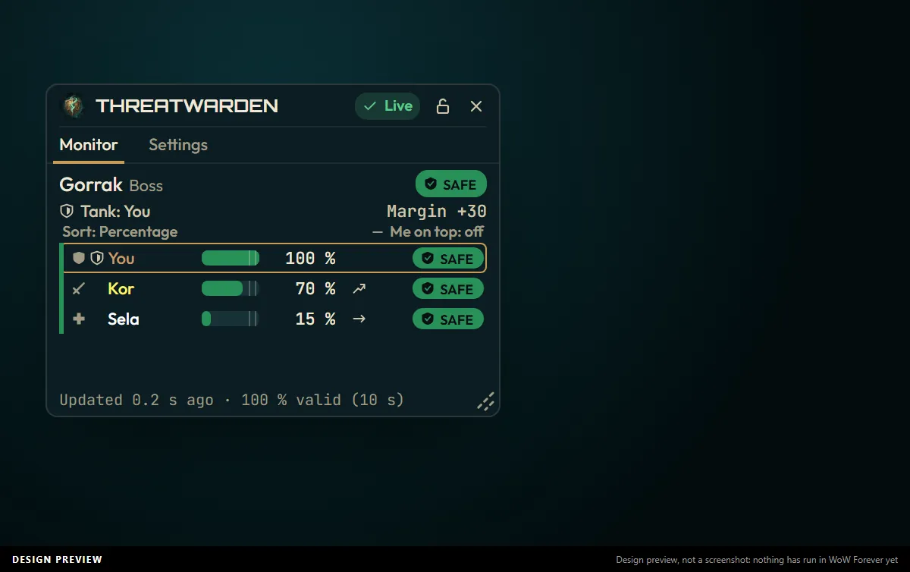
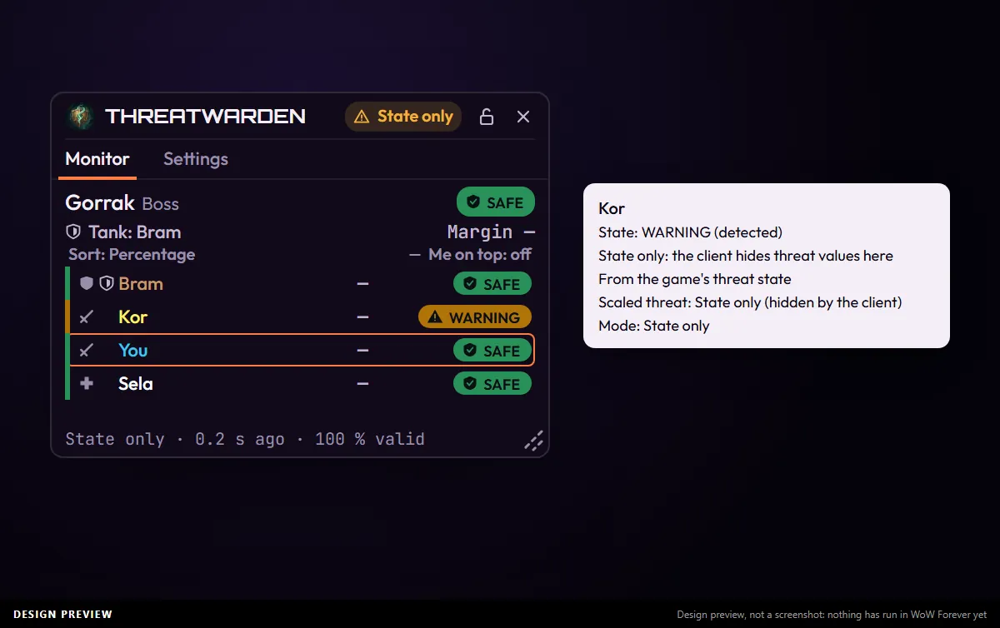
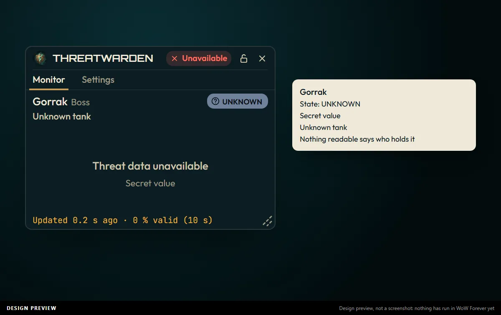
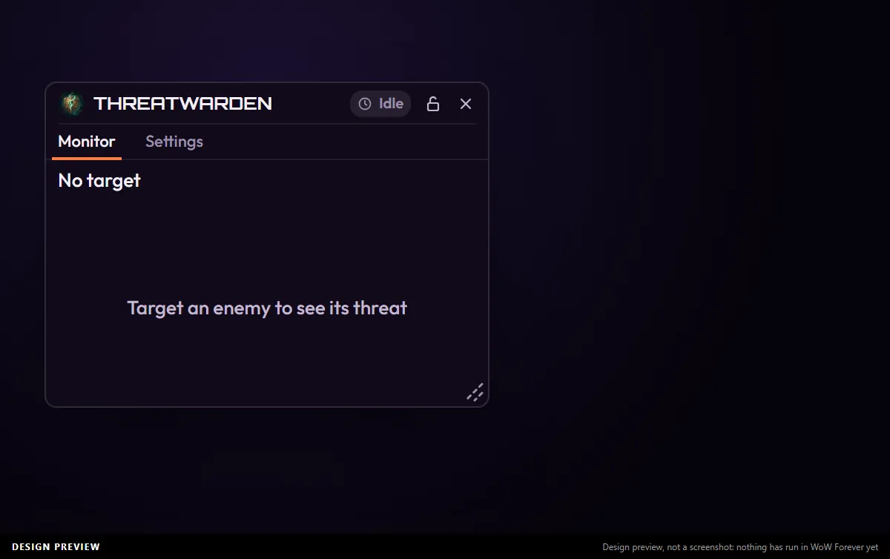
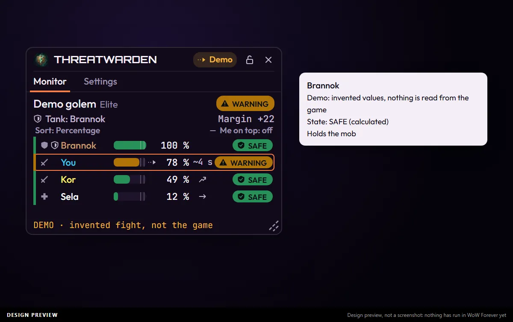
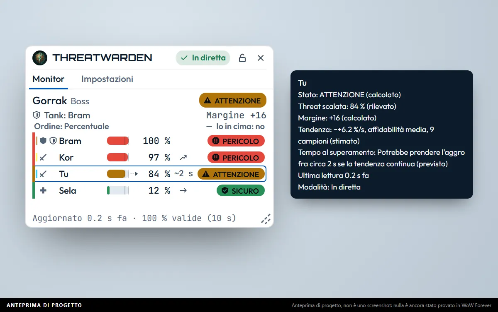
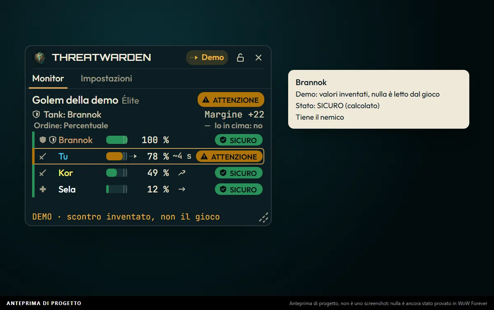

# Threat Monitor

*Italiano: [[Monitor della threat|Threat-Monitor-it]]*

> **New in `v0.2.0`, not verified in game.** Which threat data WoW Forever really gives an addon is still being
> checked (the M0 probe and the in-game checks are open), so the monitor is made for every answer: values, *state only*
> or unknown, with the reason. Thresholds and reading rate are provisional.

The **Monitor** tab shows who threatens the mob you are fighting. It reads the game while you are in combat, a mob is
monitored and the window is open on this tab. By default the window opens by itself when a fight starts or you join a
group ([when the window shows](Settings#monitor)); thresholds, rate, order and the rest are in the
[Monitor card of Settings](Settings#monitor).

## The header

- The **mob**: the enemy you target or, if you target a friend (a healer selecting the tank), the friend's target. Its
  kind (*Elite*, *Rare*, *Boss*) is written next to its name.
- **Your state**, with an icon and a word.
- **Tank**: who holds the mob. If nobody in your group holds it you read *(not in the list)* after the name, and
  *Unknown tank* when nothing readable says who it is.
- **Margin**: for a damage dealer or healer, how far you are from 100 % (taking aggro); for the tank, how far the
  second one is from 100 %.

Since `v0.3.0` a strip with [[alerts and advice|Alerts-and-Coach]] sits under the header. From `v0.7.0` (switched off
until then), in a pull with several mobs a bar under the header opens the [[Dungeon Focus|Dungeon-Focus]], and a pin
next to the mob's name marks a mob you chose to follow from its list.

## The list

One row for each unit on the mob's threat list (you, your pet, your party or raid):

| Part of a row | Meaning |
|---|---|
| Strip on the left, badge on the right | the state: **Safe**, **Warning**, **Danger** or **Unknown**, always with an icon and a word |
| Role icon, shield icon | the assigned role; the shield marks who holds the mob |
| Name | the class colour (your own row has a ring around it) |
| Bar and number | the scaled threat: 100 % means pulling aggro. The ticks are the Warning (82 %) and Danger (91 %) thresholds, or yours |
| Arrow | the trend of the last seconds (an *estimate*); `~2 s` means *may take aggro in about 2 s* (a *prediction*) |
| `?` and a dashed bar | unknown: hover the row to read why |
| `—` and no bar | *state only*: the game gives the state but hides the numbers |

Hover a row to see every value with its kind (*detected*, *calculated*, *estimated*, *predicted*) and, for anything
missing, the reason (*Secret value*, *Not available*, *Insufficient data*, *Stale*). A narrow window drops the role
icon, the trend and the bar before the words.

Click **Sort** to change the order: *Percentage*, *Absolute threat* (only where the game gives it), *Risk*, *Recent
change*. Unknown rows are always last. **Me on top** keeps your row first. The order changes at most once a second, and
at once when someone enters Danger. Both choices are saved. When the list does not fit, the last line says *+N more* and your row stays visible.

## The states

| State | For a damage dealer or healer | For the tank holding the mob |
|---|---|---|
| **Safe** | below 82 % | the second one is below 82 % |
| **Warning** | from 82 %, or predicted to reach 91 % within 3 s | the second one is from 82 % |
| **Danger** | from 91 %, or holding the mob | the second one is from 91 %, or has more threat |
| **Unknown** | the game gives nothing readable, or the data is old | the same |

The thresholds come from play: from **82 %** a damage dealer or a healer eases off (fewer casts, less damage or
healing, or lower spell ranks), from **91 %** they stop damage or healing for a moment; the
[[alerts and the Coach|Alerts-and-Coach]] say so. You can change them in [Settings](Settings#monitor); if you had never
changed them, the old 80 % and 95 % became 82 % and 91 % with this version, while thresholds you chose stay yours. A state rises at once and falls only after a second, so it does not flicker.

## When the game hides the numbers

In **state only** mode the game tells who holds the mob and each one's state, but no numbers: no bars, no margin, no
trend, and the footer says *State only*.

When nothing is readable you see **Threat data unavailable** with the reason: never an invented number, never an empty
bar that looks like 0 %.

## Before and after a fight

Without an enemy the window says *No target*. Out of combat it says *Not in combat*; when a fight ends the last rows
stay, marked as stale, under *Combat ended*. A dead or vanished enemy shows *Target died* or *Target lost*.

## Demo mode

Type `/atw demo`, or press **Start the demo** in the Monitor card of Settings, to watch an invented fight without being
in one: a *Demo golem*, an invented tank, healer and damage dealer, and you. Warning, Danger, a tank that loses the
mob and takes it back, and the predictions show up in turn, then the fight starts again. Use it to see what the monitor
looks like and to try the settings.

- The pill says **Demo**, the footer says *DEMO · invented fight, not the game* and the tooltips say the values are
  invented.
- Nothing is read from the game, and the demo saves nothing. What you change meanwhile (a setting, the order of the
  list, the window's place) is saved as usual.
- It ends with `/atw demo stop` (or `/atw demo` again), when you close the window, and **by itself as soon as a real
  fight starts**. It cannot start during combat and does not survive a reload.

## The footer and the title bar

The footer says how old the data is and how many reads of the last 10 s were usable. The pill in the title bar says
*Idle*, *Live*, *State only*, *Unavailable* or *Demo*.

The interface is also in Italian:

*Design previews, not screenshots: drawn from the addon's own layout and texts, with an invented fight, because the addon has not been run in the game yet ([all previews](https://github.com/Finland6738/azeroth-threatwarden/blob/main/docs/specs/mockups/previews/README.md)).*
