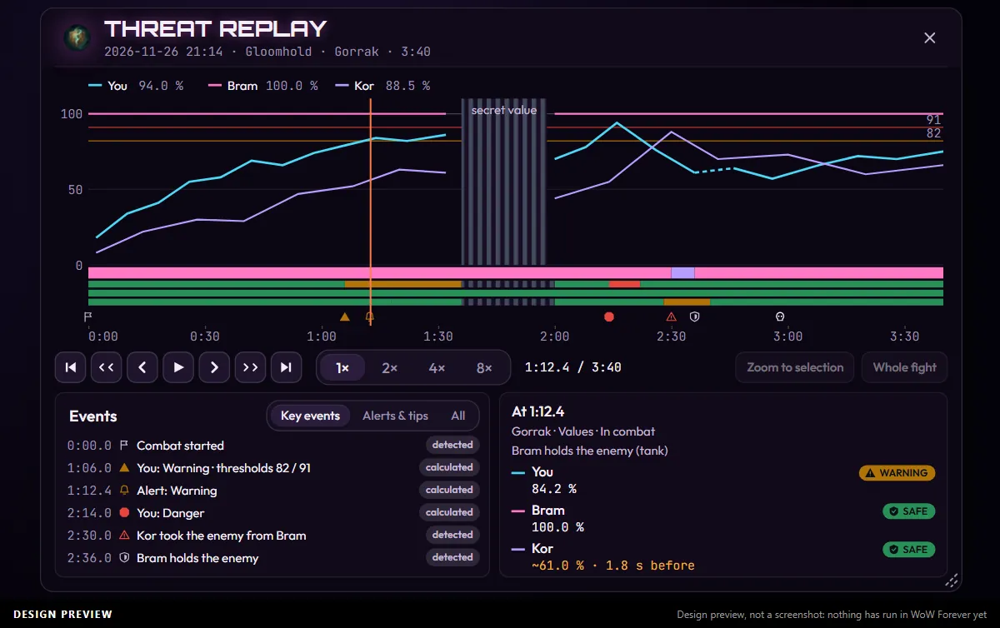
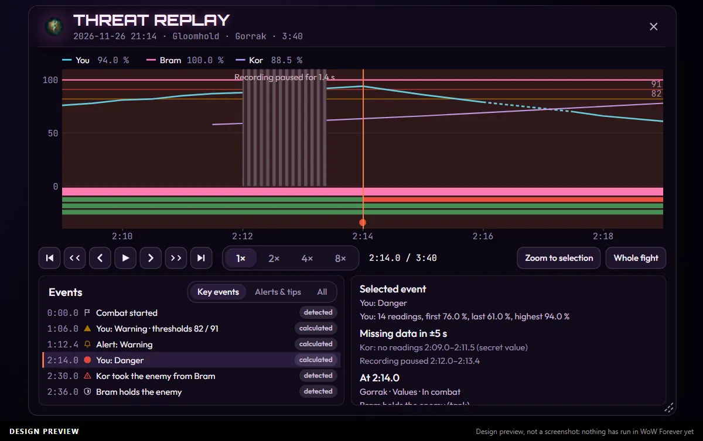
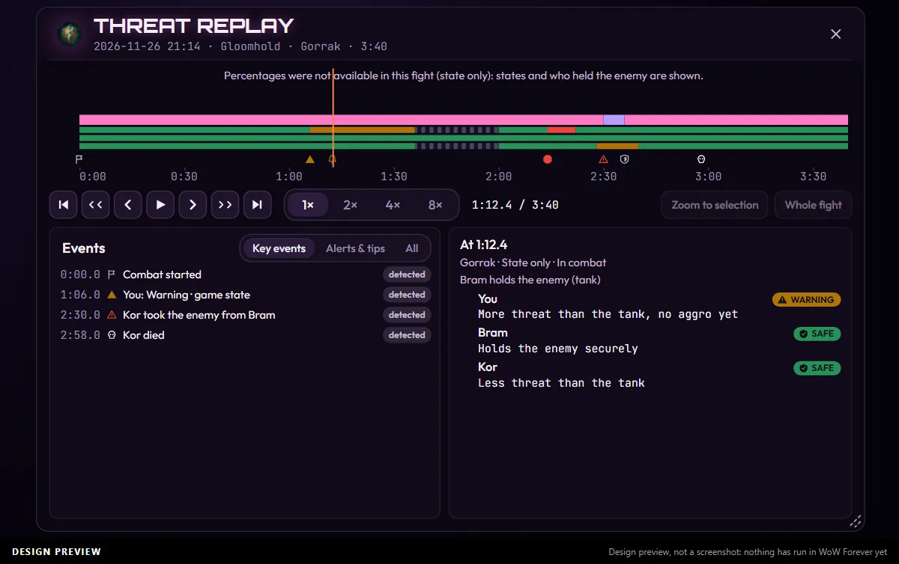
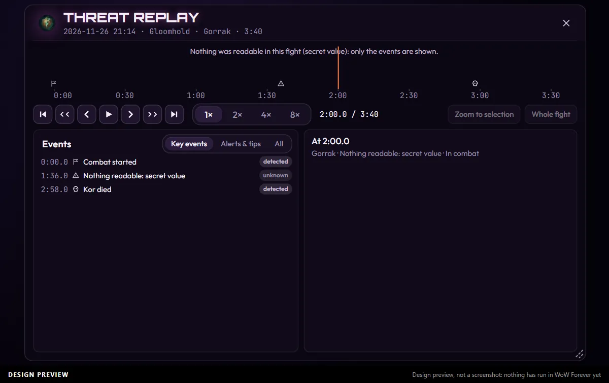

# Replay della threat

*English: [[Threat Replay|Threat-Replay]]*

> **Nuovo nella `v0.5.0`**, non verificato in gioco.

Il replay mostra come si è mossa la threat durante uno scontro che l'addon ha [[registrato|Combat-Reports-it]]: un
grafico nel tempo, gli eventi e ciò che era registrato nel momento che scegli. Legge soltanto la registrazione: non
legge mai il gioco e non vi cambia nulla. Ha una finestra sua, separata dalla finestra principale.

*Anteprime di progetto, non screenshot: disegnate dal layout e dai testi dell'addon con scontri inventati, perché
l'addon non è ancora stato provato in gioco ([tutte le anteprime](https://github.com/Finland6738/azeroth-threatwarden/blob/main/docs/specs/mockups/previews/README.md)).*

## Aprirlo

- **Replay** nella card in cima a un report, nella [scheda Report](Combat-Reports-it). È spento, con il motivo nel
  tooltip, per lo scontro in registrazione e per una registrazione danneggiata.
- Un clic sulla card **Timeline** del report apre il replay in quel momento.
- `/atw replay` apre l'ultimo scontro finito; `/atw replay 2` apre il secondo dell'elenco (1 è il più recente).

La finestra si apre al centro; si sposta dalla barra del titolo e si ridimensiona dall'angolo tratteggiato (da
640 × 420 a 1400 × 1000). Posizione, dimensione e velocità di riproduzione si ricordano per ogni personaggio.

## Il grafico

| Cosa vedi | Cosa significa |
|---|---|
| una **linea piena** | due letture prese al passo della registrazione |
| una **linea tratteggiata** | una **stima**: le due letture sono più lontane, senza nulla di sconosciuto registrato in mezzo (fino a 10 s) |
| una **banda a strisce** | un **buco**: lì non si sa nulla, e il motivo è scritto dentro o nel tooltip. Nessuna linea la attraversa |
| una banda piana | fuori combattimento |
| linee sottili a due altezze | le soglie di Attenzione e Pericolo di quella registrazione, e la linea del 100 % |
| le strisce sotto il grafico | chi teneva il nemico, e lo stato di ogni membro |
| le icone sotto di esse | gli eventi; icone vicine sono raggruppate con il loro numero |

Ogni punto è una lettura che l'addon ha davvero registrato: nulla è mediato o riempito. Passa il mouse sul grafico per
vedere ogni valore con la sua categoria; **trascina** per scegliere un intervallo e vederne il riepilogo, **clic destro**
per toglierlo, usa la **rotella** per ingrandire e clicca per spostare lì il cursore. Hanno una linea al più sei membri:
clicca un nome nel dettaglio per mostrarlo o nasconderlo.

## Comandi

| Pulsante | Tasto | Cosa fa |
|---|---|---|
| barra e triangolo, a sinistra | `Home` | va all'inizio |
| due frecce, a sinistra | `Su` | evento precedente |
| una freccia, a sinistra | `Sinistra` | indietro di un momento registrato |
| riproduci / pausa | `Spazio` | riproduce o mette in pausa |
| una freccia, a destra | `Destra` | avanti di un momento registrato |
| due frecce, a destra | `Giù` | evento seguente |
| barra e triangolo, a destra | `Fine` | va alla fine |
| 1× 2× 4× 8× | `1` – `4` | velocità di riproduzione |
| | `Maiusc` + `Sinistra` / `Destra` | 5 s indietro o avanti |
| **Ingrandisci selezione**, **Tutto lo scontro** | | mostra solo l'intervallo scelto, o di nuovo tutto (in una finestra stretta sono icone) |

I tasti funzionano **solo fuori dal combattimento e con il puntatore sopra la finestra**; ogni altro tasto va al gioco.
`Esc` chiude la finestra, anche in combattimento.

## Eventi e dettaglio

L'**elenco degli eventi** ha tre filtri: *Eventi principali*, *Avvisi e consigli* e *Tutti*. Durante la riproduzione
l'ultimo evento passato è evidenziato e resta in vista (per 3 secondi dopo che hai scorso, l'elenco resta dove l'hai
messo). Clicca un evento per andarci: i 5 secondi prima e dopo vengono selezionati, e il dettaglio elenca le letture
intorno e **che cosa manca** in quella finestra, o dice che non manca nulla.

Il **dettaglio** mostra ciò che era registrato al cursore: il nemico, se i valori erano leggibili, se eri in
combattimento, chi teneva il nemico, e lo stato e la lettura di ogni membro. Una lettura vecchia appare come stima con la
sua età (*~61.0 % · 1.8 s prima*); senza lettura dice perché e da quando (*Nessuna lettura da 1:10.2: valore
segreto*). Passa il mouse su una riga per vederne la categoria. Una finestra stretta mostra uno dei due riquadri, con il
selettore *Eventi · Dettagli*.

## In combattimento

La riproduzione va in pausa quando inizia uno scontro e **Riproduci** resta spento fino alla fine; spostarsi, scegliere un
evento e leggere il dettaglio funzionano ancora. La finestra allora non prende tasti, e non si apre né si chiude da sola.

## Limiti

- Nulla viene ricostruito: se il gioco non ha dato un valore, il replay mostra un buco, mai un'ipotesi. Dice cosa è
  successo e quando, mai perché.
- Una registrazione contiene solo ciò che il monitor ha letto alla sua frequenza (2 volte al secondo di predefinito). Che
  cosa si possa leggere su WoW Forever in scontri di gruppo veri non è ancora verificato: possono essere percentuali,
  solo lo stato della threat, o nulla. Il replay mostra quello che c'era.
- Uno scontro interrotto da un `/reload` ha un distintivo, e i pulsanti *Continua da…* e *Prosegue in…* aprono l'altra
  parte. Una registrazione arrivata al limite mostra dove si sono fermati i campioni.
- Una registrazione eliminata chiude il suo replay.
