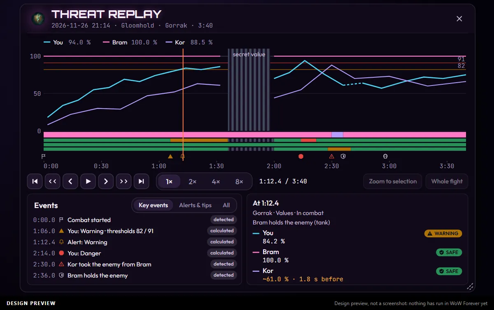
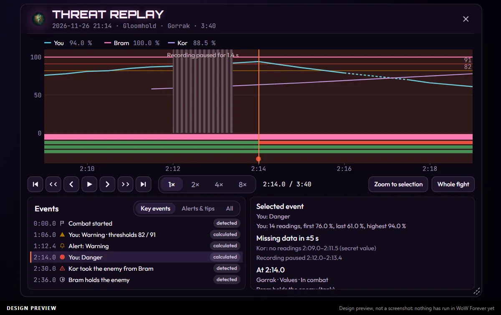
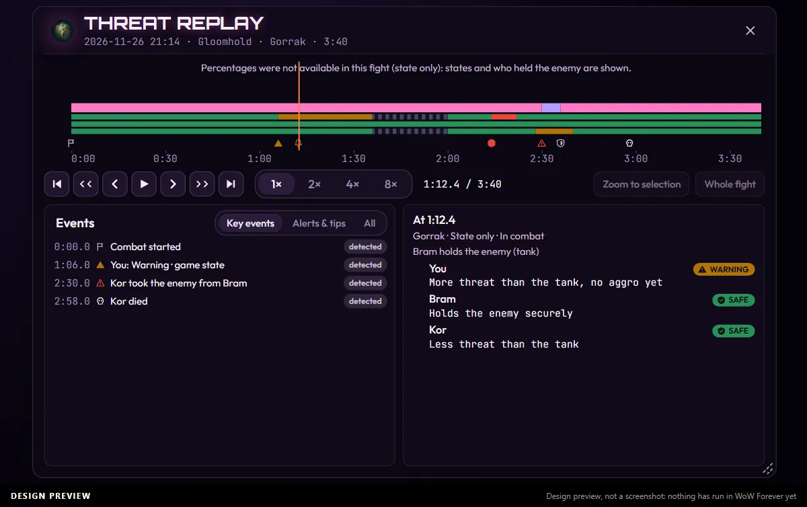
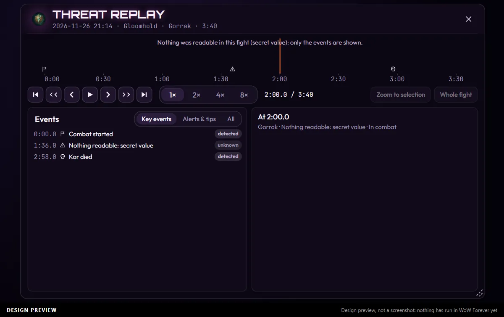

# Threat Replay

*Italiano: [[Replay della threat|Threat-Replay-it]]*

> **Coming in `v0.5.0`**: it is not in the released version yet, and nothing of it has been verified in game.

The replay shows how threat moved during a fight the addon [[recorded|Combat-Reports]]: a chart over time, the events,
and what was recorded at the moment you choose. It only reads the recording: it never reads the game and changes
nothing in it. It has a window of its own, apart from the main window.

*Design previews, not screenshots: drawn from the addon's own layout and texts with invented fights, because the addon
has not been run in the game yet ([all previews](https://github.com/Finland6738/azeroth-threatwarden/blob/main/docs/specs/mockups/previews/README.md)).*

## Opening it

- **Replay** in the card at the top of a report, in the [Reports tab](Combat-Reports). It is off, with the reason in its
  tooltip, for the fight being recorded and for a damaged recording.
- A click on the report's **Timeline** card opens the replay at that moment.
- `/atw replay` opens the latest finished fight; `/atw replay 2` opens the second one of the list (1 is the newest).

The window starts in the centre; move it by its title bar and resize it from the dashed corner (from 640 × 420 to
1400 × 1000). Its place, its size and the playback speed are remembered for each character.

## The chart

| What you see | What it means |
|---|---|
| a **solid line** | two readings taken at the recording's pace |
| a **dashed line** | an **estimate**: the two readings are further apart, with nothing unknown recorded between them (up to 10 s) |
| a **hatched band** | a **gap**: nothing is known there, and the reason is in it or in its tooltip. No line crosses it |
| a plain band | out of combat |
| thin lines at two heights | the Warning and Danger thresholds of that recording, and the 100 % line |
| the strips under the chart | who held the enemy, and each member's state |
| the icons under them | the events; icons close together are grouped with their number |

Every point is a reading the addon really recorded: nothing is averaged or filled in. Hold the mouse over the chart to
see each value with its category; **drag** to select an interval and see its summary, **right click** to clear it, use
the **wheel** to zoom, and click to move the cursor there. Up to six members have a line: click a name in the detail to
show or hide it.

## Controls

| Button | Key | What it does |
|---|---|---|
| bar and triangle, left | `Home` | go to the start |
| two arrows, left | `Up` | previous event |
| one arrow, left | `Left` | one recorded moment back |
| play / pause | `Space` | play or pause |
| one arrow, right | `Right` | one recorded moment forward |
| two arrows, right | `Down` | next event |
| bar and triangle, right | `End` | go to the end |
| 1× 2× 4× 8× | `1` – `4` | playback speed |
| | `Shift` + `Left` / `Right` | 5 s back or forward |
| **Zoom to selection**, **Whole fight** | | show only the selected interval, or everything again (in a narrow window these are icons) |

The keys work **only out of combat and while the pointer is over the window**; every other key goes to the game.
`Esc` closes the window, in combat too.

## Events and details

The **event list** has three filters: *Key events*, *Alerts & tips* and *All*. During playback the last event passed is
highlighted and kept in view (for 3 seconds after you scroll, the list stays where you put it). Click an event to jump to
it: the 5 seconds before and after are selected, and the detail lists the readings around it and **what is missing** in
that window, or says that nothing is.

The **detail** shows what was recorded at the cursor: the enemy, whether values were readable, whether you were in
combat, who held the enemy, and each member's state and reading. An old reading appears as an estimate with its age
(*~61.0 % · 1.8 s before*); without a reading it says why and since when (*No reading since 1:10.2: secret value*). Hold
the mouse over a line to see its category. A narrow window shows one of the two panels, with the *Events · Details*
selector.

## During combat

The playback pauses when a fight starts and **Play** stays off until it ends; seeking, picking an event and reading the
detail still work. The window takes no keys then, and it never opens or closes by itself.

## Limits

- Nothing is rebuilt: if the game did not give a value, the replay shows a gap, never a guess. It says what happened and
  when, never why.
- A recording holds only what the monitor read at its rate (2 times a second by default). What can be read on WoW Forever
  during real group fights is not verified yet: it may be percentages, only the threat state, or nothing at all. The
  replay shows whichever it was.
- A fight interrupted by a `/reload` has a badge, and the buttons *Continued from…* and *Continues in…* open the other
  part. A recording that reached its limit shows where the samples stopped.
- A deleted recording closes its replay.
